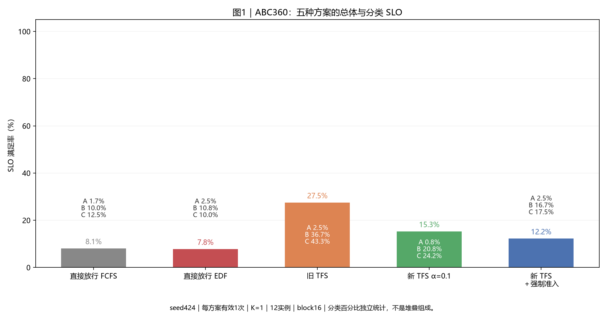
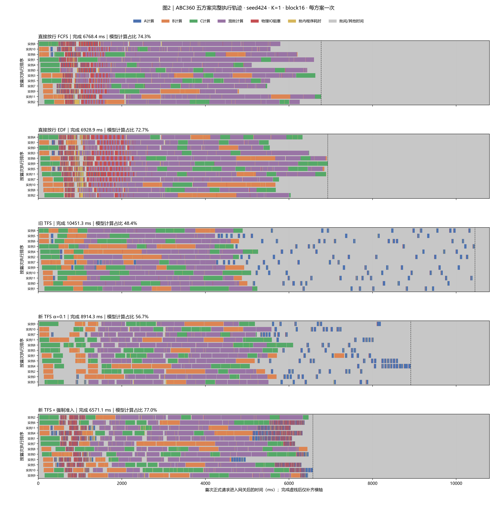
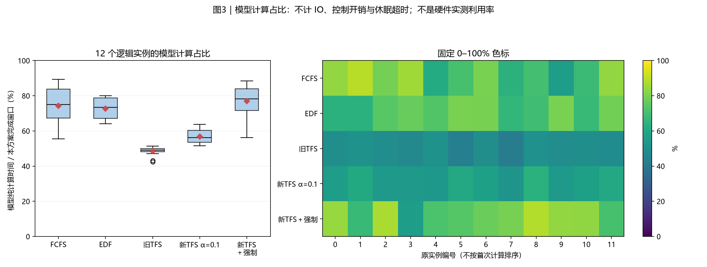
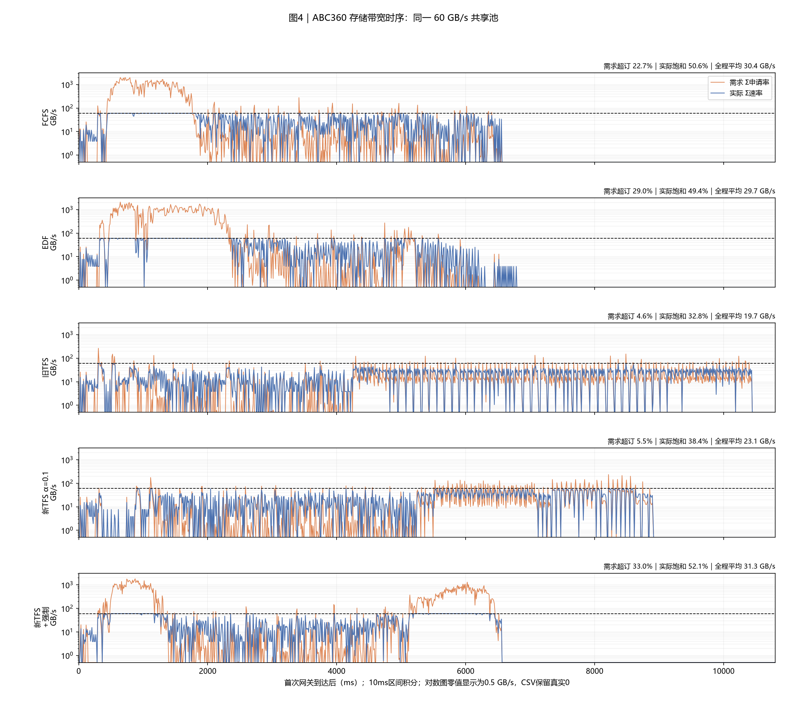
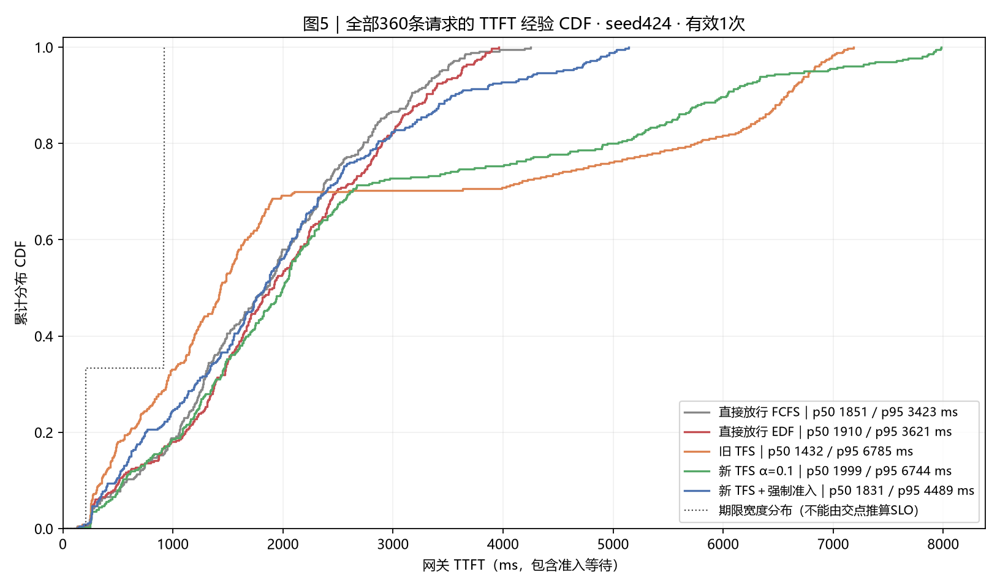
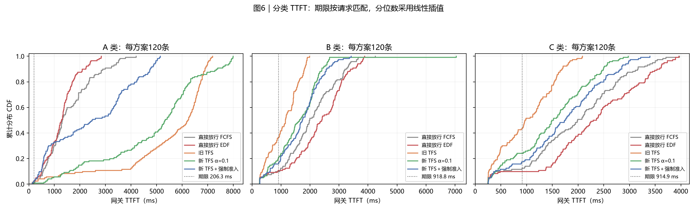
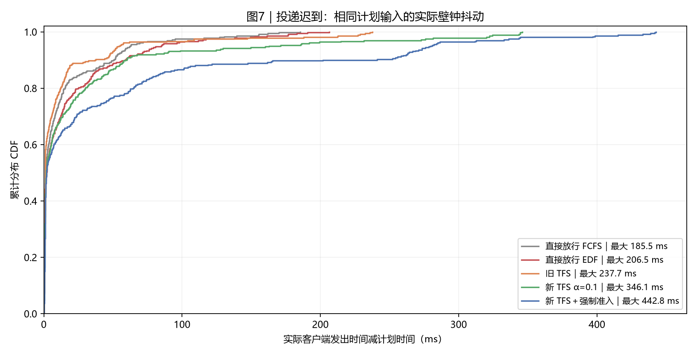

# 实验结果：ABC360 seed424 五方案对照

> 本文为最新报告的讨论导出。完整原始数据与复现边界见第9节。[返回总目录](../README.md)。

| 项目 | 约定 |
|---|---|
| 实验日 / 整理日 | 2026-10-29 / 2026-10-29；五组均为本次重新运行 |
| 输入 | seed424 / C_B；ABC 各120条，共360条；计划首末到达跨度 3609.648 ms；最后计划到达 3.612 s |
| 资源 | 1个Dynamo前端、12个vLLM逻辑实例、1个独立额度服务；60 GB/s共享池，qmax=200 GB/s |
| 组批与缓存 | batch≤4；每步8192新增token；16-token块，12258块；本地前缀缓存关闭；固定first_seen命中合同 |
| 计算与存储 | SA八层合成模型、逐层加载、预取下一层；每请求只输出1 token；本轮不使用GLM5公式 |
| 方案 | 直接FCFS、直接EDF、旧TFS、新TFS α=0.1、新TFS α=0.1＋强制准入 |
| 重复与汇总 | 每组72条预热并排空，清正式画像历史、重置GC窗口后回放360条；每方案1次，共1800条正式请求；不做跨种子聚合 |
| 时间与吞吐 | K=1；完成时间=首个正式请求进入网关→最后一个正式首token；吞吐=360/该窗口；预热不计入主表 |
| TTFT / SLO | TTFT=网关首token−网关登记到达，包含网关和实例等待；逐请求判断TTFT≤4×T0；p50/p95采用线性插值 |
| 通信 | 准入控制使用Dynamo Runtime TCP/MessagePack；四种执行反馈RPC全部移除；存储IPC、α计分接口保留 |
| 观测与程序开销 | 五组均启用相同细粒度本地记录；计时期间网关和存储循环GC暂停，结束后恢复；本地记录与存储就绪轮询仍有开销 |
| 版本与输入 | DV 6ebbfdd；五组同一冻结源码、原生扩展和输入；准确文件SHA见provenance_full.json |
| 执行边界 | 真实Dynamo路由、真实vLLM调度和组批；设备计算及存储为仿真，利用率不能解释为真实GPU/NPU实测 |

本次使用此前冻结的 seed424/C_B 输入。C类每条新增8110 token，seed416/C_A是2657 token。两组的C类计算量不同，不能把跨报告差值全部归因于随机到达顺序。五个方案均重新执行，不复用seed416轨迹。

## 0. 总判决

本次完成时间最短的是 **新 TFS α=0.1＋强制准入：6571.1 ms**。
总体SLO最高的是 **旧 TFS：27.5%**。
新TFS相对直接FCFS，完成时间增加31.7%，
平均TTFT增加43.0%，
SLO变化 **+7.2个百分点**。
强制准入相对普通新TFS，完成时间减少26.3%，
SLO变化 **-3.1个百分点**。

强制组相对直接FCFS，完成时间减少2.9%，
平均TTFT增加5.0%，
p95增加31.1%，
SLO变化 **+4.2个百分点**。

完成时间最短不代表尾部延迟最低。强制组p95为 **4488.6 ms**，
直接FCFS为 **3423.0 ms**；这两项指标不能互相替代。

五组的四种执行反馈RPC均为0。正式请求全部完成，额度及原生路由记账均排空。
五组A类SLO最高也只有2.5%。旧TFS的总体SLO主要来自B类36.7%和C类43.3%，不能解释为所有类别都受益。
这些结果来自一个种子的单次轨迹，说明本轮条件下的表现，不能据此保证每次都保持同一排名。

## 1. 汇总表与 SLO

|方案|完成ms|请求/s|平均TTFT ms|p95 ms|总体SLO%|A SLO%|B SLO%|C SLO%|
|---|---:|---:|---:|---:|---:|---:|---:|---:|
|直接放行 FCFS|6768.4|53.2|1854.0|3423.0|8.1|1.7|10.0|12.5|
|直接放行 EDF|6928.9|52.0|1954.5|3621.2|7.8|2.5|10.8|10.0|
|旧 TFS|10451.3|34.4|2511.6|6785.2|27.5|2.5|36.7|43.3|
|新 TFS α=0.1|8914.3|40.4|2651.7|6744.2|15.3|0.8|20.8|24.2|
|新 TFS＋强制准入|6571.1|54.8|1947.4|4488.6|12.2|2.5|16.7|17.5|

五组正式请求均读取205,541,867,520 B KV，完成1,496,640个新增token。带宽与模型参数相同。

|方案|准入位置|实例排序|重读分类|等待计分|强制准入|
|---|---:|---:|---:|---:|---:|
|直接放行 FCFS|直接放行|FCFS|不限制|原生完整计分|关|
|直接放行 EDF|直接放行|EDF|不限制|原生完整计分|关|
|旧 TFS|网关|FCFS|动态阈值|原生完整计分|关|
|新 TFS α=0.1|vLLM调度前|EDF|到达时冻结|α=0.1|关|
|新 TFS α=0.1＋强制准入|vLLM调度前|EDF|到达时冻结|α=0.1|开|

**读法**：柱高是总体SLO，柱内ABC是各类独立SLO。每组只有一次，不画误差条。

## 2. 完整执行时间线与组批

**读法**：每组独立按首次执行排序，保留原实例号。蓝/橙/绿/紫只覆盖模型计算时长；红色是仍未完成的存储读取对层入口造成的阻塞；金色是批内程序耗时；灰色是批间、调度或其他时间。完成虚线之后只是统一横轴。灰色不等于没有排队请求。

|方案|调度批次数|多请求批次数|平均batch|模型计算实例秒|新增token/s|
|---|---:|---:|---:|---:|---:|
|直接放行 FCFS|221.0|177.0|2.3|60.4|221120.2|
|直接放行 EDF|229.0|168.0|2.2|60.4|215998.7|
|旧 TFS|313.0|138.0|1.6|60.7|143201.8|
|新 TFS α=0.1|290.0|153.0|1.7|60.7|167891.7|
|新 TFS＋强制准入|293.0|149.0|1.7|60.7|227759.6|

同样的请求可能因分块进入多个调度批次，所以批次数不是请求数。模型计算实例秒可随组批变化，不能由请求数直接相加。

## 3. 计算占比与时间账本

**读法**：分母为各方案自己的完成窗口。箱线和热力图使用同一组12实例数据。热力图保留原编号、统一0—100%色标。这是模型计算占比。

|方案|模型计算%|物理IO阻塞%|批内程序耗时%|批间/其他%|
|---|---:|---:|---:|---:|
|直接放行 FCFS|74.3|7.6|2.0|16.1|
|直接放行 EDF|72.7|9.6|3.1|14.6|
|旧 TFS|48.4|0.4|0.7|50.5|
|新 TFS α=0.1|56.7|0.4|1.2|41.7|
|新 TFS＋强制准入|77.0|7.7|2.3|13.1|

每个实例的四项时间相加等于完成窗口。批内程序耗时包含提交、查询、轮询检测延迟、日志和休眠超时等。本轮没有把这些时间算进模型纯计算。批间时间还包含调度、IPC和等待请求，不能全部称为设备空闲。

## 4. 存储带宽

**读法**：需求与实际速率按原始不等长区间积分到10ms桶。黑虚线为60 GB/s；需求超订指需求>60 GB/s，实际饱和指实际≥54 GB/s。对数图把零显示在0.5 GB/s底线，CSV仍为零。

|方案|全程平均GB/s|需求超订%|实际饱和%|积分误差B|
|---|---:|---:|---:|---:|
|直接放行 FCFS|30.37|22.7|50.6|0.032043|
|直接放行 EDF|29.66|29.0|49.4|0.025635|
|旧 TFS|19.67|4.6|32.8|0.087891|
|新 TFS α=0.1|23.06|5.5|38.4|0.084473|
|新 TFS α=0.1＋强制准入|31.28|33.0|52.1|0.037598|

读取字节相同，平均带宽的差别主要对应完成窗口差别。需求超订和实际饱和不同；不能只凭申请带宽判断实际用满。

## 5. TTFT 累积分布

**读法**：曲线越靠左，同一分位点的TTFT越低。经验CDF按rank/n绘制；不能由总体CDF与期限分布的交点判断SLO。

**读法**：每类每方案120条。点线为该类4×T0期限；SLO由逐请求时间与自己的期限比较得到。

|方案|A均值ms|A p95 ms|B均值ms|B p95 ms|C均值ms|C p95 ms|
|---|---:|---:|---:|---:|---:|---:|
|直接放行 FCFS|1575.9|3425.9|2035.8|3378.9|1950.2|3447.3|
|直接放行 EDF|1271.9|2389.3|2306.6|3744.4|2285.0|3670.1|
|旧 TFS|5433.2|6991.2|1100.5|1867.6|1001.2|1811.6|
|新 TFS α=0.1|4857.8|7855.5|1602.7|2585.6|1494.6|2574.5|
|新 TFS＋强制准入|2463.9|4942.3|1670.2|2795.1|1708.3|2977.2|

## 6. 准入机制与程序开销

|方案|重读登记数|强制数|拒绝RPC数|申请均值ms|登记/获准→首次IO均值ms|末层IO→首token均值ms|
|---|---:|---:|---:|---:|---:|---:|
|直接放行 FCFS|129|0|0|0.000|1106.778|79.929|
|直接放行 EDF|129|0|0|0.000|795.838|60.047|
|旧 TFS|128|0|0|0.000|96.934|18.545|
|新 TFS α=0.1|129|0|3883|4.489|14.816|30.408|
|新 TFS α=0.1＋强制准入|129|109|134|16.537|8.931|28.436|

拒绝RPC数只包含真正发出的申请，本地full窗口跳过的请求不在其中。直接放行组没有额度RPC，拒绝数和申请时延均为0，但网关仍记录放行状态。
本表RPC数和申请时延只统计普通acquire。强制组已删除force_status操作和轮询；本表不统计异步force_acquire通知。申请时延是调用端观测值，包含队列、通信桥接和服务处理，不能解释为纯网络延迟。
重读登记数按登记时的重读分类统计，不等于固定A类数量。登记/获准到首次IO按中央决定时刻与存储服务首次真实提交时刻计算；强制额度使用本地决定时刻；直接放行组使用网关放行记账时刻。
末层IO到首token的间隔包含就绪检测、最后计算和返回。当前额度仍到首token才释放。

旧TFS、新TFS之间同时包含准入位置、分类冻结、实例排序和等待计分差别，不能把全部差异归因于一个开关。
普通新TFS与强制组仅差idle_bypass，其他配置逐字段核对一致。强制执行不等待同实例上一笔强制额度的释放确认；额度仍逐笔按HTTP首token释放，每轮最多强制一条。强制放行仍占账，也可能超出常规额度；它不增加物理带宽。

**读法**：输入的计划时间完全相同，宿主实际发送仍有抖动。此图用于核对该差异；TTFT主表从网关到达开始统计，客户端完整口径保留在CSV。

## 7. 计算模型与结论限制

ABC继续使用SA八层公式：`T_batch=8×[t_launch+a×Σu/η+b×Σ(u×h+u×(u+1)/2)]`，`η=min(1,max(1/16,Σu/512))`。
该模型按实际请求边界聚合工作量。本轮没有切换到GLM5的78层模型。公式通过独立复算检查。

这是CPU上的控制面实跑与执行仿真。没有真实GPU/NPU kernel或存储传输。真实部署的绝对延迟不能直接取本报告数值。
网络准入RPC使用本机回环，其延迟不能替代跨机器网络测量。本地观测和存储0.5ms轮询仍可能影响组批与执行。
每组单种子、单次运行，原生路由的平局选择和宿主抖动都可能改变排名。
旧报告还可能使用在线执行反馈、Unix RPC、不同GC或预热条件，不能把跨报告差值全部当作移除反馈的收益。

## 8. 输入与附表

|类别|请求数|命中token|新增token|SLO期限ms|
|---|---:|---:|---:|---:|
|A|120|42880|259|206.270|
|B|120|9392|4103|918.791|
|C|120|0|8110|914.916|

沿用block16命中对齐：A的命中从42883向下对齐到42880，B从9399对齐到9392。提示总长度保持不变，差出的token计入新增计算，T0及4×T0期限按对齐后的h/u重新计算。到达时间与既有seed424输入逐条一致。

全部独立请求的参考计算量为 60.771 实例秒。按12实例和计划首末到达跨度计算，参考计算输入约 140.3%，存储输入约 94.9%。这两个比例是输入量标定，分母不同于各方案实际完成窗口，也不是硬件利用率。

### 与上一份seed416报告的描述性对照

|方案|seed416完成ms|seed424完成ms|seed416平均TTFT ms|seed424平均TTFT ms|seed416 SLO%|seed424 SLO%|
|---|---:|---:|---:|---:|---:|---:|
|直接FCFS|5106.7|6768.4|976.3|1854.0|16.9|8.1|
|直接EDF|5175.5|6928.9|1072.7|1954.5|6.9|7.8|
|旧TFS|8151.7|10451.3|1384.1|2511.6|56.7|27.5|
|新TFS α=0.1|6669.3|8914.3|1497.6|2651.7|27.2|15.3|
|新TFS＋强制准入|4650.3|6571.1|974.8|1947.4|28.1|12.2|

seed424是C_B工况。C类每条新增token从2657变为8110；总新增token从842,280变为1,496,640。KV读取字节仍为205,541,867,520 B。输入到达跨度仍约3.61 s。参考计算量为60.771实例秒，参考计算输入为140.3%。计算输入超过12实例在该到达窗口内的总计算容量，排队压力不能只解释为存储竞争。

seed416前四组使用DV 761ece2，强制组使用6ebbfdd；本次五组均使用强制组的同一冻结源码6ebbfdd及其诊断差异。只有强制组与此前seed416强制组的运行文件逐项一致。跨seed表用于观察结果变化，不作为纯种子消融，也不做跨工况平均。[对照CSV](report_data/seed_comparison.csv)、[seed416主表副本](report_data/seed416_reference.csv)、[seed416版本与修订记录](report_data/seed416_revision_reference.json)。

## 9. 公开范围与验证

本次仅整理并发布已有实验，没有新增运行。第0—8节和第10节沿用最新完整报告；指标、结论和七张图片不变。发布目录保留小型结果表、配置及版本摘要。

完整原始trace、逐层日志、存储区间、原生扩展、完整重绘脚本和分享ZIP保留在原工作区。本目录可以阅读报告并核对汇总，不能独立重跑仿真或重绘完整执行时间线。

原实验的验收与文件摘要见[原始验证清单](report_data/source_validation.json)。该清单中的完整原始文件未全部公开。本次另核对公开图片及结果表与原文件逐字节一致，并检查正文全部相对链接；见[导出校验清单](report_data/validation.json)。发布检查不替代实验验收。

公开数据：[run_summary](report_data/run_summary.csv)、[requests_full](report_data/requests_full.csv)、[step_summary](report_data/step_summary.csv)、[device_utilization](report_data/device_utilization.csv)、[bandwidth_10ms](report_data/bandwidth_10ms.csv)、[bandwidth_summary](report_data/bandwidth_summary.csv)、[cdf](report_data/cdf.csv)、[idle_bypass_metrics](report_data/idle_bypass_metrics.csv)、[full_summary](report_data/full_summary.json)、[input_check](report_data/input_check.json)、[matrix_receipt](report_data/matrix_receipt.json)、[plan](report_data/plan.json)、[provenance_full](report_data/provenance_full.json)、[seed_comparison](report_data/seed_comparison.csv)、[seed416_reference](report_data/seed416_reference.csv)、[seed416_revision_reference](report_data/seed416_revision_reference.json)。

中央加载字段来自排空后的离线补全，不代表在线准入读取了存储真值。

## 10. 简要解读

本轮应先看自己的目标：完成时间最优是新 TFS α=0.1＋强制准入，SLO最优是旧 TFS。两者可能不同。

本次强制组相对普通新TFS，A类平均TTFT从4857.8降到2463.9 ms；B类从1602.7变为1670.2 ms，C类从1494.6变为1708.3 ms。总体达标数从55降到44条。A类时延改善，同时B/C类时延增加，不能仅凭完成时间判断全部请求受益。

四种执行反馈已从在线路径移除，但额度查询、存储查询与轮询、路由和宿主执行仍有成本。后续如果继续优化，应结合金色批内耗时、灰色批间时间和准入等待定位；这轮结果不能单独证明原先Dynamo Runtime超时的根因。
