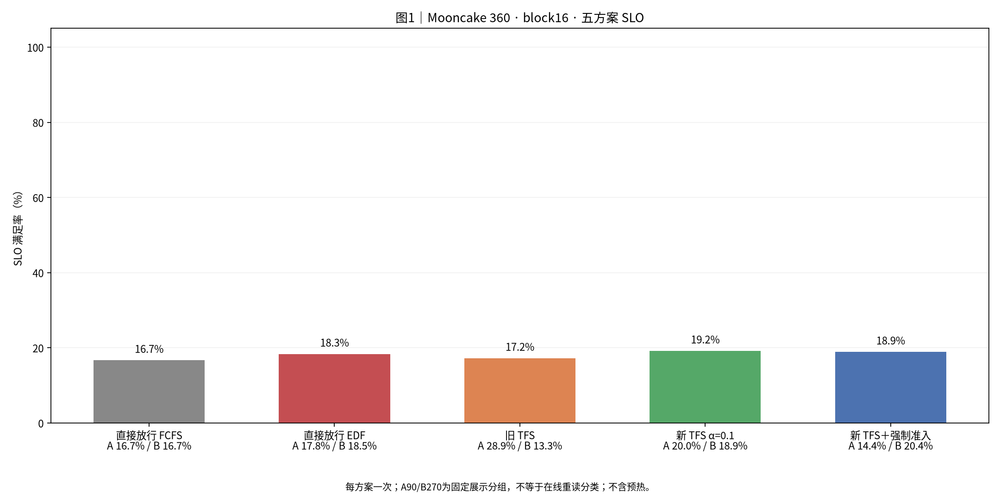
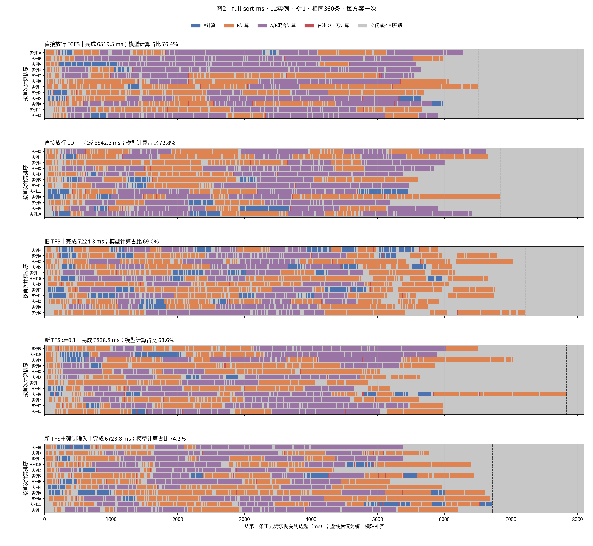
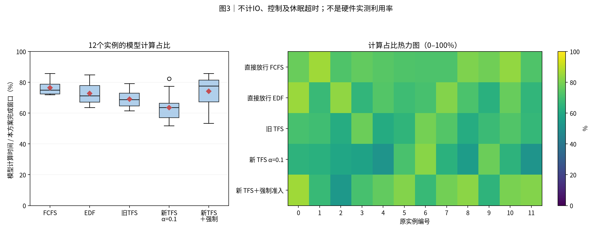
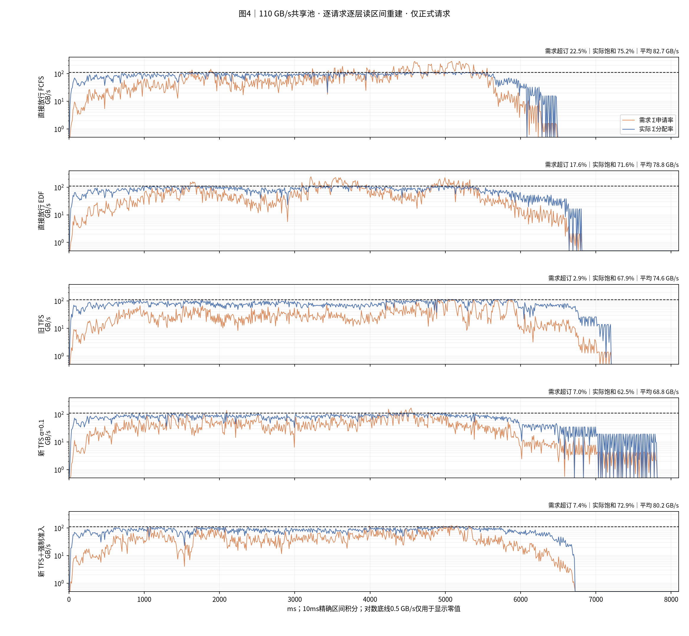
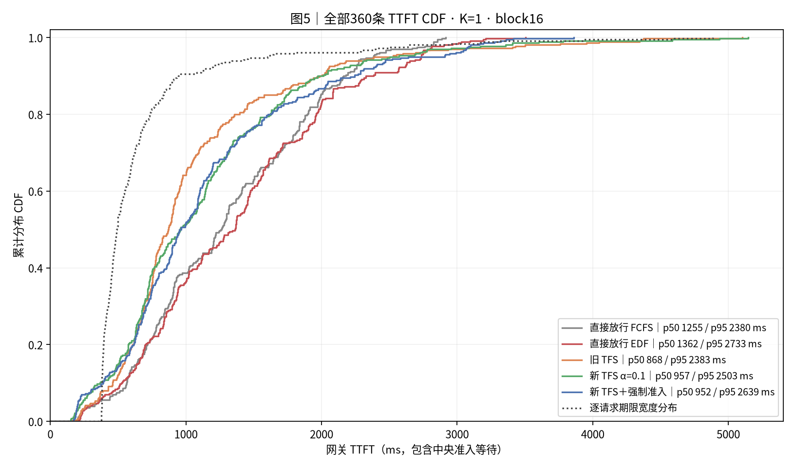
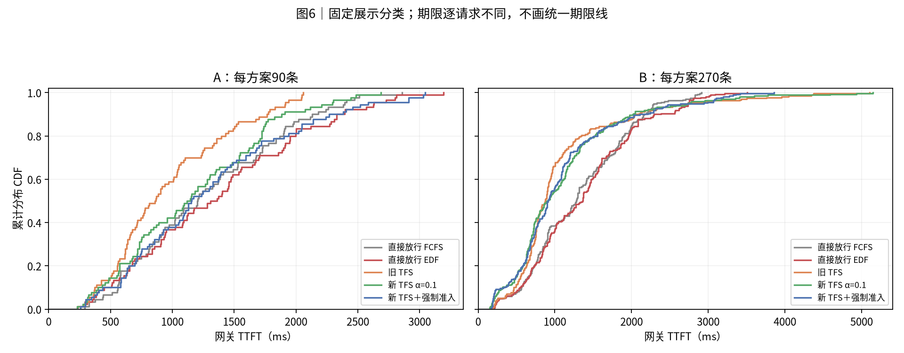
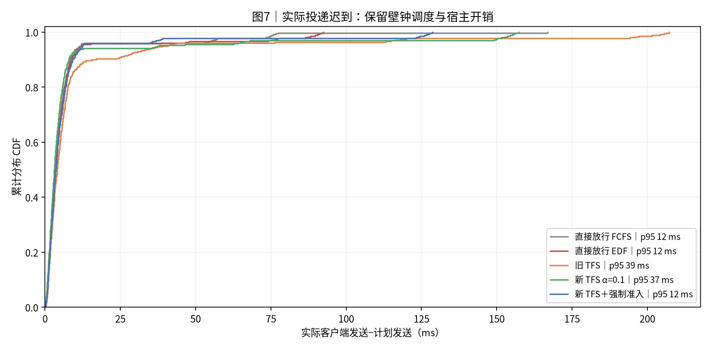

# 实验结果：Mooncake360 110 GB/s＋直接组合计时五方案对照

> 本文为最新报告的讨论导出。完整原始数据与复现边界见第9节。[返回总目录](../README.md)。

|项目|约定|
|---|---:|
|实验日 / 整理日|2026-10-29；五组均重新运行|
|输入|conversation 前360条，保留顺序和同刻组，计划到达窗口0–4秒|
|命中|人为96%远端命中，向下对齐完整16-token块；本地前缀缓存关闭|
|输入总量|5,117,755输入token；4,910,208命中；207,547新计算|
|资源|1个Dynamo前端、12个真实vLLM逻辑实例及EngineCore、独立准入服务；K1|
|组批|max_num_seqs=4；max_num_batched_tokens=8192；逻辑块池30159块|
|计算|glm5_direct_sum_v1；单请求时间相加，仅扣显式重复算子启动；合并比例1；固定TP1/DP8/EP8；78层|
|存储|110 GB/s单共享池、GroupedStorage max-min、零启动延迟；逐层读、预取下一层|
|方案|直接FCFS、直接EDF、旧网关TFS、新调度前TFS α=0.1、新TFS＋空闲强制准入|
|预热 / 重复|每组72条预热，排空后清画像历史并重置GC窗口；正式360条；每方案1次|
|完成与吞吐|首条正式请求网关登记→最后一条正式首token；请求吞吐=360/该窗口|
|TTFT / SLO|TTFT=网关首token−登记时间，含全部等待；TTFT≤4T0；T0按最新画像v3统一计算|
|统计|p50/p95采用nearest-rank；每条期限分别匹配；无置信区间|
|通信|Dynamo Runtime TCP/MessagePack准入；四种在线执行反馈已移除；首token释放保留|
|观测|各组相同本地细粒度记录；正式窗口网关和存储循环GC暂停，结束后恢复|
|展示分组|固定历史标签A90/B270；无C；与本轮在线P75重读集合分开|
|源码|DV 7a032a2d32c74db600f9ec0cf6ab71a48d46f57a，另保留原有RPC阶段诊断补丁；五组同源码和native扩展|
|输入SHA256|57b23ce7ac589220f23a5ce7b1ba768f786fa9506c41d58ddbb3ffa62f315f9b|
|执行边界|真实控制面和Scheduler；GPU计算、专家通信与远端存储传输由模型模拟|

## 0. 总判决

本轮完成最快的是 **直接放行 FCFS：6519.5 ms**。总体SLO最高的是 **新 TFS α=0.1：19.2%**。每方案只有一次，结果只描述本轮，不证明稳定排名。

|方案|完成ms|请求/s|平均TTFT ms|p95 ms|SLO %|
|---|---:|---:|---:|---:|---:|
|直接放行 FCFS|6519.54|55.22|1303.71|2380.27|16.67|
|直接放行 EDF|6842.28|52.61|1366.81|2733.23|18.33|
|旧 TFS|7224.31|49.83|1062.46|2382.82|17.22|
|新 TFS α=0.1|7838.77|45.93|1124.85|2502.97|19.17|
|新 TFS＋强制准入|6723.78|53.54|1143.43|2639.09|18.89|

新TFS相对直接FCFS：完成时间变化 **+20.23%**，平均TTFT变化 **-13.72%**，SLO变化 **+2.50个百分点**。时间变化为正表示变慢。

新TFS相对旧TFS：完成时间变化 **+8.51%**，平均TTFT变化 **+5.87%**，SLO变化 **+1.94个百分点**。时间变化为正表示变慢。

强制准入相对新TFS：完成时间变化 **-14.22%**，平均TTFT变化 **+1.65%**，SLO变化 **-0.28个百分点**。时间变化为正表示变慢。

五组共1800条正式请求全部返回首token并正常结束。全部结果采用本次重新运行的数据。

## 1. 汇总表与 SLO

**读法**：柱高为总体SLO；横轴附A/B各自SLO。每组样本相同，不含72条预热；没有把分类SLO相加。

|方案|准入|实例内排序|等待重读计分|强制|
|---|---:|---:|---:|---:|
|直接FCFS|网关立即转发|FCFS|完整|关|
|直接EDF|网关立即转发|固定deadline EDF|完整|关|
|旧TFS|网关配额控制，动态P75|FCFS|完整|关|
|新TFS α=0.1|实例调度前申请，分类到达时冻结|EDF|等待0.1，获准补齐|关|
|新TFS＋强制|同新TFS|EDF|同新TFS|满足条件的空闲实例每轮至多1条；不等上一笔额度释放|

|方案|A平均TTFT ms|B平均TTFT ms|A SLO %|B SLO %|
|---|---:|---:|---:|---:|
|直接放行 FCFS|1275.84|1313.00|16.67|16.67|
|直接放行 EDF|1365.02|1367.40|17.78|18.52|
|旧 TFS|963.13|1095.57|28.89|13.33|
|新 TFS α=0.1|1168.35|1110.35|20.00|18.89|
|新 TFS＋强制准入|1297.02|1092.23|14.44|20.37|

共同的期限宽度范围为 **375.13–4885.51 ms**，均值 **669.09 ms**。同一请求跨五组使用相同期限宽度。

当前T0按单请求和8192-token参考分块计算，并按逐层预取协议合成读取与计算重叠。这与早期直接将整段读取加计算的画像不同。SLO既不是trace自带要求，也不是固定毫秒数；倍率4为实验设定。

## 2. 完整执行时间线与组批

**读法**：五组各12行，独立按首次计算排序，保留原实例编号，共用横轴。蓝A、橙B、紫混合计算。红为存在在途读取但无模型计算的区间，不全部等于依赖阻塞；灰包含空闲、控制和观测开销。虚线后为横轴补齐。

|方案|step数|多请求step|平均批大小|批大小1/2/3/4|跨step请求数|
|---|---:|---:|---:|---:|---:|
|直接放行 FCFS|130|91|2.769|39/12/19/60|0|
|直接放行 EDF|133|93|2.707|40/17/18/58|0|
|旧 TFS|180|85|2.000|95/28/19/38|0|
|新 TFS α=0.1|152|87|2.368|65/20/13/54|0|
|新 TFS＋强制准入|161|80|2.236|81/14/13/53|0|

平均批大小=各step请求成员次数之和/step数。请求分块后可以进入多个step，因此不能总用360/step数代替。所有实际step的新token合计必须等于207547，批大小不能用层色块数推断。

|方案|各step单请求模型时间之和：实例秒|合并启动减少：实例毫秒|实际模型计算：实例秒|
|---|---:|---:|---:|
|直接放行 FCFS|60.155147|376.740|59.778407|
|直接放行 EDF|60.155147|371.826|59.783321|
|旧 TFS|60.155147|294.840|59.860307|
|新 TFS α=0.1|60.155147|340.704|59.814443|
|新 TFS＋强制准入|60.155147|325.962|59.829185|

这里的启动减少量是12实例累计值，不能直接当作整批完成时间的缩短量。新模式只减少显式重复启动，合批不会再摊薄权重读取或专家通信时间。

## 3. 模型计算占比分布与热力图

**读法**：每实例名义模型计算时间/本方案完成窗口。箱线和热图使用同一组12个值，色标0–100%。它不是宿主CPU利用率或真实GPU利用率；观察到的计算段还包含sleep超时和本地程序开销。

|方案|模型计算实例秒|4秒窗口计算压力%|全程模型计算占比%|
|---|---:|---:|---:|
|直接放行 FCFS|59.778|124.54|76.41|
|直接放行 EDF|59.783|124.55|72.81|
|旧 TFS|59.860|124.71|69.05|
|新 TFS α=0.1|59.814|124.61|63.59|
|新 TFS＋强制准入|59.829|124.64|74.15|

输入侧单请求参考计算总量为60.155实例秒，除以12×4秒为125.32%。上表采用各组实际batch的估时，两种计算压力口径分开。

## 4. 存储带宽时序

**读法**：橙线为需求，蓝线为模型实际分配速率，黑虚线为110GB/s。由逐请求逐层读取端点重建区间，再按10ms桶积分；零值只在对数图中显示为0.5，CSV保留0。

|方案|平均GB/s|需求超订%|实际饱和%|积分误差B|
|---|---:|---:|---:|---:|
|直接放行 FCFS|82.71|22.47|75.19|2.355774|
|直接放行 EDF|78.81|17.62|71.65|2.525085|
|旧 TFS|74.65|2.86|67.86|3.515442|
|新 TFS α=0.1|68.79|7.02|62.54|2.926941|
|新 TFS＋强制准入|80.20|7.36|72.91|3.196411|

各组正式读取均为 **539,258,683,392 B（539.259 GB）**，连续占满110GB/s也需要4.902秒。4秒输入窗口的存储压力为122.56%。需求超订按需求>B，饱和按实际≥0.9B，分母为各组完成窗口。

重建使用本轮单盘、零启动延迟、始终分配剩余带宽的GroupedStorage语义。端点为双精度时间，末尾按剩余字节裁剪会留下少量积分误差。预先沿用1e-11相对误差阈值；没有缩放速率或改写原时间来消除误差。

## 5. TTFT 累积分布

**读法**：每条曲线360条，按rank/n阶梯绘制。点线为逐请求期限宽度分布。期限各不相同，SLO按每个请求匹配计算，不能由两条CDF交点推断。

**读法**：固定A90/B270展示标签。分类与在线重读判定分开，不把A固定解释为当轮全部重请求。分类期限也不统一。

|方案|p50 ms|p95 ms|客户端平均TTFT的统计范围|
|---|---:|---:|---:|
|直接放行 FCFS|1254.91|2380.27|客户端另存逐请求表；主表使用网关口径|
|直接放行 EDF|1361.59|2733.23|客户端另存逐请求表；主表使用网关口径|
|旧 TFS|868.04|2382.82|客户端另存逐请求表；主表使用网关口径|
|新 TFS α=0.1|957.05|2502.97|客户端另存逐请求表；主表使用网关口径|
|新 TFS＋强制准入|951.64|2639.09|客户端另存逐请求表；主表使用网关口径|

## 6. 机制解释与同条件比较

直接FCFS与直接EDF只改变policy/request_ordering。新TFS与强制准入只改变admission.idle_bypass。旧TFS与新TFS同时改变准入位置、分类时刻、实例排序和等待计分，不能将全部差异归因于α。

|方案|网关等待均值ms|转发到首个读取均值ms|重读标记数|正式拒绝次数|强制次数|held峰值|
|---|---:|---:|---:|---:|---:|---:|
|直接放行 FCFS|0.77|703.29|0|0|0|41|
|直接放行 EDF|0.91|783.76|0|0|0|45|
|旧 TFS|275.98|329.50|0|0|0|12|
|新 TFS α=0.1|0.88|603.55|102|266|0|10|
|新 TFS＋强制准入|0.95|624.21|102|19|50|12|

重读标记数统计下发给实例的storage_hint；旧网关模式不下发此标记，0不表示没有重读请求。网关等待发生在转发前；转发到读取还包含路由、worker接收、实例排队、配额等待与调度，不能全部解释成单次RPC延迟。held峰值表示模型内占账数量。强制模式允许符合条件的实例暂时超过中央cap，增加并发也会增加带宽竞争。

本轮已移除load_submitted、layer_load_submitted、load_completed、no_external_load四类中央执行反馈RPC；准入、回滚、强制通知及首token释放仍然在线。读取事实由worker本地日志结束后补入报告，不作为在线策略的信息输入。旧报告的通信、模型、T0、GC或预热条件可能不同；本报告不复用其性能数字作为同版本消融。

本轮五组使用同一当前冻结源码。相较上一轮120GB/s＋v2，当前还包含取消强制准入释放等待与force_status轮询的修订。因此跨轮差异不能只归因于带宽和计时模型。110GB/s同时用于真实存储模型和准入参考带宽，T0按此配置重新计算；单请求计算时间本身与v2一致。

## 7. 计算模型与结论限制

- 按各请求本步真实形状分别使用v2单请求估时，再逐层相加；仅扣max(n-1,0)×3×7µs×78的重复kernel启动。固定TP/DP/EP，权重读取及专家通信逐请求累加。启动合并是仿真假设，未做目标设备定标。
- 12个逻辑执行实例与公式中的参考DP8/EP8是不同层次；本轮没有真实多卡模型分片或同步专家通信。
- 每组一次。路由同分选择、到达迟到、宿主调度和组批变化都可能改变结果，不提供稳定收益或统计显著结论。
- 只做prefill并输出1 token。本地前缀缓存关闭，人为96%外部命中不是原trace实测命中率；不覆盖持续decode、真实存储容量淘汰、真实KV张量和跨机网络。
- 暂停GC仅在受保护测量窗口内生效；本地记录、sleep、存储轮询和真实控制程序仍计入壁钟。

## 8. 附表：实际投递与资源

**读法**：实际客户端发送时间减计划发送时间，保留全部迟到值。五组计划相同不等于实际到达完全相同；它与网关排队不是同一段时间。

|方案|发送迟到均值ms|发送迟到p95 ms|发送迟到最大ms|客户端完成ms|
|---|---:|---:|---:|---:|
|直接放行 FCFS|6.49|11.61|166.89|6525.99|
|直接放行 EDF|6.92|12.00|92.45|6848.33|
|旧 TFS|11.98|38.85|207.30|7227.73|
|新 TFS α=0.1|9.27|37.27|157.28|7842.14|
|新 TFS＋强制准入|7.38|12.39|128.69|6728.89|

|方案|整轮壁钟s（含启动/预热/验收）|子进程RSS峰值GiB|最低可用内存GiB|观察到的swap峰值GiB|
|---|---:|---:|---:|---:|
|直接放行 FCFS|57.138|17.116|7.977|0.000|
|直接放行 EDF|59.673|17.111|7.995|0.000|
|旧 TFS|58.490|17.090|8.056|0.000|
|新 TFS α=0.1|67.382|17.417|7.828|0.000|
|新 TFS＋强制准入|65.458|17.421|7.849|0.000|

## 9. 公开范围与验证

本次仅整理并发布已有实验，没有新增运行。第0—8节和第10节沿用最新完整报告；指标、结论和七张图片不变。发布目录保留小型结果表、配置及版本摘要。

完整原始trace、逐层日志、存储区间、原生扩展、完整重绘脚本和分享ZIP保留在原工作区。本目录可以阅读报告并核对汇总，不能独立重跑仿真或重绘完整执行时间线。

原实验的验收与文件摘要见[原始验证清单](report_data/source_validation.json)。该清单中的完整原始文件未全部公开。本次另核对公开图片及结果表与原文件逐字节一致，并检查正文全部相对链接；见[导出校验清单](report_data/validation.json)。发布检查不替代实验验收。

公开数据：[run_summary](report_data/run_summary.csv)、[requests](report_data/requests.csv)、[device_utilization](report_data/device_utilization.csv)、[bandwidth_10ms](report_data/bandwidth_10ms.csv)、[cdf](report_data/cdf.csv)、[admission_summary](report_data/admission_summary.csv)、[summary](report_data/summary.json)、[input_check](report_data/input_check.json)、[matrix_receipt](report_data/matrix_receipt.json)、[plan](report_data/plan.json)、[provenance](report_data/provenance.json)。

中央加载字段来自排空后的离线补全，不代表在线准入读取了存储真值。

## 10. 简要解读

本轮可先看新 TFS α=0.1的SLO与直接放行 FCFS的完成时间，再看A/B分组和时间线。比较新TFS与强制准入，观察缩短空闲是否同时增加带宽竞争或伤害短请求。计算压力应使用各组实际batch时间；不能将单请求参考压力、模型计算占比和真实GPU利用率混为一个指标。
