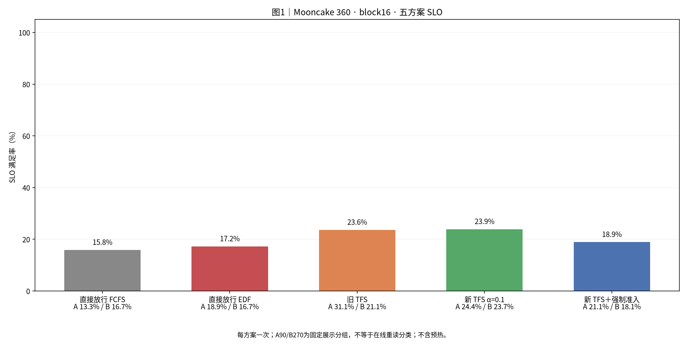
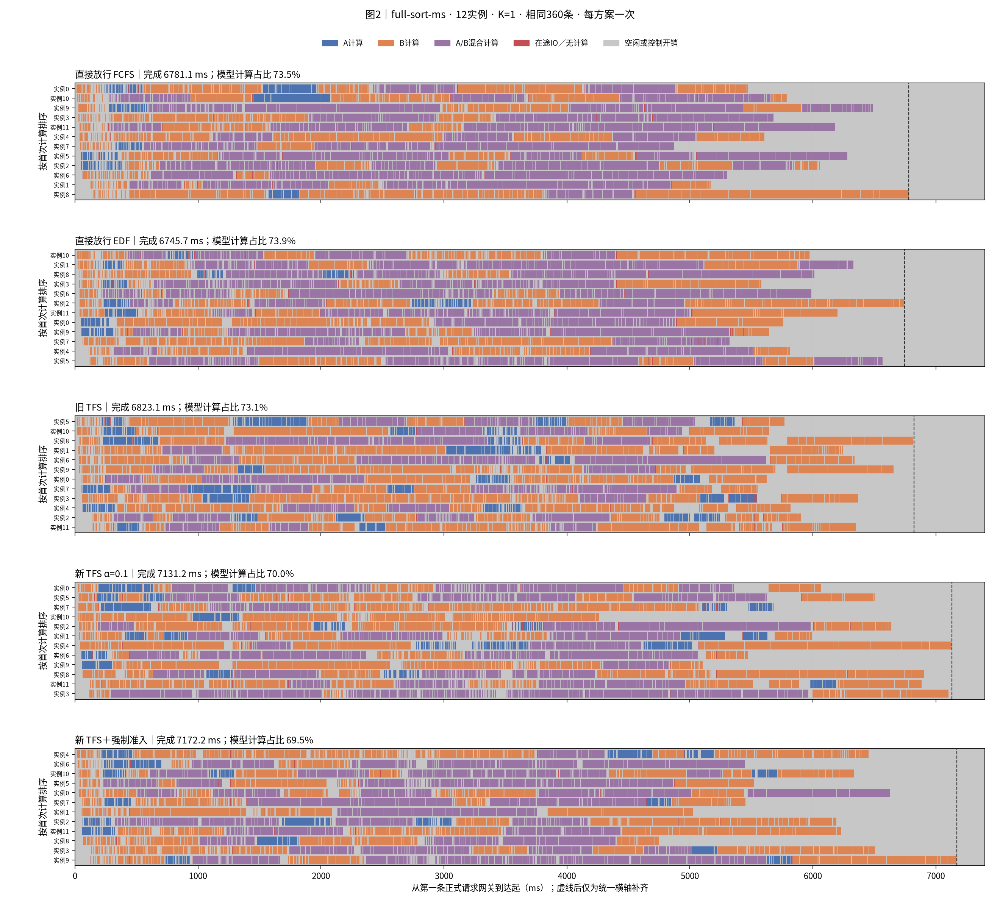
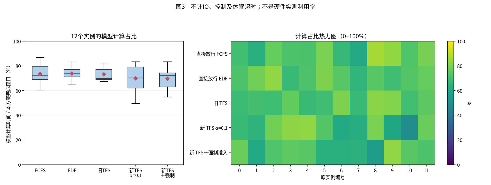
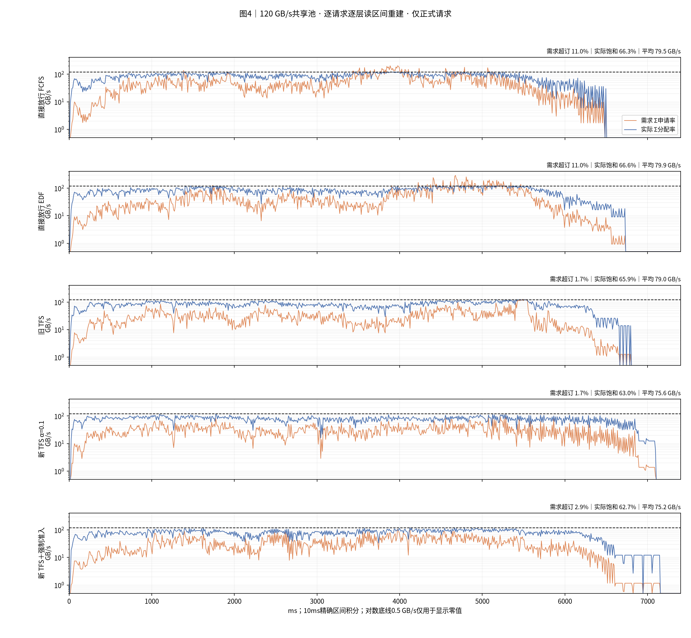
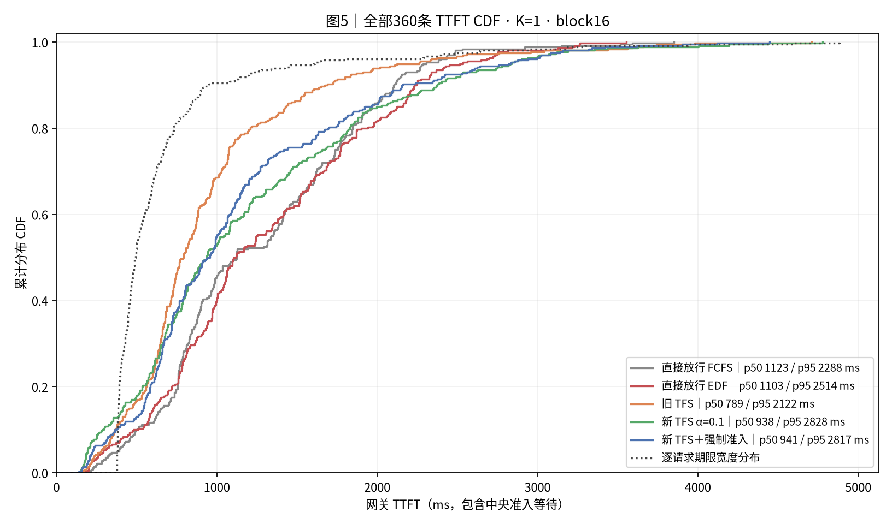
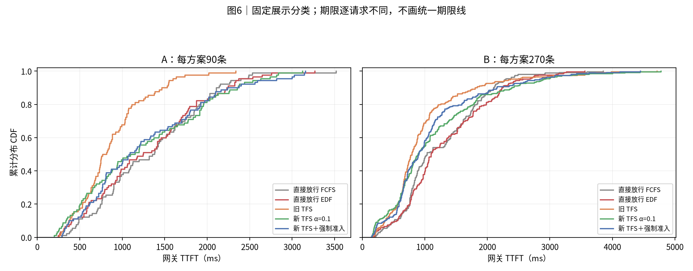
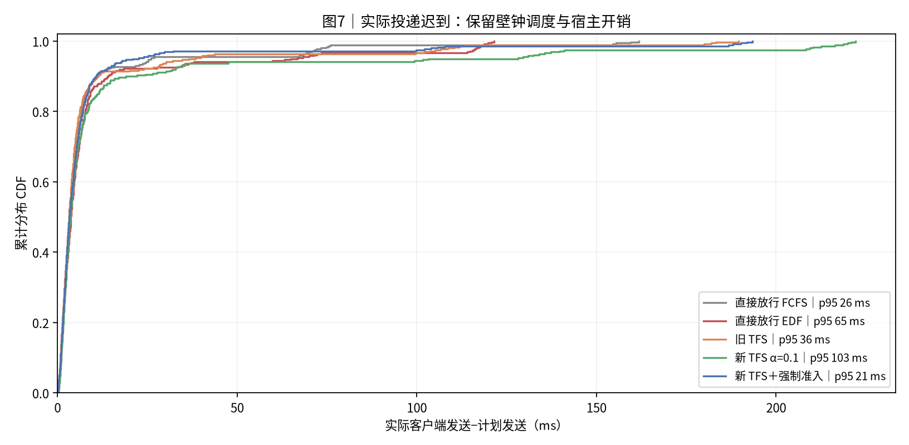

# 实验结果：Mooncake360 120 GB/s＋直接组合计时五方案对照

> 本文为最新报告的讨论导出。完整原始数据与复现边界见第9节。[返回总目录](../README.md)。

|项目|约定|
|---|---:|
|实验日 / 整理日|2026-10-29；五组均重新运行|
|输入|conversation 前360条，保留顺序和同刻组，计划到达窗口0–4秒|
|命中|人为96%远端命中，向下对齐完整16-token块；本地前缀缓存关闭|
|输入总量|5,117,755输入token；4,910,208命中；207,547新计算|
|资源|1个Dynamo前端、12个真实vLLM逻辑实例及EngineCore、独立准入服务；K1|
|组批|max_num_seqs=4；max_num_batched_tokens=8192；逻辑块池30159块|
|计算|glm5_direct_sum_v1；单请求时间相加，仅扣显式重复算子启动；合并比例1；固定TP1/DP8/EP8；78层|
|存储|120 GB/s单共享池、GroupedStorage max-min、零启动延迟；逐层读、预取下一层|
|方案|直接FCFS、直接EDF、旧网关TFS、新调度前TFS α=0.1、新TFS＋空闲强制准入|
|预热 / 重复|每组72条预热，排空后清画像历史并重置GC窗口；正式360条；每方案1次|
|完成与吞吐|首条正式请求网关登记→最后一条正式首token；请求吞吐=360/该窗口|
|TTFT / SLO|TTFT=网关首token−登记时间，含全部等待；TTFT≤4T0；T0按最新画像v3统一计算|
|统计|p50/p95采用nearest-rank；每条期限分别匹配；无置信区间|
|通信|Dynamo Runtime TCP/MessagePack准入；四种在线执行反馈已移除；首token释放保留|
|观测|各组相同本地细粒度记录；正式窗口网关和存储循环GC暂停，结束后恢复|
|展示分组|固定历史标签A90/B270；无C；与本轮在线P75重读集合分开|
|源码|DV 7a032a2d32c74db600f9ec0cf6ab71a48d46f57a，另保留原有RPC阶段诊断补丁；五组同源码和native扩展|
|输入SHA256|57b23ce7ac589220f23a5ce7b1ba768f786fa9506c41d58ddbb3ffa62f315f9b|
|执行边界|真实控制面和Scheduler；GPU计算、专家通信与远端存储传输由模型模拟|

## 0. 总判决

本轮完成最快的是 **直接放行 EDF：6745.7 ms**。总体SLO最高的是 **新 TFS α=0.1：23.9%**。每方案只有一次，结果只描述本轮，不证明稳定排名。

|方案|完成ms|请求/s|平均TTFT ms|p95 ms|SLO %|
|---|---:|---:|---:|---:|---:|
|直接放行 FCFS|6781.13|53.09|1269.44|2287.74|15.83|
|直接放行 EDF|6745.74|53.37|1304.53|2513.70|17.22|
|旧 TFS|6823.11|52.76|955.23|2122.36|23.61|
|新 TFS α=0.1|7131.16|50.48|1182.32|2827.85|23.89|
|新 TFS＋强制准入|7172.21|50.19|1143.13|2816.83|18.89|

新TFS相对直接FCFS：完成时间变化 **+5.16%**，平均TTFT变化 **-6.86%**，SLO变化 **+8.06个百分点**。时间变化为正表示变慢。

新TFS相对旧TFS：完成时间变化 **+4.51%**，平均TTFT变化 **+23.77%**，SLO变化 **+0.28个百分点**。时间变化为正表示变慢。

强制准入相对新TFS：完成时间变化 **+0.58%**，平均TTFT变化 **-3.31%**，SLO变化 **-5.00个百分点**。时间变化为正表示变慢。

五组共1800条正式请求全部返回首token并正常结束。全部结果采用本次重新运行的数据。

## 1. 汇总表与 SLO

**读法**：柱高为总体SLO；横轴附A/B各自SLO。每组样本相同，不含72条预热；没有把分类SLO相加。

|方案|准入|实例内排序|等待重读计分|强制|
|---|---:|---:|---:|---:|
|直接FCFS|网关立即转发|FCFS|完整|关|
|直接EDF|网关立即转发|固定deadline EDF|完整|关|
|旧TFS|网关配额控制，动态P75|FCFS|完整|关|
|新TFS α=0.1|实例调度前申请，分类到达时冻结|EDF|等待0.1，获准补齐|关|
|新TFS＋强制|同新TFS|EDF|同新TFS|满足条件的空闲实例每轮至多1条；不等上一笔额度释放|

|方案|A平均TTFT ms|B平均TTFT ms|A SLO %|B SLO %|
|---|---:|---:|---:|---:|
|直接放行 FCFS|1339.12|1246.22|13.33|16.67|
|直接放行 EDF|1296.35|1307.25|18.89|16.67|
|旧 TFS|870.13|983.60|31.11|21.11|
|新 TFS α=0.1|1252.14|1159.04|24.44|23.70|
|新 TFS＋强制准入|1272.35|1100.06|21.11|18.15|

共同的期限宽度范围为 **375.12–4885.02 ms**，均值 **669.03 ms**。同一请求跨五组使用相同期限宽度。

当前T0按单请求和8192-token参考分块计算，并按逐层预取协议合成读取与计算重叠。这与早期直接将整段读取加计算的画像不同。SLO既不是trace自带要求，也不是固定毫秒数；倍率4为实验设定。

## 2. 完整执行时间线与组批

**读法**：五组各12行，独立按首次计算排序，保留原实例编号，共用横轴。蓝A、橙B、紫混合计算。红为存在在途读取但无模型计算的区间，不全部等于依赖阻塞；灰包含空闲、控制和观测开销。虚线后为横轴补齐。

|方案|step数|多请求step|平均批大小|批大小1/2/3/4|跨step请求数|
|---|---:|---:|---:|---:|---:|
|直接放行 FCFS|126|96|2.865|30/20/13/63|1|
|直接放行 EDF|136|95|2.647|41/22/17/56|0|
|旧 TFS|177|88|2.034|89/30/21/37|0|
|新 TFS α=0.1|159|88|2.270|71/21/20/47|1|
|新 TFS＋强制准入|160|84|2.250|76/14/24/46|0|

平均批大小=各step请求成员次数之和/step数。请求分块后可以进入多个step，因此不能总用360/step数代替。所有实际step的新token合计必须等于207547，批大小不能用层色块数推断。

|方案|各step单请求模型时间之和：实例秒|合并启动减少：实例毫秒|实际模型计算：实例秒|
|---|---:|---:|---:|
|直接放行 FCFS|60.205557|384.930|59.820627|
|直接放行 EDF|60.155147|366.912|59.788235|
|旧 TFS|60.155147|299.754|59.855393|
|新 TFS α=0.1|60.199273|330.876|59.868397|
|新 TFS＋强制准入|60.155147|327.600|59.827547|

这里的启动减少量是12实例累计值，不能直接当作整批完成时间的缩短量。新模式只减少显式重复启动，合批不会再摊薄权重读取或专家通信时间。

## 3. 模型计算占比分布与热力图

**读法**：每实例名义模型计算时间/本方案完成窗口。箱线和热图使用同一组12个值，色标0–100%。它不是宿主CPU利用率或真实GPU利用率；观察到的计算段还包含sleep超时和本地程序开销。

|方案|模型计算实例秒|4秒窗口计算压力%|全程模型计算占比%|
|---|---:|---:|---:|
|直接放行 FCFS|59.821|124.63|73.51|
|直接放行 EDF|59.788|124.56|73.86|
|旧 TFS|59.855|124.70|73.10|
|新 TFS α=0.1|59.868|124.73|69.96|
|新 TFS＋强制准入|59.828|124.64|69.51|

输入侧单请求参考计算总量为60.155实例秒，除以12×4秒为125.32%。上表采用各组实际batch的估时，两种计算压力口径分开。

## 4. 存储带宽时序

**读法**：橙线为需求，蓝线为模型实际分配速率，黑虚线为120GB/s。由逐请求逐层读取端点重建区间，再按10ms桶积分；零值只在对数图中显示为0.5，CSV保留0。

|方案|平均GB/s|需求超订%|实际饱和%|积分误差B|
|---|---:|---:|---:|---:|
|直接放行 FCFS|79.52|10.98|66.27|2.866699|
|直接放行 EDF|79.94|10.99|66.62|3.162170|
|旧 TFS|79.03|1.70|65.86|3.793091|
|新 TFS α=0.1|75.62|1.70|63.02|3.871521|
|新 TFS＋强制准入|75.19|2.89|62.66|3.814270|

各组正式读取均为 **539,258,683,392 B（539.259 GB）**，连续占满120GB/s也需要4.494秒。4秒输入窗口的存储压力为112.35%。需求超订按需求>B，饱和按实际≥0.9B，分母为各组完成窗口。

重建使用本轮单盘、零启动延迟、始终分配剩余带宽的GroupedStorage语义。端点为双精度时间，末尾按剩余字节裁剪会留下少量积分误差。预先沿用1e-11相对误差阈值；没有缩放速率或改写原时间来消除误差。

## 5. TTFT 累积分布

**读法**：每条曲线360条，按rank/n阶梯绘制。点线为逐请求期限宽度分布。期限各不相同，SLO按每个请求匹配计算，不能由两条CDF交点推断。

**读法**：固定A90/B270展示标签。分类与在线重读判定分开，不把A固定解释为当轮全部重请求。分类期限也不统一。

|方案|p50 ms|p95 ms|客户端平均TTFT的统计范围|
|---|---:|---:|---:|
|直接放行 FCFS|1122.64|2287.74|客户端另存逐请求表；主表使用网关口径|
|直接放行 EDF|1103.48|2513.70|客户端另存逐请求表；主表使用网关口径|
|旧 TFS|788.86|2122.36|客户端另存逐请求表；主表使用网关口径|
|新 TFS α=0.1|937.55|2827.85|客户端另存逐请求表；主表使用网关口径|
|新 TFS＋强制准入|941.22|2816.83|客户端另存逐请求表；主表使用网关口径|

## 6. 机制解释与同条件比较

直接FCFS与直接EDF只改变policy/request_ordering。新TFS与强制准入只改变admission.idle_bypass。旧TFS与新TFS同时改变准入位置、分类时刻、实例排序和等待计分，不能将全部差异归因于α。

|方案|网关等待均值ms|转发到首个读取均值ms|重读标记数|正式拒绝次数|强制次数|held峰值|
|---|---:|---:|---:|---:|---:|---:|
|直接放行 FCFS|0.87|655.60|0|0|0|47|
|直接放行 EDF|1.16|720.14|0|0|0|44|
|旧 TFS|205.65|298.10|0|0|0|12|
|新 TFS α=0.1|1.24|650.46|102|326|0|11|
|新 TFS＋强制准入|1.12|628.07|102|20|45|13|

重读标记数统计下发给实例的storage_hint；旧网关模式不下发此标记，0不表示没有重读请求。网关等待发生在转发前；转发到读取还包含路由、worker接收、实例排队、配额等待与调度，不能全部解释成单次RPC延迟。held峰值表示模型内占账数量。强制模式允许符合条件的实例暂时超过中央cap，增加并发也会增加带宽竞争。

本轮已移除load_submitted、layer_load_submitted、load_completed、no_external_load四类中央执行反馈RPC；准入、回滚、强制通知及首token释放仍然在线。读取事实由worker本地日志结束后补入报告，不作为在线策略的信息输入。更早报告的通信、模型、T0、GC或预热条件可能不同；下面仅对比已逐项核实的110GB/s那一轮。

本轮五组同源码；运行文件与上一轮110GB/s逐文件指纹一致，native扩展也一致。相较110GB/s只修改共享池和准入参考带宽，直接组合f=1及其他配置不变。T0按120GB/s重新计算，期限随既有规则变化；计算单请求时间本身不变。两轮各方案均仅运行一次，实际到达、路由同分选择及宿主开销仍有波动。

|方案|110完成ms|120完成ms|完成变化%|110平均ms|120平均ms|平均变化%|
|---|---:|---:|---:|---:|---:|---:|
|直接放行 FCFS|6519.54|6781.13|4.01|1303.71|1269.44|-2.63|
|直接放行 EDF|6842.28|6745.74|-1.41|1366.81|1304.53|-4.56|
|旧 TFS|7224.31|6823.11|-5.55|1062.46|955.23|-10.09|
|新 TFS α=0.1|7838.77|7131.16|-9.03|1124.85|1182.32|5.11|
|新 TFS＋强制准入|6723.78|7172.21|6.67|1143.43|1143.13|-0.03|

|方案|110原期限SLO%|120新期限SLO%|变化百分点|120沿用110期限SLO%|
|---|---:|---:|---:|---:|
|直接放行 FCFS|16.67|15.83|-0.83|15.83|
|直接放行 EDF|18.33|17.22|-1.11|17.22|
|旧 TFS|17.22|23.61|6.39|23.61|
|新 TFS α=0.1|19.17|23.89|4.72|23.89|
|新 TFS＋强制准入|18.89|18.89|0.00|18.89|

时间变化为正表示120GB/s更慢。准入参考带宽参与额度计算，因此配额也按原规则随带宽变化。主表SLO仍按各轮原有T0规则；最后一列只将本轮TTFT与同请求的110GB/s期限比较，不改变执行。两轮的汇总及逐请求CSV均保存，旧数值没有被重算或覆盖。[带宽对照数据](report_data/bandwidth_comparison.csv)。

本轮直接放行 EDF、旧 TFS、新 TFS α=0.1在120GB/s的完成时间更短。两轮各方案均仅一次；该差异不能视为稳定收益，实际到达、路由、组批及宿主调度仍可能影响结果。

本轮所有方案沿用110GB/s期限后，达标请求数均未变化。因此，上表SLO差异不是这次期限重算造成的。

## 7. 计算模型与结论限制

- 按各请求本步真实形状分别使用v2单请求估时，再逐层相加；仅扣max(n-1,0)×3×7µs×78的重复kernel启动。固定TP/DP/EP，权重读取及专家通信逐请求累加。启动合并是仿真假设，未做目标设备定标。
- 12个逻辑执行实例与公式中的参考DP8/EP8是不同层次；本轮没有真实多卡模型分片或同步专家通信。
- 每组一次。路由同分选择、到达迟到、宿主调度和组批变化都可能改变结果，不提供稳定收益或统计显著结论。
- 只做prefill并输出1 token。本地前缀缓存关闭，人为96%外部命中不是原trace实测命中率；不覆盖持续decode、真实存储容量淘汰、真实KV张量和跨机网络。
- 暂停GC仅在受保护测量窗口内生效；本地记录、sleep、存储轮询和真实控制程序仍计入壁钟。

## 8. 附表：实际投递与资源

**读法**：实际客户端发送时间减计划发送时间，保留全部迟到值。五组计划相同不等于实际到达完全相同；它与网关排队不是同一段时间。

|方案|发送迟到均值ms|发送迟到p95 ms|发送迟到最大ms|客户端完成ms|
|---|---:|---:|---:|---:|
|直接放行 FCFS|8.31|25.96|161.73|6786.58|
|直接放行 EDF|10.18|64.94|121.56|6748.76|
|旧 TFS|9.40|36.48|189.60|6826.68|
|新 TFS α=0.1|14.63|103.21|222.15|7133.92|
|新 TFS＋强制准入|8.56|20.92|193.37|7175.24|

|方案|整轮壁钟s（含启动/预热/验收）|子进程RSS峰值GiB|最低可用内存GiB|观察到的swap峰值GiB|
|---|---:|---:|---:|---:|
|直接放行 FCFS|59.305|17.127|7.968|0.000|
|直接放行 EDF|59.680|17.037|8.055|0.000|
|旧 TFS|61.341|17.115|7.994|0.000|
|新 TFS α=0.1|60.703|17.400|7.775|0.000|
|新 TFS＋强制准入|67.431|17.317|7.949|0.000|

## 9. 公开范围与验证

本次仅整理并发布已有实验，没有新增运行。第0—8节和第10节沿用最新完整报告；指标、结论和七张图片不变。发布目录保留小型结果表、配置及版本摘要。

完整原始trace、逐层日志、存储区间、原生扩展、完整重绘脚本和分享ZIP保留在原工作区。本目录可以阅读报告并核对汇总，不能独立重跑仿真或重绘完整执行时间线。

原实验的验收与文件摘要见[原始验证清单](report_data/source_validation.json)。该清单中的完整原始文件未全部公开。本次另核对公开图片及结果表与原文件逐字节一致，并检查正文全部相对链接；见[导出校验清单](report_data/validation.json)。发布检查不替代实验验收。

公开数据：[run_summary](report_data/run_summary.csv)、[requests](report_data/requests.csv)、[device_utilization](report_data/device_utilization.csv)、[bandwidth_10ms](report_data/bandwidth_10ms.csv)、[cdf](report_data/cdf.csv)、[admission_summary](report_data/admission_summary.csv)、[summary](report_data/summary.json)、[input_check](report_data/input_check.json)、[matrix_receipt](report_data/matrix_receipt.json)、[plan](report_data/plan.json)、[provenance](report_data/provenance.json)、[bandwidth_comparison](report_data/bandwidth_comparison.csv)。

中央加载字段来自排空后的离线补全，不代表在线准入读取了存储真值。

## 10. 简要解读

本轮可先看新 TFS α=0.1的SLO与直接放行 EDF的完成时间，再看A/B分组和时间线。比较新TFS与强制准入，观察缩短空闲是否同时增加带宽竞争或伤害短请求。计算压力应使用各组实际batch时间；不能将单请求参考压力、模型计算占比和真实GPU利用率混为一个指标。
