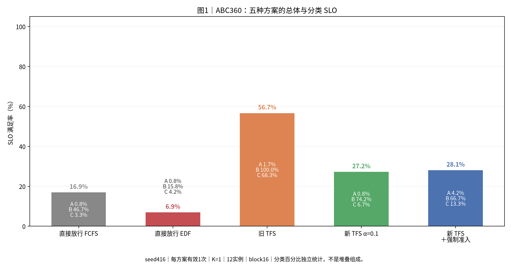
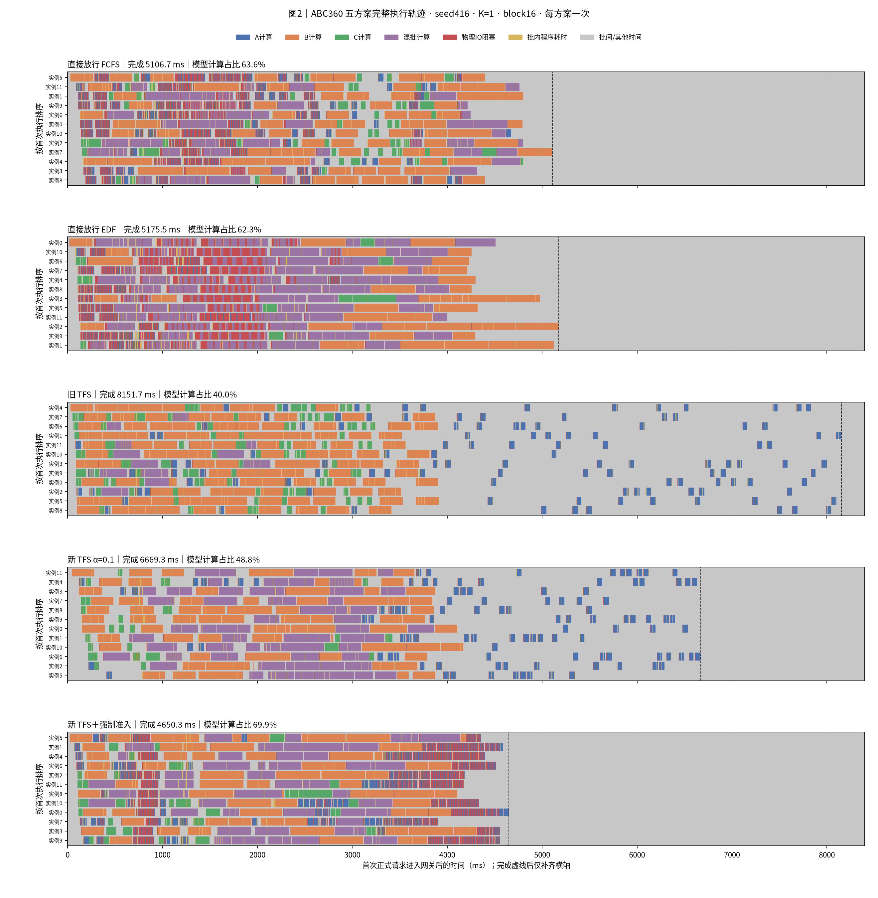
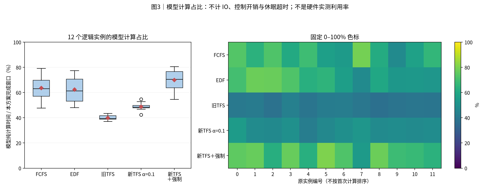
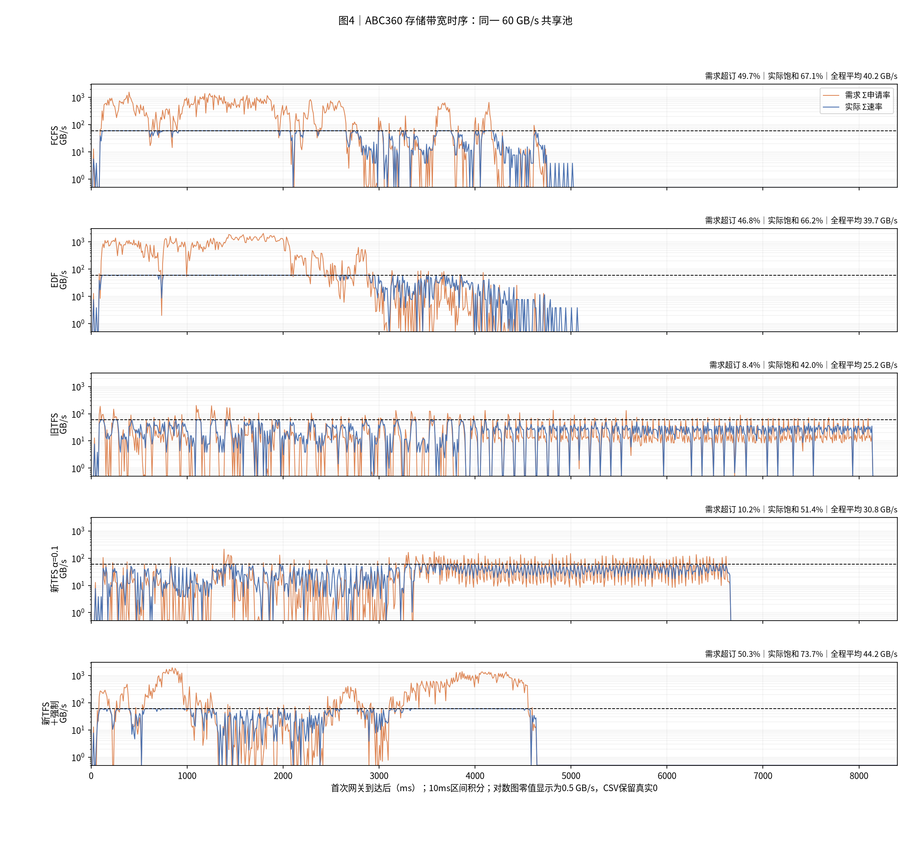
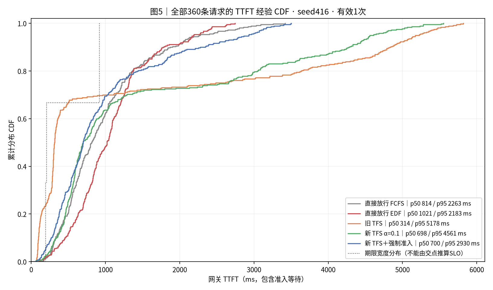
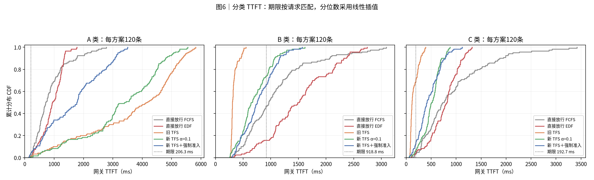
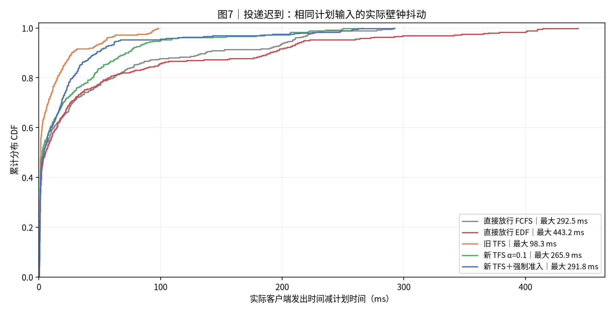

# 实验结果：ABC360 移除执行反馈后的五方案对照（强制组已更新）

| 项目 | 约定 |
|---|---|
| 实验日 / 整理日 | 2026-10-29 / 2026-10-29；四组沿用上一版记录；仅TFS＋强制准入替换为最新单组重跑 |
| 输入 | seed416；ABC 各120条，共360条；计划首末到达跨度 3608.970 ms；最后计划到达 3.612 s |
| 资源 | 1个Dynamo前端、12个vLLM逻辑实例、1个独立额度服务；60 GB/s共享池，qmax=200 GB/s |
| 组批与缓存 | batch≤4；每步8192新增token；16-token块，12258块；本地前缀缓存关闭；固定first_seen命中合同 |
| 计算与存储 | SA八层合成模型、逐层加载、预取下一层；每请求只输出1 token；本轮不使用GLM5公式 |
| 方案 | 直接FCFS、直接EDF、旧TFS、新TFS α=0.1、新TFS α=0.1＋强制准入 |
| 重复与汇总 | 每组72条预热并排空，清正式画像历史、重置GC窗口后回放360条；每方案1次，共1800条正式请求；不做跨种子聚合 |
| 时间与吞吐 | K=1；完成时间=首个正式请求进入网关→最后一个正式首token；吞吐=360/该窗口；预热不计入主表 |
| TTFT / SLO | TTFT=网关首token−网关登记到达，包含网关和实例等待；逐请求判断TTFT≤4×T0；p50/p95采用线性插值 |
| 通信 | 准入控制使用Dynamo Runtime TCP/MessagePack；四种执行反馈RPC全部移除；存储IPC、α计分接口保留 |
| 观测与程序开销 | 五组均启用相同细粒度本地记录；计时期间网关和存储循环GC暂停，结束后恢复；本地记录与存储就绪轮询仍有开销 |
| 版本与输入 | 前四组DV 761ece2；强制组DV 6ebbfdd；同输入、原生扩展与SA公式，运行代码版本不同；公开版本摘要见run_metadata.json；完整源码指纹保留在私有工作区 |
| 执行边界 | 真实Dynamo路由、真实vLLM调度和组批；设备计算及存储为仿真，利用率不能解释为真实GPU/NPU实测 |

本次只更新强制准入组。该组取消上一笔强制额度登记/释放依赖，并删除force_status轮询；每轮最多强制一条，各笔额度仍按HTTP首token释放。其他四组没有重跑，原始投影和表格数据逐项保留。当前五组不是同一代码版本的重新运行对照。旧强制组已从当前汇总和七图中移除，旧版分享包已备份；来源和版本见[修订清单](report_data/report_revision.json)。

## 0. 总判决

本次完成时间最短的是 **新 TFS α=0.1＋强制准入：4650.3 ms**。
总体SLO最高的是 **旧 TFS：56.7%**。
新TFS相对直接FCFS，完成时间增加30.6%，
平均TTFT增加53.4%，
SLO变化 **+10.3个百分点**。
强制准入相对普通新TFS，完成时间减少30.3%，
SLO变化 **+0.8个百分点**。

完成时间最短不代表尾部延迟最低。强制组p95为 **2929.7 ms**，
直接FCFS为 **2263.3 ms**；这两项指标不能互相替代。

五组的四种执行反馈RPC均为0。正式请求全部完成，额度及原生路由记账均排空。
五组A类SLO最高也只有4.2%。旧TFS的总体SLO主要来自B类100.0%和C类68.3%，不能解释为所有类别都受益。
这些结果来自一个种子的单次轨迹，说明本轮条件下的表现，不能据此保证每次都保持同一排名。

## 1. 汇总表与 SLO

|方案|完成ms|请求/s|平均TTFT ms|p95 ms|总体SLO%|A SLO%|B SLO%|C SLO%|
|---|---:|---:|---:|---:|---:|---:|---:|---:|
|直接放行 FCFS|5106.7|70.5|976.3|2263.3|16.9|0.8|46.7|3.3|
|直接放行 EDF|5175.5|69.6|1072.7|2183.1|6.9|0.8|15.8|4.2|
|旧 TFS|8151.7|44.2|1384.1|5177.8|56.7|1.7|100.0|68.3|
|新 TFS α=0.1|6669.3|54.0|1497.6|4561.4|27.2|0.8|74.2|6.7|
|新 TFS＋强制准入|4650.3|77.4|974.8|2929.7|28.1|4.2|66.7|13.3|

五组正式请求均读取205,541,867,520 B KV，完成842,280个新增token。带宽与模型参数相同。

|方案|准入位置|实例排序|重读分类|等待计分|强制准入|
|---|---:|---:|---:|---:|---:|
|直接放行 FCFS|直接放行|FCFS|不限制|原生完整计分|关|
|直接放行 EDF|直接放行|EDF|不限制|原生完整计分|关|
|旧 TFS|网关|FCFS|动态阈值|原生完整计分|关|
|新 TFS α=0.1|vLLM调度前|EDF|到达时冻结|α=0.1|关|
|新 TFS α=0.1＋强制准入|vLLM调度前|EDF|到达时冻结|α=0.1|开|

**读法**：柱高是总体SLO，柱内ABC是各类独立SLO。每组只有一次，不画误差条。

## 2. 完整执行时间线与组批

**读法**：每组独立按首次执行排序，保留原实例号。蓝/橙/绿/紫只覆盖模型计算时长；红色是仍未完成的存储读取对层入口造成的阻塞；金色是批内程序耗时；灰色是批间、调度或其他时间。完成虚线之后只是统一横轴。灰色不等于没有排队请求。

|方案|调度批次数|多请求批次数|平均batch|模型计算实例秒|新增token/s|
|---|---:|---:|---:|---:|---:|
|直接放行 FCFS|277.0|72.0|1.4|39.0|164935.1|
|直接放行 EDF|152.0|118.0|2.8|38.7|162743.6|
|旧 TFS|342.0|15.0|1.1|39.1|103325.8|
|新 TFS α=0.1|258.0|80.0|1.6|39.0|126291.2|
|新 TFS＋强制准入|256.0|86.0|1.6|39.0|181123.8|

同样的请求可能因分块进入多个调度批次，所以批次数不是请求数。模型计算实例秒可随组批变化，不能由请求数直接相加。

## 3. 计算占比与时间账本

**读法**：分母为各方案自己的完成窗口。箱线和热力图使用同一组12实例数据。热力图保留原编号、统一0—100%色标。这是模型计算占比。

|方案|模型计算%|物理IO阻塞%|批内程序耗时%|批间/其他%|
|---|---:|---:|---:|---:|
|直接放行 FCFS|63.6|9.8|3.5|23.1|
|直接放行 EDF|62.3|15.0|3.4|19.3|
|旧 TFS|40.0|0.5|1.9|57.6|
|新 TFS α=0.1|48.8|0.7|1.9|48.7|
|新 TFS＋强制准入|69.9|11.2|3.2|15.7|

每个实例的四项时间相加等于完成窗口。批内程序耗时包含提交、查询、轮询检测延迟、日志和休眠超时等。本轮没有把这些时间算进模型纯计算。批间时间还包含调度、IPC和等待请求，不能全部称为设备空闲。

## 4. 存储带宽

**读法**：需求与实际速率按原始不等长区间积分到10ms桶。黑虚线为60 GB/s；需求超订指需求>60 GB/s，实际饱和指实际≥54 GB/s。对数图把零显示在0.5 GB/s底线，CSV仍为零。

|方案|全程平均GB/s|需求超订%|实际饱和%|积分误差B|
|---|---:|---:|---:|---:|
|直接放行 FCFS|40.25|49.7|67.1|0.017120|
|直接放行 EDF|39.71|46.8|66.2|0.012421|
|旧 TFS|25.21|8.4|42.0|0.072968|
|新 TFS α=0.1|30.82|10.2|51.4|0.055481|
|新 TFS α=0.1＋强制准入|44.20|50.3|73.7|0.015411|

读取字节相同，平均带宽的差别主要对应完成窗口差别。需求超订和实际饱和不同；不能只凭申请带宽判断实际用满。

## 5. TTFT 累积分布

**读法**：曲线越靠左，同一分位点的TTFT越低。经验CDF按rank/n绘制；不能由总体CDF与期限分布的交点判断SLO。

**读法**：每类每方案120条。点线为该类4×T0期限；SLO由逐请求时间与自己的期限比较得到。

|方案|A均值ms|A p95 ms|B均值ms|B p95 ms|C均值ms|C p95 ms|
|---|---:|---:|---:|---:|---:|---:|
|直接放行 FCFS|879.6|2127.0|1098.4|2476.2|951.0|2140.3|
|直接放行 EDF|936.8|1374.1|1511.5|2433.5|769.9|1203.4|
|旧 TFS|3662.4|5520.0|332.7|490.1|157.2|333.3|
|新 TFS α=0.1|3277.4|5068.1|712.8|1216.5|502.7|806.9|
|新 TFS＋强制准入|1684.5|3175.2|782.0|1278.3|457.8|835.5|

## 6. 准入机制与程序开销

|方案|重读登记数|强制数|拒绝RPC数|申请均值ms|登记/获准→首次IO均值ms|末层IO→首token均值ms|
|---|---:|---:|---:|---:|---:|---:|
|直接放行 FCFS|121|0|0|0.000|709.179|28.280|
|直接放行 EDF|121|0|0|0.000|505.557|56.475|
|旧 TFS|121|0|0|0.000|73.573|12.865|
|新 TFS α=0.1|121|0|3302|5.454|18.118|18.163|
|新 TFS α=0.1＋强制准入|121|110|103|20.166|7.074|18.228|

拒绝RPC数只包含真正发出的申请，本地full窗口跳过的请求不在其中。直接放行组没有额度RPC，拒绝数和申请时延均为0，但网关仍记录放行状态。
本表RPC数和申请时延只统计普通acquire。最新强制组已删除force_status操作和轮询；本表不统计异步force_acquire通知。申请时延是调用端观测值，包含队列、通信桥接和服务处理，不能解释为纯网络延迟。
重读登记数按登记时的重读分类统计，不等于固定A类数量。登记/获准到首次IO按中央决定时刻与存储服务首次真实提交时刻计算；强制额度使用本地决定时刻；直接放行组使用网关放行记账时刻。
末层IO到首token的间隔包含就绪检测、最后计算和返回。当前额度仍到首token才释放。

旧TFS、新TFS之间同时包含准入位置、分类冻结、实例排序和等待计分差别，不能把全部差异归因于一个开关。
普通新TFS与最新强制组的配置字段仅差idle_bypass，但强制组运行代码还包含释放依赖和状态轮询的移除。因此，两组差异同时包含强制开关与实现修订，不能全部归因于单独一个开关。最新强制组正式阶段同实例未释放强制账目峰值为2，最终均逐笔释放。强制放行仍占账，也可能超出常规额度；它不增加物理带宽。

**读法**：输入的计划时间完全相同，宿主实际发送仍有抖动。此图用于核对该差异；TTFT主表从网关到达开始统计，客户端完整口径保留在CSV。

## 7. 计算模型与结论限制

ABC继续使用SA八层公式：`T_batch=8×[t_launch+a×Σu/η+b×Σ(u×h+u×(u+1)/2)]`，`η=min(1,max(1/16,Σu/512))`。
该模型按实际请求边界聚合工作量。本轮没有切换到GLM5的78层模型。公式通过独立复算检查。

这是CPU上的控制面实跑与执行仿真。没有真实GPU/NPU kernel或存储传输。真实部署的绝对延迟不能直接取本报告数值。
网络准入RPC使用本机回环，其延迟不能替代跨机器网络测量。本地观测和存储0.5ms轮询仍可能影响组批与执行。
每组单种子、单次运行，原生路由的平局选择和宿主抖动都可能改变排名。
旧报告还可能使用在线执行反馈、Unix RPC、不同GC或预热条件，不能把跨报告差值全部当作移除反馈的收益。

## 8. 输入与附表

|类别|请求数|命中token|新增token|SLO期限ms|
|---|---:|---:|---:|---:|
|A|120|42880|259|206.270|
|B|120|9392|4103|918.791|
|C|120|0|2657|192.673|

全部独立请求的参考计算量为 39.104 实例秒。按12实例和计划首末到达跨度计算，参考计算输入约 90.3%，存储输入约 94.9%。这两个比例是输入量标定，分母不同于各方案实际完成窗口，也不是硬件利用率。

## 9. 公开范围与验证

本次发布没有新增实验。四组沿用上一版记录，强制准入组替换为已经完成的最新单组重跑。当前五组不是同一代码版本的重新运行对照。

公开版包含正文、七张已检查的原图、聚合统计、CDF排名和10ms带宽桶。图表和统计表与私有完整报告逐字节一致。原始trace、逐请求事件、日志、运行代码、完整重绘数据和完整ZIP保留在私有工作区。

私有完整报告的检查覆盖1800条正式请求、每组72条预热排空、60份实例时间账本、画像历史重置、零在线执行反馈、KV字节一致、分块token守恒、batch/token上限、逐层屏障、独立公式、额度及路由排空。带宽积分误差均小于1 B。其余四组的50,860行表格和152份原始投影保持不变。七张图已检查中文、图例、坐标和留白。

- [汇总表](report_data/run_summary.csv)、[总体与分类统计](report_data/full_summary.json)。
- [逐实例四项时间账本](report_data/device_utilization.csv)、[带宽汇总与积分误差](report_data/bandwidth_summary.csv)、[10ms带宽桶](report_data/bandwidth_10ms.csv)。
- [准入机制统计](report_data/idle_bypass_metrics.csv)、[CDF排名和概率质量](report_data/cdf.csv)。
- [运行与版本摘要](report_data/run_metadata.json)、[强制组修订及分组版本](report_data/report_revision.json)、[公开文件校验清单](report_data/validation.json)。

公开数据可以核对报告的汇总指标和实验范围。公开数据不足以独立重跑实验或重绘完整执行时间线。完整复现需要私有工作区及固定运行环境。公开仓库只接收本报告的独立导出，不接收私有工作区历史。

中央加载字段来自排空后的离线补全，不代表在线准入读取了存储真值。沿用的普通新TFS原始记录曾在评分排空导出时覆盖离线加载字段。收集器只在报告副本中从本地日志重新合并，冻结原始文件未改。最新强制组已使用修复后的导出代码；该导出修复发生于测量结束后，不改变执行轨迹。

## 10. 简要解读

本轮应先看自己的目标：完成时间最优是新 TFS α=0.1＋强制准入，SLO最优是旧 TFS。两者可能不同。

四种执行反馈已从在线路径移除，但额度查询、存储查询与轮询、路由和宿主执行仍有成本。后续如果继续优化，应结合金色批内耗时、灰色批间时间和准入等待定位；这轮结果不能单独证明原先Dynamo Runtime超时的根因。
