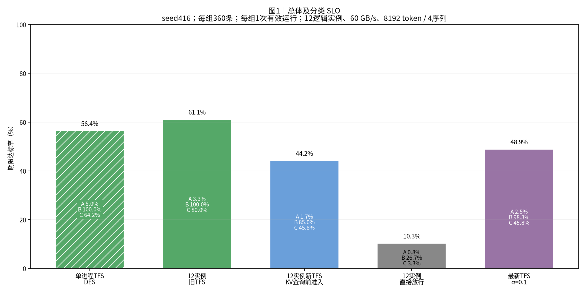
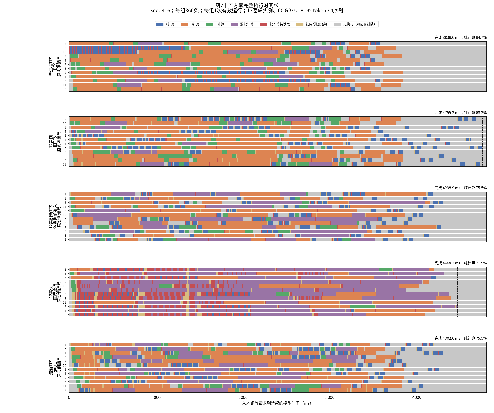
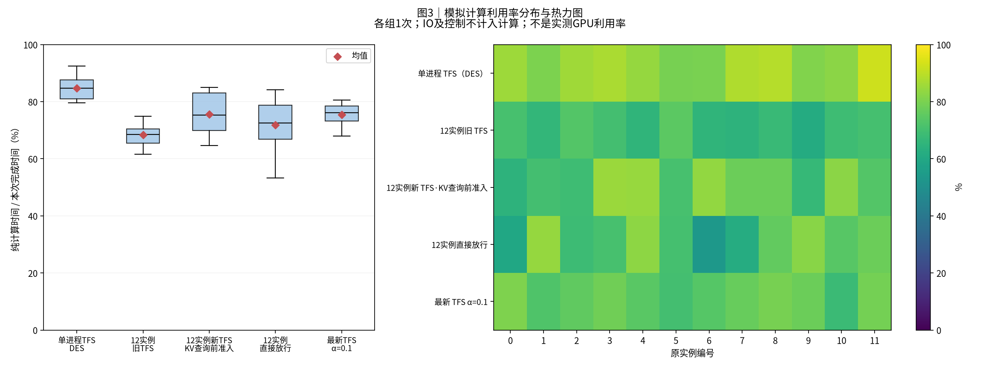
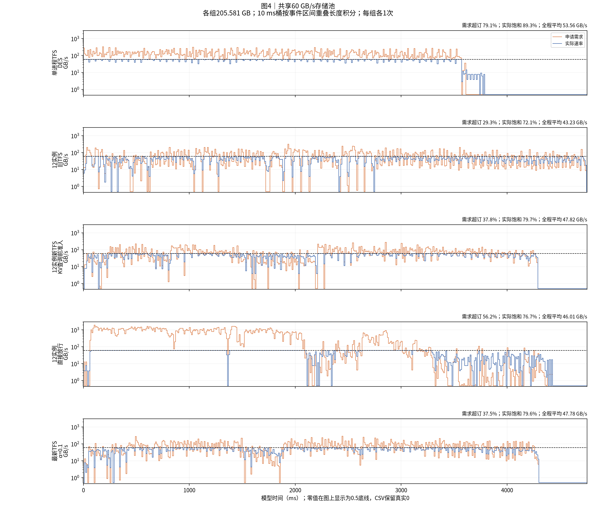
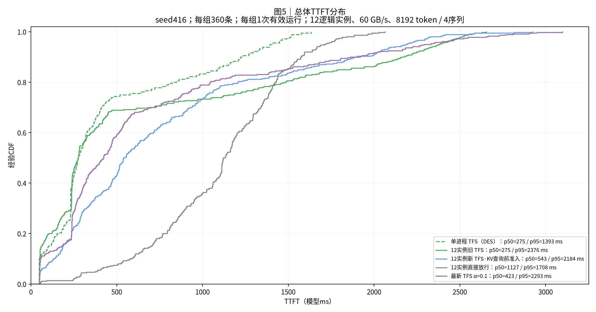
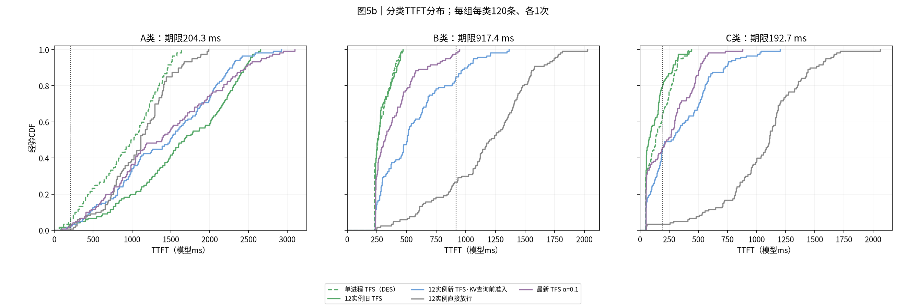

# ABC最佳计分阈值与四组历史方案对照

| 项目 | 约定 |
|---|---|
| 日期 | 正式运行与报告整理：2026-10-27；历史基线：2026-10-26 |
| 输入 | ABC seed416，360条，A/B/C各120条；每组同一冻结trace |
| 请求形状 | A：命中h=42883、新算u=256；B：h=9399/u=4096；C：h=0/u=2657；每请求输出1 token |
| 资源 | 12个逻辑实例；多进程组为12个worker及各自EngineCore，不是总共只有12个OS进程；共享60 GB/s |
| 调度 | 每步8192新token、最多4条序列；SA八层读算、下一层预取；原生KV路由 |
| 本次新组额度策略 | P75重读阈值、到达时分类、首token释放、关闭aging；额度不足在后续调度轮重查，重试间隔2壁钟ms；历史基线按原实现 |
| 到达与重复 | 计划窗口约3.612模型秒；各组1次有效运行，不设置信区间；原生实际到达窗口见附表 |
| 实验矩阵 | 复用4个历史单次结果，加本次扫描选出的1个单次结果；本报告新增运行0次 |
| 选优规则 | 正式运行前记录：总体平均TTFT最低；相同则依次取SLO高、完成快、α小；不按看到的结果改目标 |
| 统计口径 | 表图均对应各自完整单次；A/B/C等量，整体均值为三类均值的平均；分位数为线性插值 |
| 时间与SLO | 全文模型ms；原生壁钟除以K=10，从网关登记到达计TTFT；DES从冻结计划到达计TTFT；均含准入等待，按每请求4T0判定期限 |
| 存储与计算量 | 每组读取205,581,189,120 B=205.581 GB；每组新算841,080 token；不是12倍复制输入 |
| 执行边界 | 真实Dynamo/vLLM控制面，CPU上模拟计算和KV读取；没有实测GPU算力或跨机存储网络 |
| 当前版本 | DV febfe8c784d389523a65dcc15c4c23cb831d38f8；固定上游版本、输入及构建摘要见公开运行说明；没有升级上游 |
| 协议和构建 | 最佳组使用最新Dynamo原生TCP/MessagePack准入RPC及release计分扩展。旧TFS在网关扣留重请求；新TFS在引擎调度前、外部KV命中查询前查额度。历史组使用其当时的协议和构建。DES没有多进程通信壁钟开销。这些差异均保留，不强行归一。 |
| 输入SHA256 | 35e488b618a8744b420eb7a1876d4a8efeb4c7bb0d3f8def55754f9a4b918750 |

TTFT指从到达到首token的时间。SLO指TTFT不超过请求期限的比例。T0为冻结请求画像中的单请求参考服务时间（`reference_service_s`），请求期限宽度固定为4T0。

## 0. 总判决

**五比例扫描按平均TTFT选出的 最新 TFS α=0.1，在本报告中与四组历史结果对照。** 本次最佳组平均TTFT **684.7 ms**，SLO **48.9%**，完成 **4302.6 ms**。下表给出逐项变化。历史组未重跑；跨版本差值不能全部归因于计分策略。

相对旧12实例TFS，平均TTFT变化为 -0.1%，SLO变化为 -12.2个百分点。相对单进程DES，平均TTFT变化为 +49.4%。这些指标应一起判断，不能仅凭均值宣布全面优于历史方案。

运行稳定性：α=0.25首次尝试出现worker9/11的原生Dynamo准入RPC等待超过5壁钟秒，EngineCore退出，整组验收失败。该次不进入性能表图。未改配置的重试通过后才纳入比较。没有触发内存保护，也没有swap；超时根因尚未确认，不能据此断言0.25本身导致失败。[尝试记录与证据](report_data/run_metadata.json)记录失败类型及原参数重试；完整失败路径和异常栈保留本地。

| 参照方案 | 最佳组平均TTFT降低 | 最佳组SLO变化 | 最佳组完成时间变化 |
|---|---:|---:|---:|
| 单进程 TFS（DES） | -49.4% | -7.5个百分点 | +12.1% |
| 12实例旧 TFS | +0.1% | -12.2个百分点 | -9.5% |
| 12实例新 TFS·KV查询前准入 | +11.4% | +4.7个百分点 | +0.1% |
| 12实例直接放行 | +38.0% | +38.6个百分点 | -3.7% |

正号TTFT降低表示更快；完成时间变化的负号表示更早完成。SLO差使用百分点。

## 1. 总体与分类结果

| 方案 | 平均TTFT(ms) | p50(ms) | p95(ms) | 总体SLO | 完成(ms) | 模拟计算占比 |
|---|---:|---:|---:|---:|---:|---:|
| 单进程 TFS（DES） | 458.4 | 275.1 | 1392.5 | 56.4% | 3838.6 | 84.7% |
| 12实例旧 TFS | 685.5 | 275.5 | 2376.5 | 61.1% | 4755.3 | 68.3% |
| 12实例新 TFS·KV查询前准入 | 772.6 | 542.6 | 2183.8 | 44.2% | 4298.9 | 75.5% |
| 12实例直接放行 | 1103.5 | 1127.5 | 1707.9 | 10.3% | 4468.3 | 71.9% |
| 最新 TFS α=0.1 | 684.7 | 423.2 | 2293.1 | 48.9% | 4302.6 | 75.5% |

**读法**：柱高为总体SLO，柱内文字为各类别独立SLO；分类数值不是堆叠组成。每组仅1次，不画误差线。

| 方案 | A平均(ms) | B平均(ms) | C平均(ms) | A SLO | B SLO | C SLO |
|---|---:|---:|---:|---:|---:|---:|
| 单进程 TFS（DES） | 927.7 | 289.2 | 158.3 | 5.0% | 100.0% | 64.2% |
| 12实例旧 TFS | 1638.7 | 292.3 | 125.4 | 3.3% | 100.0% | 80.0% |
| 12实例新 TFS·KV查询前准入 | 1421.2 | 555.9 | 340.7 | 1.7% | 85.0% | 45.8% |
| 12实例直接放行 | 1091.4 | 1163.2 | 1055.7 | 0.8% | 26.7% | 3.3% |
| 最新 TFS α=0.1 | 1412.1 | 389.9 | 252.0 | 2.5% | 98.3% | 45.8% |

计分比例0表示等待重请求暂不贡献相应路由分数；0.1表示贡献10%；1表示等待期间全额计分。获得额度后都恢复全额计分。所有比例都保留完整资源预留，实际KV容量不打折。

| 方案 | 准入位置与计分 | 执行形态 |
|---|---|---|
| 单进程 TFS（DES） | 网关TFS；单进程虚拟时间调度 | DES单进程模拟12实例 |
| 12实例旧 TFS | 网关TFS；下发后全额计分 | 真实12-worker控制面 + 模拟执行 |
| 12实例新 TFS·KV查询前准入 | 调度前、KV命中查询前准入；下发后全额计分 | 真实12-worker控制面 + 模拟执行 |
| 12实例直接放行 | 不等待TFS额度；下发后全额计分 | 真实12-worker控制面 + 模拟执行 |
| 最新 TFS α=0.1 | 调度前、KV命中查询前准入；等待按α计分、获准补齐 | 真实12-worker控制面 + 模拟执行 |

本报告沿用用户的“计分阈值”说法，具体参数是等待计分比例α。它与TFS判定重请求的P75压力阈值θ不同；本次没有扫描θ。

## 2. 完整执行时间线与组批

**读法**：五组共用覆盖最长运行的横轴。每行独立按实例首次执行排序，保留原编号。虚线表示本组完成。完成后的灰色是统一横轴的补齐。

红色为批次等待读取，蓝/橙/绿为A/B/C计算，紫色为多类别共同计算。金色为成功调度和批内控制时间。灰色表示没有执行step，仍可能存在等待额度或排队请求。DES不推进真实控制代码的虚拟耗时。

| 方案 | step数 | 平均batch | batch=1/2/3/4的step数 | 到达窗口(ms) |
|---|---:|---:|---:|---:|
| 单进程 TFS（DES） | 332 | 1.10 | 307 / 18 / 5 / 2 | 3609.0 |
| 12实例旧 TFS | 338 | 1.09 | 322 / 6 / 7 / 3 | 3606.8 |
| 12实例新 TFS·KV查询前准入 | 271 | 1.44 | 200 / 34 / 26 / 11 | 3603.3 |
| 12实例直接放行 | 142 | 2.94 | 22 / 21 / 43 / 56 | 3606.2 |
| 最新 TFS α=0.1 | 301 | 1.27 | 251 / 25 / 19 / 6 | 3608.8 |

平均batch按step计算，一个分块请求可以出现在多个step中。色块数量不是请求数量。组批多少受到达、路由、额度和引擎队列共同影响。DES到达窗口来自计划时间，原生组来自实际网关登记，两者不混称为实测。

## 3. 模拟计算利用率

**读法**：每实例累计纯计算时间除以该组全部完成时间。箱线和热力图使用相同12个数；热力图列为原实例编号，固定0–100%。

该指标不包含IO等待和控制时间。它表示模拟计算在该运行窗口内的占比，不是宿主CPU利用率，也不是真实GPU利用率。

## 4. 共享存储带宽

**读法**：橙线为申请需求，蓝线为实际速率，黑虚线为60 GB/s容量。每个10 ms桶按事件区间与桶的重叠长度积分。

| 方案 | 全程平均GB/s | 需求超订时间占比 | 实际饱和时间占比 |
|---|---:|---:|---:|
| 单进程 TFS（DES） | 53.56 | 79.1% | 89.3% |
| 12实例旧 TFS | 43.23 | 29.3% | 72.1% |
| 12实例新 TFS·KV查询前准入 | 47.82 | 37.8% | 79.7% |
| 12实例直接放行 | 46.01 | 56.2% | 76.7% |
| 最新 TFS α=0.1 | 47.78 | 37.5% | 79.6% |

超订条件为需求>60 GB/s；饱和条件为实际≥54 GB/s。两者都以各自完成窗口为分母。每组读取字节完全相同；平均带宽差来自读取的时间分布和整批完成时间，不表示读取量减少。

仅按读取总量除以容量，理想连续满带宽需要3426.4 ms。这是存储传输下界，不包含最初调度、层间控制、计算和收尾；不能直接作为整批完成预测。

## 5. TTFT分布

**读法**：经验CDF使用rank/n阶梯线。曲线越靠左，同一分位的TTFT越短；图例列出p50和p95。

**读法**：各类期限在所有方案间一致，因此画固定期限竖线。SLO按每个请求配对判定，不从总体CDF与期限分布的交点推算。

## 6. 机制与对照边界

等待重请求已下发但尚未获准执行时，前端仍保留完整请求资源预留。评分器按比例扣除等待部分对prefill和decode成本的贡献。额度准入成功后，服务先补齐原生路由分数，再返回准入结果。补分、回滚和结束清理都有请求尝试标识和许可标识校验。

正式运行沿用历史输入预处理、tokenizer/profile缓存、绑定引用传输和缓冲细粒度探针适配器。最新准入和计分逻辑来自当前冻结sim模块。适配器与源代码的SHA逐组核对；没有为某个比例单独更换适配器。

最新组只将worker与准入账本之间的控制/反馈接到Dynamo原生RPC。计分控制仍为独立持久TCP JSON，存储控制仍沿用原适配器。不能把“用了Dynamo原生RPC”解释成所有通信链路都已替换。

在本工况的block=1、缓存重叠为0、权重为1时，可以将候选成本写为：`max(0, P−(1−α)H) + max(0, D−(1−α)H)`。P、D包含原生候选投影负载；H为该实例尚未激活的重请求prompt token之和。α改变路由成本，不改变请求token、KV分配量和准入配额。

事实：本次完整运行的计分检查核对原生候选分数、最低成本选择、注册→绑定→激活→关闭和最终账本清空。α=1也保留计分控制接口，因此它是最新TFS中的全额计分对照，不等同于关闭TFS的直接放行。

推断边界：α较小时，等待A对新请求路由的排斥减弱，可能减轻BC排队，也可能让A集中到少数实例。下表和逐请求数据可以观察实际结果，但本次每比例只有1次，不能排除进程调度和路由同分选择的波动。

| 方案 | 重读标记A/B/C | KV命中查询数 | 折扣候选日志数 | 计分RPC均值(壁钟ms) | 最低可用GiB | 最大swap GiB |
|---|---:|---:|---:|---:|---:|---:|
| 最新 TFS α=0.1 | {'B': 1, 'A': 120} | 360 | 3791 | 1.272 | 4.2 | 0.0 |

计分RPC均值按调用统计，不是请求TTFT。壁钟RPC毫秒没有除以K；主表全部是模型毫秒。每个比例的重读标记分布和实际到达窗口均保留，不能将到达时画像自动当作完全相同的常数。

| 方案 | A路由到最忙实例条数 | B路由到最忙实例条数 | C路由到最忙实例条数 |
|---|---:|---:|---:|
| 单进程 TFS（DES） | 29 | 13 | 17 |
| 12实例旧 TFS | 16 | 12 | 15 |
| 12实例新 TFS·KV查询前准入 | 13 | 12 | 19 |
| 12实例直接放行 | 12 | 13 | 18 |
| 最新 TFS α=0.1 | 16 | 12 | 20 |

以上按类别分别找接收该类请求最多的实例。三列的实例可以不同，不能将三列相加当作一个实例的负载。A集中度只说明最终路由数量，不表示这些请求同时在计算。

| 方案 | 额度RPC返回 | 调用数 | 均值(壁钟ms) | p95(壁钟ms) |
|---|---:|---:|---:|---:|
| 最新 TFS α=0.1 | full | 15331 | 1.513 | 2.548 |
| 最新 TFS α=0.1 | granted | 121 | 3.571 | 5.702 |

额度RPC从worker发起到收到结果计时，包含原生Runtime通信线程桥接。`full`是没有额度，后续调度轮会重试；其调用数量与被阻塞请求数量不同。以上RPC时间是调度阶段内的嵌套诊断，不能再加到TTFT账本。RPC p95使用排序后floor((n−1)×0.95)位置；主表TTFT分位数使用线性插值。

| 方案 | HTTP+路由(ms) | Core输入排队(ms) | 引擎等待(ms) | 成功调度(ms) | 模拟计算(ms) | 物理读等待(ms) |
|---|---:|---:|---:|---:|---:|---:|
| 单进程 TFS（DES） | 0.00 | 0.00 | 36.87 | 0.00 | 127.55 | 4.60 |
| 12实例旧 TFS | 2.10 | 28.78 | 0.41 | 3.14 | 124.05 | 2.31 |
| 12实例新 TFS·KV查询前准入 | 5.51 | 108.46 | 444.65 | 3.86 | 200.59 | 2.77 |
| 12实例直接放行 | 6.10 | 267.77 | 391.55 | 14.67 | 331.38 | 80.13 |
| 最新 TFS α=0.1 | 4.83 | 87.83 | 409.69 | 3.90 | 166.07 | 2.79 |

这些是每请求独占时间账本的均值节选，不是可随意重复叠加的嵌套RPC分解。独占表示单个请求的阶段不重叠；同批不同请求可以共享计算区间，不能跨请求相加当作实例计算量。各阶段全量保留本地；本公开版提供正文聚合表。历史四组按原结果复用。单进程为DES，旧TFS在网关排队，新TFS在引擎调度前排队；最新组同时包含原生RPC与release计分扩展。此处展示最终表现，不提供纯策略因果估计。

## 7. 模型与限制

本次使用SA八层ABC计算公式，与此前ABC对照一致。没有换成Mooncake真实trace，也没有换成prefill_time模型。实际控制通信和进程排队消耗壁钟，模型时间统一除以K=10；模拟计算和存储同时按K扩展，不能把模型毫秒称为真实GPU耗时。

只有一个输入种子，每个比例1次有效结果，另有0.25的失败尝试，未做随机化运行顺序或重复置信区间。最佳比例是五个有效结果中的均值最优，不是普适最优。跨版本历史对比还受到构建、RPC和实际到达抖动的影响。当前原生RPC出现过5秒超时，性能完成不等于长时间稳定性已验证。

测试边界为prefill-only、max_tokens=1、无跨实例KV复用。没有测取消/抢占、跨机RPC、存储落盘或真实GPU张量。已有Rust扩展回归中的索引恢复超时在未修改上游也能复现；当前实验不启用对应恢复路径，不能据此宣称全部Rust回归通过。

## 8. 公开运行凭据

公开版保留输入摘要、代码和构建版本、预先声明的选优规则，以及五个新运行的受控变量检查。五个比例各有1次有效运行；0.25首次RPC超时、原参数重试通过。失败结果未进入性能表图。

- [运行配置、构建摘要与失败尝试说明](report_data/run_metadata.json)
- [计分生命周期、额度查询与组批汇总](report_data/mechanism_summary.json)

完整原始配置、日志、异常栈、源代码及逐请求事件保留本地，没有放入公开仓库。第二份报告复用四个历史基线，版本差异按正文保留。

## 9. 公开范围与验证

本次只发布两份报告正文、13张原图、聚合指标及小型核验数据。不发布逐请求记录、原始trace、事件日志、存储事件区间、运行代码、二进制、重绘脚本或完整分享ZIP。

完整本地报告已经核对请求计数、分类、TTFT、SLO、阶段账本、CDF和利用率。存储区间积分对每组205,581,189,120 B读取量的误差小于1 B。13张PNG已逐张查看；公开图与本地已验证图的SHA相同。

- [汇总CSV](report_data/summary.csv)、[总体与分类汇总](report_data/summary.json)
- [逐实例计算占比](report_data/utilization.csv)、[带宽积分检查](report_data/bandwidth_validation.json)
- [计算检查摘要](report_data/checks.json)、[配色和线型](report_data/styles.json)
- [公开文件校验清单](report_data/validation.json)

公开数据可以核对聚合指标和运行范围，不能独立重跑实验或重绘全部时间线与CDF。完整导出和本地分享包保留在私有工作区。公开仓库沿用自己的提交历史，不包含私有工作区历史。

## 10. 简要解读

先看第1节的ABC均值和SLO，再看第2节执行时间线。均值更优不保证A尾部或全部完成更优。最后结合第6节的队列等待和调用记录，区分路由改变与通信开销。当前观测支持选择最新 TFS α=0.1作为这批负载的均值优先结果；其他负载和重复运行需要重新验证。

配套报告：[五个计分比例对比](../ABC十二进程计分阈值扫描-20261027/实验结果-ABC十二进程计分阈值扫描-20261027.md)。
