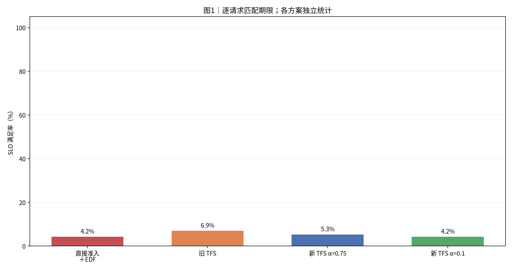
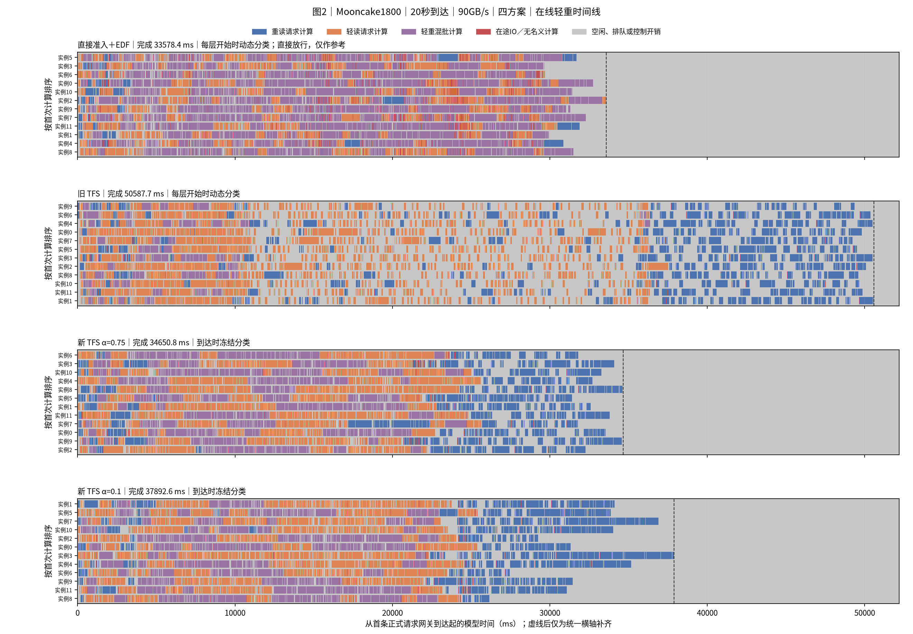
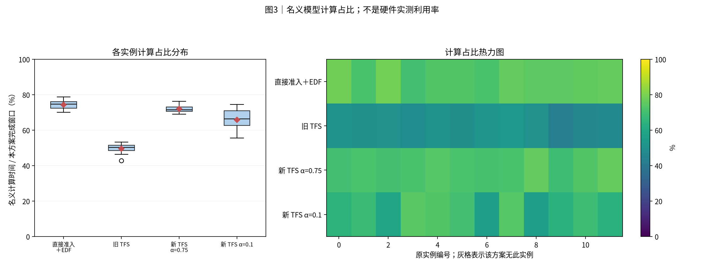
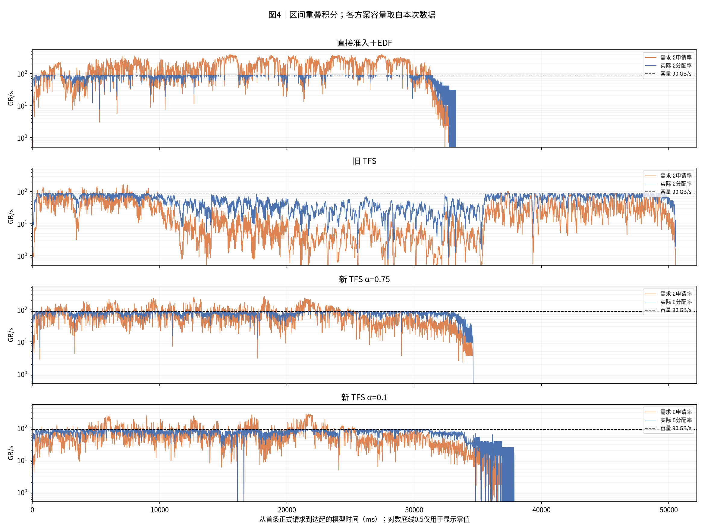
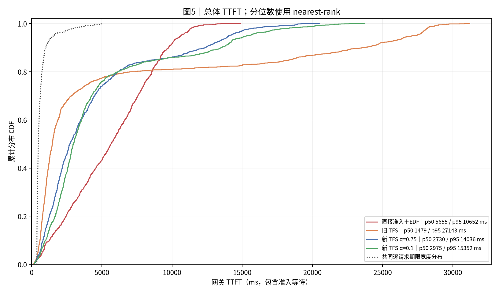
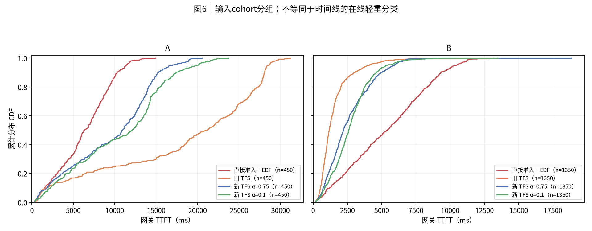
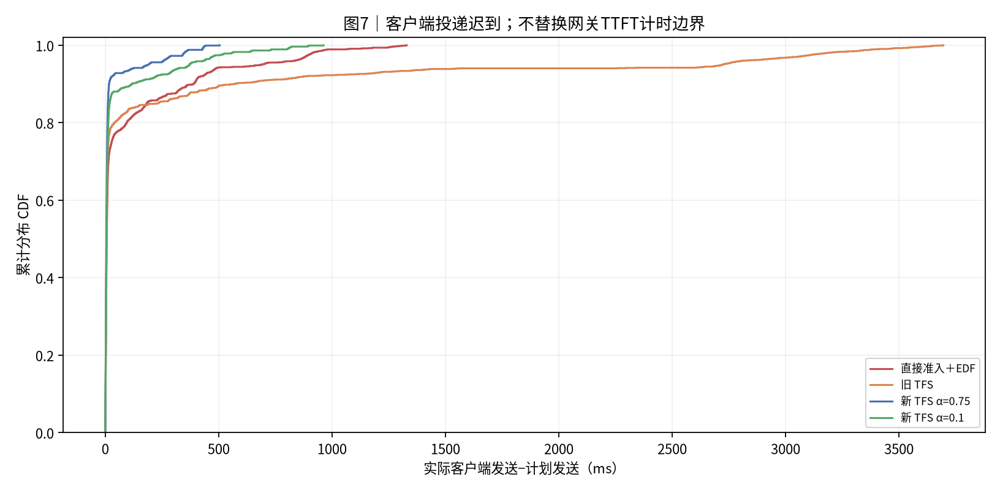

# 实验结果：Mooncake1800｜20秒到达｜90GB/s｜四方案

> 本文为选定报告的公开导出。公开范围和复现边界见第9节。[返回三规模总目录](../README.md)。

|项目|约定|
|---|---:|
|执行边界|本任务新跑本组四个方案；本报告生成阶段只读取冻结日志，不再次启动实验。2160条组按用户要求排除。|
|方案顺序|直接准入＋EDF → 旧 TFS → 新 TFS α=0.75 → 新 TFS α=0.1|
|输入种子 / 重复|每个case独立展示一个冻结运行；种子与重复见附表，未提供时不推断|
|汇总 / 轨迹|不跨case合并样本、不生成置信区间；轨迹保留全部正式请求|
|SLO / TTFT|逐请求匹配deadline；TTFT=first_token−gateway arrival，包含准入等待|
|分组|分类表和CDF使用输入cohort；时间线使用在线轻重判定|
|单位|时间秒/毫秒；容量字节；带宽GB/s=10^9 B/s|
|负载|conversation前1800条；保留相对到达间隔并压缩到20秒；各方案一次，共7200条正式请求|
|请求形状|总输入25320642 token，平均14067.0 token/请求；命中24293840 token，新增计算1026802 token；输入cohort数量{'B': 1350, 'A': 450}|
|资源与计算|12个逻辑实例；90GB/s共享池；block16；batch≤4/8192新增token；K=1；78层；prefill_time直接组合|
|命中假设|每条输入token按96%人为远端命中，向下对齐block16；不是trace原生实测命中率|
|SLO规则|arrival + 4 × 当前glm5_reference_v3逐请求参考服务时间；只输出1个token|
|参考并行布局|TP1/DP8/EP8为计算模型参考布局，不等于本次12个逻辑实例的真实GPU部署|
|版本与数据来源|DV b6aca299ec9888d25435c94013f05d73fd8fa825；交付的12个有效运行统一冻结；完整原始结果在本机WSL审计目录|
|运行补丁|冻结副本统一使用Kahan累计字节计数；只修诊断精度，读取状态和完成时刻对拍一致；原生<1B核验阈值不变|
|原始审计目录|/home/zed/.local/share/state-aware-network/audits/mooncake-scale-four-20261029-r1/1800|

## 0. 总判决

本轮1800条、20秒到达。**旧 TFS的SLO满足率最高，为6.9%**；**直接准入＋EDF完成最快，为33578.4ms**；平均TTFT最低为新 TFS α=0.75的4346.2ms。四个方案均重新运行，没有复用此前360条结果。相对直接准入＋EDF的变化如下。

|方案|完成时间变化%|平均TTFT变化%|SLO变化百分点|
|---|---:|---:|---:|
|旧 TFS|+50.7|+1.5|+2.7|
|新 TFS α=0.75|+3.2|-22.3|+1.1|
|新 TFS α=0.1|+12.8|-16.4|+0.0|

每个方案只有一次运行，不能据此宣称统计显著或稳定收益。

以上主指标使用网关计时。客户端平均TTFT最低为新 TFS α=0.75的4388.2ms；客户端口径对照见第6节。

## 1. 汇总表与 SLO 柱状图

|方案|请求数|完成ms|平均TTFT ms|p95 ms|SLO%|网关等待ms|
|---|---:|---:|---:|---:|---:|---:|
|直接准入＋EDF|1800|33578.4|5596.8|10652.4|4.2|2.3|
|旧 TFS|1800|50587.7|5679.6|27143.0|6.9|4312.0|
|新 TFS α=0.75|1800|34650.8|4346.2|14035.9|5.3|2.0|
|新 TFS α=0.1|1800|37892.6|4679.0|15351.5|4.2|2.4|

分类结果使用输入cohort：

|方案|分组|请求数|平均TTFT ms|SLO%|
|---|---:|---:|---:|---:|
|直接准入＋EDF|A|450|6268.3|7.8|
|直接准入＋EDF|B|1350|5373.0|3.0|
|旧 TFS|A|450|18121.1|4.0|
|旧 TFS|B|1350|1532.5|7.9|
|新 TFS α=0.75|A|450|9557.4|7.6|
|新 TFS α=0.75|B|1350|2609.2|4.5|
|新 TFS α=0.1|A|450|10544.0|4.4|
|新 TFS α=0.1|B|1350|2723.9|4.1|

**读法**：柱高与上表同口径。每条请求使用自身期限判断是否达标。

## 2. 各方案 full-sort-ms 执行时间线

**读法**：蓝重读、橙轻读、紫轻重混批。红色为未被名义计算覆盖的在途IO，灰色含空闲、排队和控制。动态与冻结分类分别标注；直接放行分类仅作参考。虚线右侧仅为统一横轴补齐。

## 3. 模型计算占比分布与热力图

**读法**：箱线和热力图来自同一组逐实例数据。分母是各方案从首次正式到达到末条首token的窗口。该值不是硬件实测利用率。

## 4. 存储带宽时序

**读法**：橙线为需求，蓝线为实际分配，虚线为本次容量。按时间重叠积分，不对不等长事件直接取平均。零值在CSV保留0。

|方案|平均GB/s|需求超订%|实际饱和%|
|---|---:|---:|---:|
|直接准入＋EDF|79.5|64.0|88.3|
|旧 TFS|52.7|4.9|58.6|
|新 TFS α=0.75|77.0|28.0|85.6|
|新 TFS α=0.1|70.4|22.1|78.2|

## 5. TTFT 累积分布 CDF

**读法**：经验CDF按rank/n绘制，终点为1。期限不同时，SLO必须逐请求匹配，不能由两条CDF交点推算。

**读法**：此处分组来自cohort，可能是历史A/B或业务分类，不用该标签推断在线轻重。

## 6. 机制解释与前序对照

受控变量：四个方案的请求内容、到达计划、命中量、存储容量、模型计算、原生路由扩展和冻结源码相同。旧TFS在网关准入，实例按FCFS执行，轻重分类动态更新；新TFS在Scheduler前准入，按EDF执行，到达时冻结轻重标记。两种新TFS仅等待计分α不同。未开启强制准入，也未开启四类执行反馈RPC。

α同时影响路由时的等待负载记账，不能把α差异直接解释为配额变化。新旧TFS之间还存在准入位置、分类和实例排序差异，所以总耗时差不能全部归因于RPC。在线轻重图和历史A/B分类CDF使用不同标签。

本报告四个方案使用当前b6aca29的最终答复/后台收尾机制。此前360条报告使用更早的RPC路径，本轮不把跨版本差异当作单一规模变量的效果。配额一直按首token释放。

|方案|名义计算合计s|红色在途IO合计s|灰色时间合计s|平均GB/s|实际饱和%|
|---|---:|---:|---:|---:|---:|
|直接准入＋EDF|299.792|22.541|80.608|79.46|88.3|
|旧 TFS|300.926|2.684|303.443|52.74|58.6|
|新 TFS α=0.75|299.883|5.216|110.711|77.00|85.6|
|新 TFS α=0.1|299.874|4.589|150.249|70.41|78.2|

名义计算、红色IO和灰色均为12个实例的时间合计。红色是IO并集减去名义计算，灰色还包含控制与排队；两者不能直接当成某次RPC延迟。计算占比的分母随完成窗口变化，占比变高不代表单个算子变快。

|方案|step数|平均组批条数|额度拒绝次数|实际到达窗口ms|子进程RSS峰值GiB|最小可用GiB|宿主swap峰值GiB|
|---|---:|---:|---:|---:|---:|---:|---:|
|直接准入＋EDF|507|3.560|0|22585.9|20.71|1.53|0.0002|
|旧 TFS|1318|1.366|0|35378.9|20.19|2.00|0.0076|
|新 TFS α=0.75|681|2.643|7719|20016.1|21.25|1.21|0.0078|
|新 TFS α=0.1|676|2.663|4332|20200.3|21.33|1.08|0.0083|

### 客户端口径补充

四个方案使用相同到达计划，但实际网关登记曲线并不相同。客户端在调用HTTP stream之前开始计时，因此客户端TTFT包含连接池、传输和网关之前的等待；原主表的网关TTFT不包含这段时间。辅助达标率沿用每条请求相同的期限宽度，改从客户端开始提交起算，不替换原主表口径。

|方案|客户端平均TTFT ms|客户端p95 ms|客户端同宽度SLO%|提交→网关平均ms|提交→网关最大ms|
|---|---:|---:|---:|---:|---:|
|直接准入＋EDF|5843.9|11320.1|3.83|225.2|1791.5|
|旧 TFS|8779.2|29476.2|4.56|3058.8|11747.3|
|新 TFS α=0.75|4388.2|14086.1|4.72|23.2|534.5|
|新 TFS α=0.1|4750.7|15365.3|3.89|40.6|1000.4|

[逐请求客户端计时](report_data/client_timing.csv)。这些数据尚未把提交→网关细分到连接池、HTTP解析或线程争用，不能据此指定唯一原因。

1800条旧TFS的提交→网关平均约3.06秒，最大约11.75秒；实际网关到达窗口约35.38秒，明显长于20秒计划。其网关SLO优势不能直接当作客户端端到端优势。该组客户端同宽度达标率最高为α=0.75的4.72%（85/1800），旧TFS为4.56%（82/1800）；只有一次运行，不据此判断稳定差异。

## 7. 计算模型与结论限制

计算与存储为仿真；控制面及多进程通信在CPU上实跑。prefill_time使用glm5_direct_sum_v1，启动合并比例1；目标GLM5/D950PR时间尚未用真实目标硬件定标。读取总量2668.047GB，计划窗口内平均存储输入压力为**148.2%**；单请求参考计算时间加和折算的计算输入压力为**125.7%**。这两个是输入压力，不是运行利用率。

只取原trace前N条并缩放相对时间，不代表全量分布。四种规模使用不同前缀集合，平均到达率都约90条/秒，但长度分布、计算量和读取量可以变化。严格前N截断可能拆开相同时间戳组；各组输入检查保留截断事实。

Kahan补偿求和仅作用于冻结副本的累计传输字节统计，防止TB级累计浮点误差导致诊断失败。对拍确认读取状态、速率和完成时刻保持一致；未修改工作区运行代码。带宽图的事件时间戳浮点积分误差与原生累计字节检查分别保存。

每轮单次；没有置信区间。资源表RSS是驱动所见子进程RSS加和，不含驱动自身，且共享页可能重复计数。最小可用内存和swap来自整个宿主WSL，不能据此声称某个实验进程发生了交换。若大规模组出现宿主换页或控制面拥塞，可能影响壁钟结果；不能把全部差异归因于调度策略。数据包足以重绘；完整原始日志保留在本机审计目录，未全部打入分享包。

## 8. 附表

**读法**：此图描述客户端实际发送相对计划的迟到，不是单次准入RPC耗时。

|方案|实例数|模型计算占比%|运行标识|
|---|---:|---:|---:|
|直接准入＋EDF|12|74.4|{"input": "conversation first1800", "planned_window_s": 20.0, "repeat": 0, "seed": "原trace顺序，无随机抽样", "source_commit": "b6aca299ec9888d25435c94013f05d73fd8fa825"}|
|旧 TFS|12|49.6|{"input": "conversation first1800", "planned_window_s": 20.0, "repeat": 0, "seed": "原trace顺序，无随机抽样", "source_commit": "b6aca299ec9888d25435c94013f05d73fd8fa825"}|
|新 TFS α=0.75|12|72.1|{"input": "conversation first1800", "planned_window_s": 20.0, "repeat": 0, "seed": "原trace顺序，无随机抽样", "source_commit": "b6aca299ec9888d25435c94013f05d73fd8fa825"}|
|新 TFS α=0.1|12|65.9|{"input": "conversation first1800", "planned_window_s": 20.0, "repeat": 0, "seed": "原trace顺序，无随机抽样", "source_commit": "b6aca299ec9888d25435c94013f05d73fd8fa825"}|

|方案|序列上限|token预算|存储容量GB/s|准入位置 / 规则|计算模型|
|---|---:|---:|---:|---:|---:|
|直接准入＋EDF|4|8192|90.0|gateway / dynamic|glm5_direct_sum_v1|
|旧 TFS|4|8192|90.0|gateway / dynamic|glm5_direct_sum_v1|
|新 TFS α=0.75|4|8192|90.0|scheduler / arrival|glm5_direct_sum_v1|
|新 TFS α=0.1|4|8192|90.0|scheduler / arrival|glm5_direct_sum_v1|

实际配置见[配置附表](report_data/configuration.json)。各方案的step、组批、额度及资源审计如下。

|方案|step数|平均组批条数|额度拒绝次数|实际到达窗口ms|子进程RSS峰值GiB|最小可用GiB|宿主swap峰值GiB|
|---|---:|---:|---:|---:|---:|---:|---:|
|直接准入＋EDF|507|3.560|0|22585.9|20.71|1.53|0.0002|
|旧 TFS|1318|1.366|0|35378.9|20.19|2.00|0.0076|
|新 TFS α=0.75|681|2.643|7719|20016.1|21.25|1.21|0.0078|
|新 TFS α=0.1|676|2.663|4332|20200.3|21.33|1.08|0.0083|

## 9. 公开范围与验证

本文发布于2026-10-29，导出已完成的本地报告；本次发布没有新增实验。第0—8节和第10节的指标、结论与七张图片保留原值。

公开内容包含正文、七张图片、方案汇总、分类汇总、逐实例账本、客户端计时、CDF、带宽分桶和配置。完整原始trace、逐层日志、大型dataset、完整重绘工具与ZIP留在原工作区。公开目录可以阅读报告并核对所选结果表，不能独立重跑实验或重绘完整时间线。

原实验验收摘要与完整验证文件哈希见[源验收摘要](report_data/source_validation_summary.json)。本次导出校验见[公开校验记录](report_data/validation.json)。导出校验不替代原实验验收。

公开结果表：[run_summary](report_data/run_summary.csv)、[cohort_summary](report_data/cohort_summary.csv)、[device_utilization](report_data/device_utilization.csv)、[configuration](report_data/configuration.json)、[client_timing](report_data/client_timing.csv)、[cdf](report_data/cdf.csv)、[bandwidth_bins](report_data/bandwidth_bins.csv)。

## 10. 简要解读

先比较本组的SLO、平均TTFT和完成时间。再结合时间线、带宽与组批表区分队列积压和已提交IO竞争。三个交付规模的报告采用同一配置与工具；跨规模比较还要同时检查各组输入计算量和读取量，不能只比较请求条数。
