# 全局4%计算额度：90 GB/s下的直接准入与新TFS

|项目|约定|
|---|---:|
|日期|2026-10-29|
|输入|Mooncake conversation前360条，保留input和到达节奏；不使用原output和hash推导命中|
|构造|ABC=240/90/30；ABCD=220/90/30/20；新计算总204699 token，约3.999781%|
|存储|单共享池90 GB/s，Grouped max-min，零启动延迟；每组读取539571462144 B|
|资源|12个真实vLLM实例与原生Dynamo；GLM5实际组批v2；TP1/DP8/EP8；78层流水|
|调度|各组均EDF；batch≤4，8192新token/步，block16，K=1|
|预热与重复|每组72预热排空、重置历史和正式GC；每方案一次；六组固定seed打乱串行|
|计时|网关实际到达→首token；SLO逐请求TTFT≤4×新T0|
|源码|当前DV工作树统一快照，包含未提交改动；精确文件SHA见provenance|
|边界|仅模拟模型执行和共享存储；不是Ascend实测；不运行长期decode|

## 0. 总判决

ABC：本次平均TTFT最低为 **新 TFS α=0.1**；完成最快为 **新 TFS α=0.1**；SLO最高为 **新 TFS α=0.1**。每方案仅一次，不判断稳定最优。

ABCD：本次平均TTFT最低为 **新 TFS α=1**；完成最快为 **新 TFS α=1**；SLO最高为 **新 TFS α=1**。每方案仅一次，不判断稳定最优。

## 1. 汇总表与SLO

|负载/方案|完成ms|平均TTFT ms|p95 ms|SLO %|平均batch|
|---|---:|---:|---:|---:|---:|
|ABC/直接准入 EDF|8128.0|1665.2|3637.3|13.6|2.531|
|ABC/新 TFS α=0.1|7750.6|1181.0|3546.4|33.6|1.703|
|ABC/新 TFS α=1|9001.4|1534.6|4099.1|13.6|1.962|
|ABCD/直接准入 EDF|8880.6|1471.1|3364.2|15.6|2.517|
|ABCD/新 TFS α=0.1|8056.8|1993.9|4594.9|7.8|2.306|
|ABCD/新 TFS α=1|6868.4|1254.1|3199.0|26.4|1.846|

直接准入立即转发且完整计分；两TFS在Scheduler分配slot前申请到达冻结P75配额，首token释放，无强制准入。两TFS仅waiting_factor不同。三组共用同步batch反馈与compact trace。

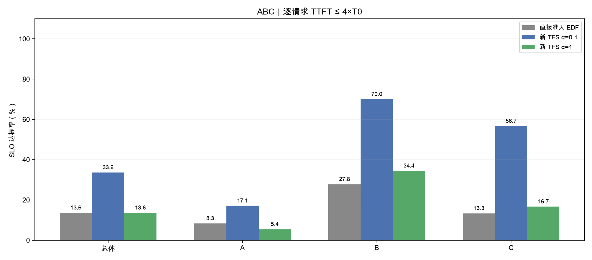

**读法**：按同一请求的新T0判断达标；类别为人工构造标签，不等同在线重读分类。

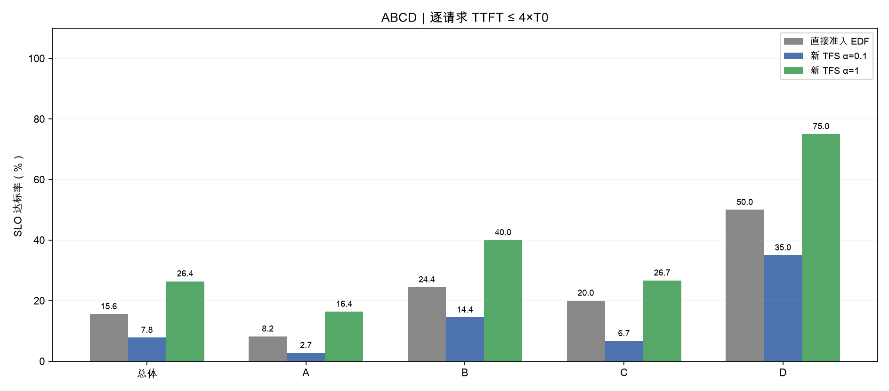

**读法**：按同一请求的新T0判断达标；类别为人工构造标签，不等同在线重读分类。

## 2. 完整执行轨迹与实际组批

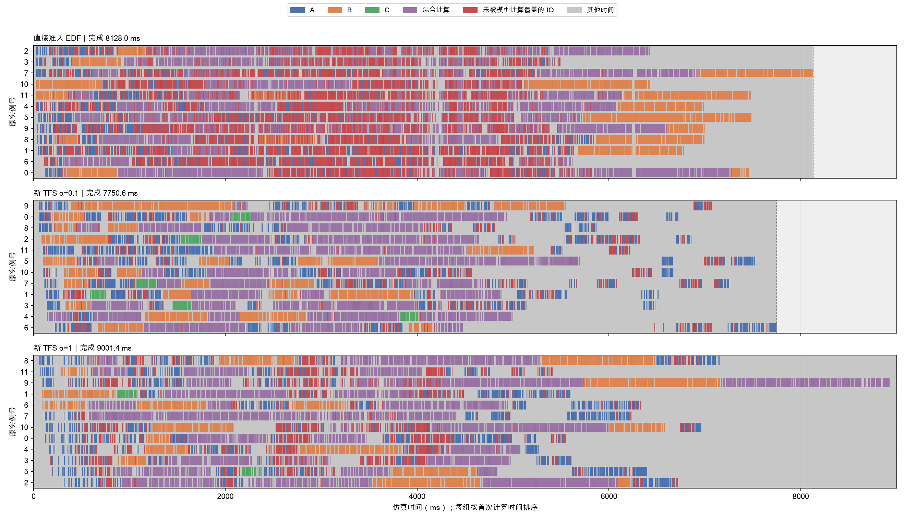

**读法**：每组12行，各自按首次计算排序。A蓝、B橙、C绿、D棕、混合紫；红为在途IO未覆盖模型计算，灰为其他时间，虚线后为补齐。

|方案|step数|batch1/2/3/4|跨step请求数|
|---|---:|---:|---:|
|直接准入 EDF|143|53/17/17/56|2|
|新 TFS α=0.1|212|133/31/26/22|1|
|新 TFS α=1|185|109/17/16/43|3|

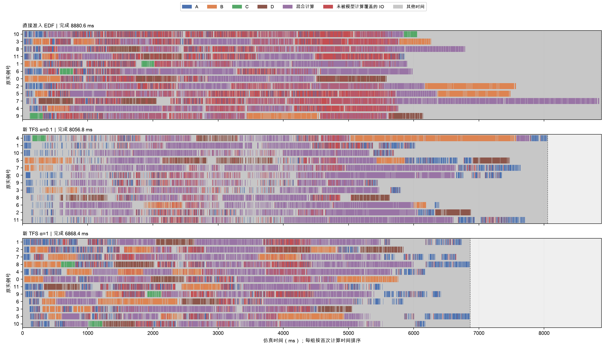

**读法**：每组12行，各自按首次计算排序。A蓝、B橙、C绿、D棕、混合紫；红为在途IO未覆盖模型计算，灰为其他时间，虚线后为补齐。

|方案|step数|batch1/2/3/4|跨step请求数|
|---|---:|---:|---:|
|直接准入 EDF|143|52/20/16/55|0|
|新 TFS α=0.1|157|65/28/15/49|2|
|新 TFS α=1|195|117/25/19/34|0|

## 3. 模型计算占比

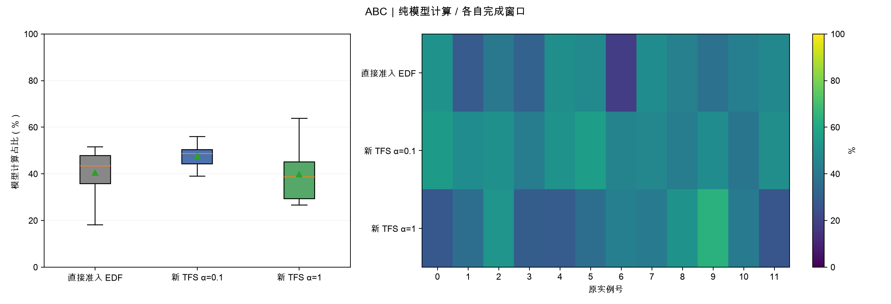

**读法**：每实例纯模型计算时间/本组实际完成窗口；不含IO、控制和sleep超时，不是硬件GPU/NPU利用率。

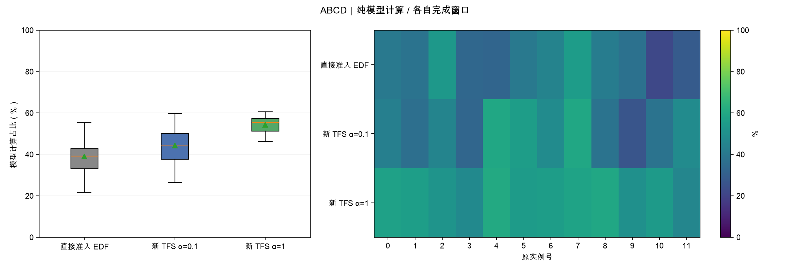

**读法**：每实例纯模型计算时间/本组实际完成窗口；不含IO、控制和sleep超时，不是硬件GPU/NPU利用率。

|负载/方案|模型计算总秒|平均模型计算占比%|实例计算量CV|
|---|---:|---:|---:|
|ABC/直接准入 EDF|39.537|40.54|0.238|
|ABC/新 TFS α=0.1|44.391|47.73|0.102|
|ABC/新 TFS α=1|43.036|39.84|0.276|
|ABCD/直接准入 EDF|41.552|38.99|0.233|
|ABCD/新 TFS α=0.1|42.832|44.30|0.227|
|ABCD/新 TFS α=1|44.731|54.27|0.081|

CV为12个实例模型计算量的总体标准差/均值。CV较低表示计算量较均衡。完成窗口变短也会提高计算占比，不能只用计算占比判断节省了多少计算。

## 4. 存储带宽时序

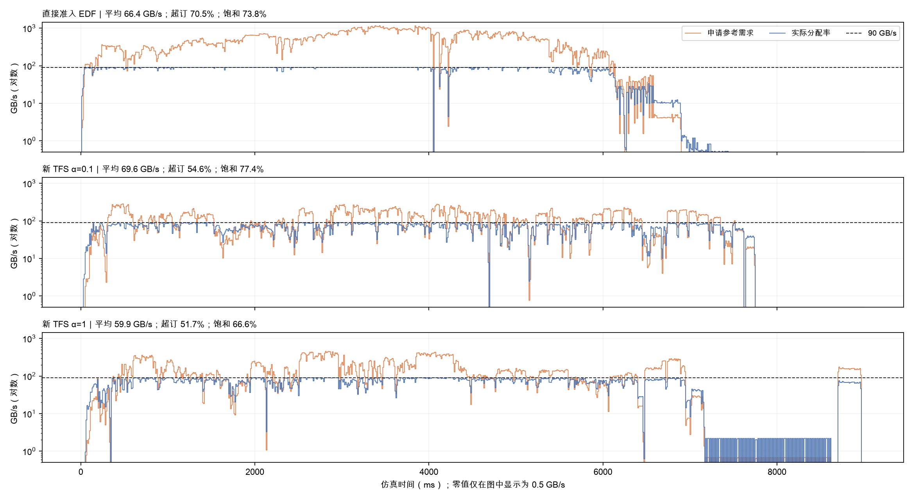

**读法**：10ms积分平均，同一负载三图共用对数纵轴。零值仅在图中显示为0.5，CSV保留零值。橙线累计已提交读取的请求参考需求，未按真实batch重新估算；蓝线为分配率，虚线90GB/s。

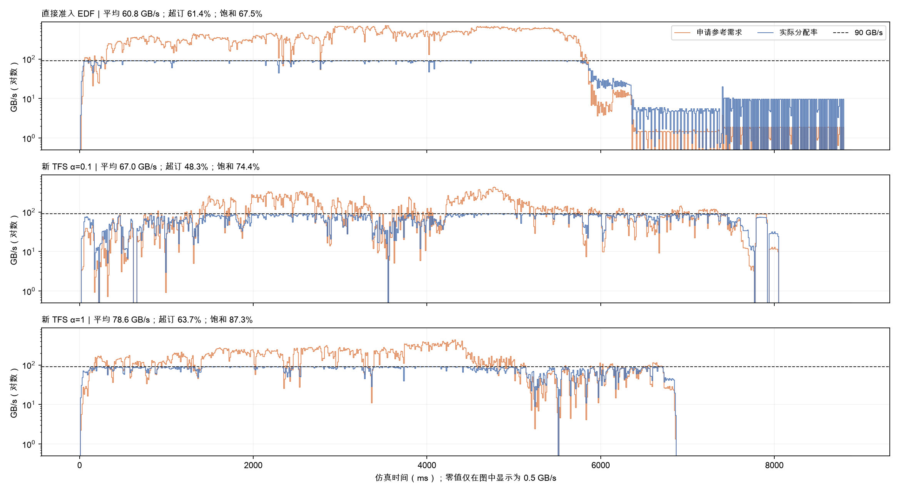

**读法**：10ms积分平均，同一负载三图共用对数纵轴。零值仅在图中显示为0.5，CSV保留零值。橙线累计已提交读取的请求参考需求，未按真实batch重新估算；蓝线为分配率，虚线90GB/s。

|负载/方案|平均GB/s|需求超订%|饱和%|无在途IO秒|
|---|---:|---:|---:|---:|
|ABC/直接准入 EDF|66.4|70.5|73.8|2.133|
|ABC/新 TFS α=0.1|69.6|54.6|77.4|1.755|
|ABC/新 TFS α=1|59.9|51.7|66.6|3.006|
|ABCD/直接准入 EDF|60.8|61.4|67.5|2.885|
|ABCD/新 TFS α=0.1|67.0|48.3|74.4|2.062|
|ABCD/新 TFS α=1|78.6|63.7|87.3|0.873|

同字节量在90GB/s下至少需要5.995238秒满带宽传输。当前工作守恒模型只要有读取就用满池带宽，无IO时段可包含计算、准入等待和控制，不能全部归为可消除损失。

## 5. 首token延迟CDF

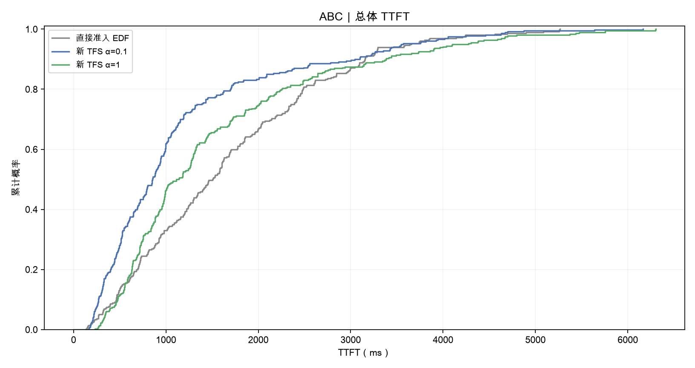

**读法**：rank/n阶梯经验CDF，终点1；p95用nearest-rank。

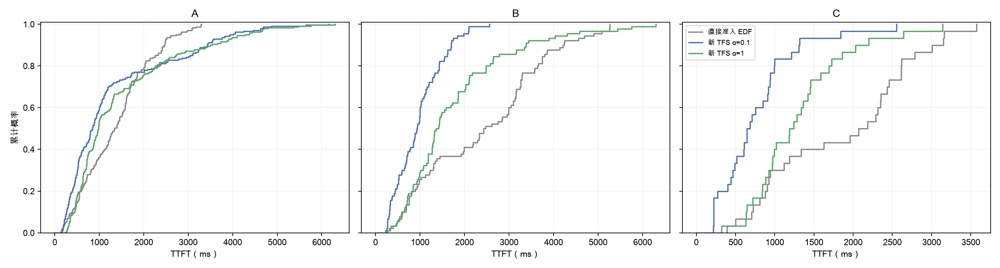

**读法**：固定人工类别成员；A/B/C/D在同一负载三方案中一致，便于检查收益和代价由哪些请求承担。

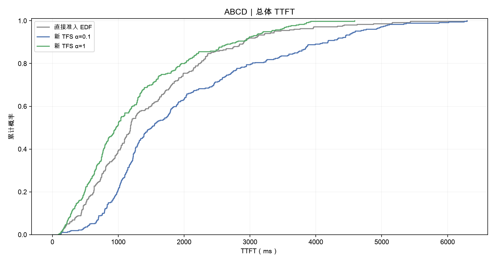

**读法**：rank/n阶梯经验CDF，终点1；p95用nearest-rank。

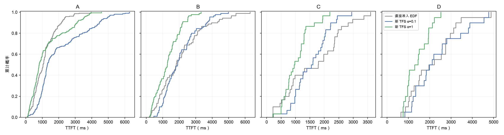

**读法**：固定人工类别成员；A/B/C/D在同一负载三方案中一致，便于检查收益和代价由哪些请求承担。

## 6. 机制解释与受控比较

ABC 新 TFS α=0.1相对直接准入：平均TTFT变化-29.08%，完成时间变化-4.64%，SLO变化+20.00个百分点。正的时间变化表示变慢。

ABC 新 TFS α=1相对直接准入：平均TTFT变化-7.84%，完成时间变化+10.75%，SLO变化+0.00个百分点。正的时间变化表示变慢。

ABCD 新 TFS α=0.1相对直接准入：平均TTFT变化+35.54%，完成时间变化-9.28%，SLO变化-7.78个百分点。正的时间变化表示变慢。

ABCD 新 TFS α=1相对直接准入：平均TTFT变化-14.75%，完成时间变化-22.66%，SLO变化+10.83个百分点。正的时间变化表示变慢。

同一负载内T0/期限一致。ABC到ABCD把最长20条A改成D，并从B调出计算额度，保持总新token/总读取量不变，但计算总时间仍可因上下文与组批变化而不同。不能把新负载与原96% case跨版本差值称为TFS优化收益。

ABC的α=0.1主要改善B/C：平均TTFT分别由2407.1/1862.9ms降到964.9/770.8ms；A只由1362.3ms降到1313.3ms。ABCD的α=1主要改善B/C/D，A平均TTFT反而由1140.8ms增至1253.2ms。各请求期限不同，因此A的平均TTFT变差可以与A的SLO达标率提高同时发生。

这些收益没有依赖更大的batch。ABC的α=0.1与ABCD的α=1都减小了batch，同时增加了模型计算总时间。ABCD的α=1把平均带宽从60.8提高到78.6GB/s，无在途IO时间从2.885缩短到0.873秒，实例计算量CV也从0.233降到0.081。这些现象支持读取与计算衔接改善的解释，但单次运行不能确定唯一原因。

ABCD的α=0.1是反例：全部完成更快，平均TTFT、p95和SLO却变差。减少尾部时间不保证每个请求更快，也不能把α=0.1当作通用最优值。

## 7. 限制

每方案一次。K=1包含HTTP、IPC、轮询和系统调度开销；全部运行使用电池供电，主机有既存swap，电源/内存记录见matrix.progress。GLM公式未用Ascend910C实机校准，采用均匀专家路由假设。缓存命中人为分配、文本合成、本地前缀缓存关闭，仅prefill-only与输出1 token。

## 8. 分类附表

### ABC

|方案/类别|数量|平均TTFT ms|p95 ms|SLO %|
|---|---:|---:|---:|---:|
|直接准入 EDF/A|240|1362.3|2725.2|8.3|
|直接准入 EDF/B|90|2407.1|4899.0|27.8|
|直接准入 EDF/C|30|1862.9|3160.9|13.3|
|新 TFS α=0.1/A|240|1313.3|3943.7|17.1|
|新 TFS α=0.1/B|90|964.9|1978.0|70.0|
|新 TFS α=0.1/C|30|770.8|1838.9|56.7|
|新 TFS α=1/A|240|1475.8|4273.8|5.4|
|新 TFS α=1/B|90|1766.8|4303.3|34.4|
|新 TFS α=1/C|30|1308.3|2642.7|16.7|

### ABCD

|方案/类别|数量|平均TTFT ms|p95 ms|SLO %|
|---|---:|---:|---:|---:|
|直接准入 EDF/A|220|1140.8|2356.2|8.2|
|直接准入 EDF/B|90|2067.7|5155.8|24.4|
|直接准入 EDF/C|30|1646.2|3367.7|20.0|
|直接准入 EDF/D|20|2157.2|3470.8|50.0|
|新 TFS α=0.1/A|220|2004.5|4936.1|2.7|
|新 TFS α=0.1/B|90|2038.9|3854.2|14.4|
|新 TFS α=0.1/C|30|1539.5|2447.7|6.7|
|新 TFS α=0.1/D|20|2355.6|4547.3|35.0|
|新 TFS α=1/A|220|1253.2|3521.9|16.4|
|新 TFS α=1/B|90|1293.9|2528.5|40.0|
|新 TFS α=1/C|30|1035.3|1942.7|26.7|
|新 TFS α=1/D|20|1412.6|2217.0|75.0|

## 9. 验证与复现

六组各360正式+72预热成功；另三次冒烟6/6/8条。原生路由/完整资源预留、预算token、字节、公式、逐层屏障、配额归零、GC恢复及进程回收由运行验收与独立提取共同检查。报告检查2160请求CDF、72份时间账本与带宽积分。

[逐运行表](report_data/run_summary.csv)、[逐请求表](report_data/requests.csv)、[分类表](report_data/class_summary.csv)、[带宽桶](report_data/bandwidth_10ms.csv)、[提取核对](report_data/extraction_checks.json)、[来源指纹](report_data/provenance.json)、[报告验证](report_data/validation.json)、[复现说明](reproduce/README.md)。

运行build_report.py可从紧凑数据重画。分享包包含本次小型运行源码快照与构造表，不含虚拟环境、原生二进制和完整原始事件。完整原始事件保留本机DV results/mooncake360_global4_90g_20261029。

## 10. 阅读顺序

先看第1节总体结果，再用第8节定位受益和受损类别，结合第2/4节检查组批、争抢与尾部。需要核实数值时查看report_data与本机原始记录。
