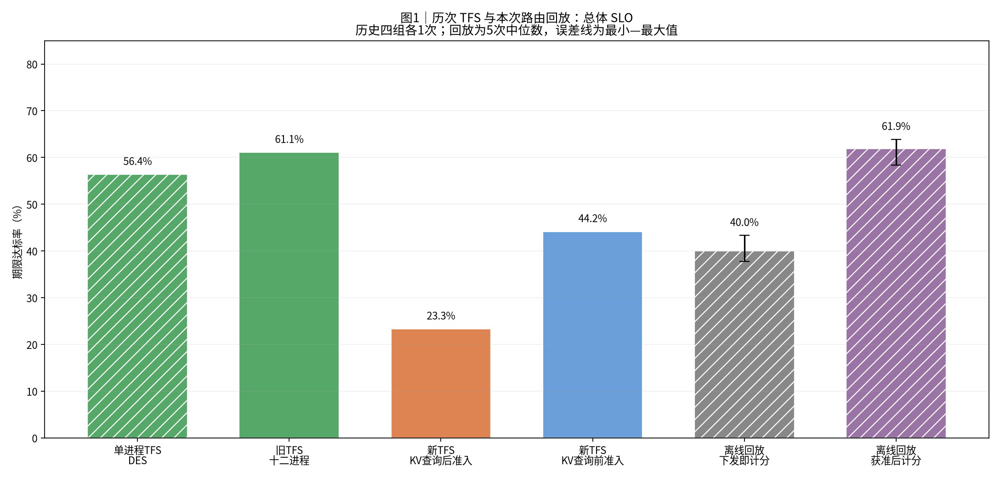
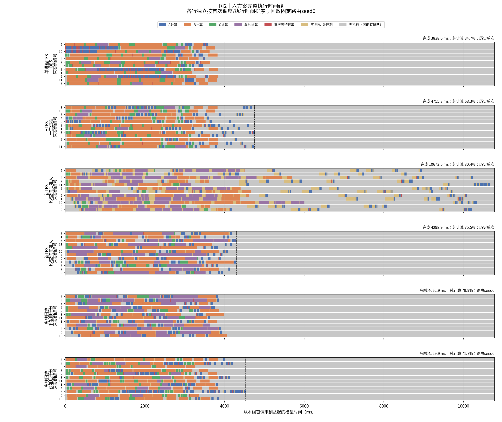
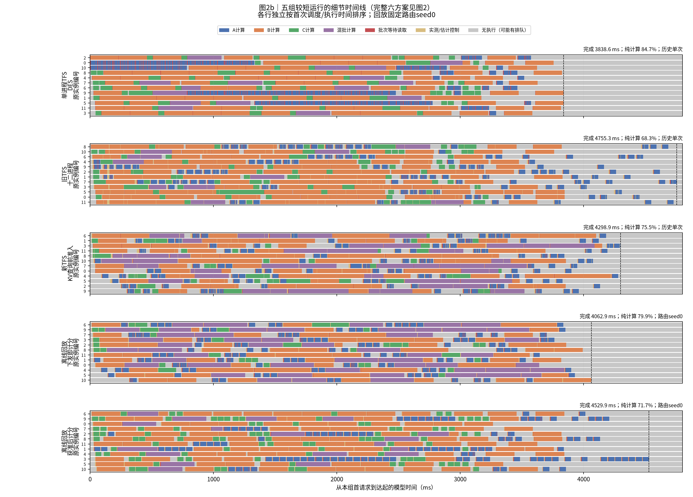
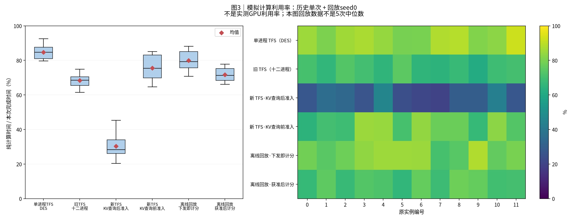
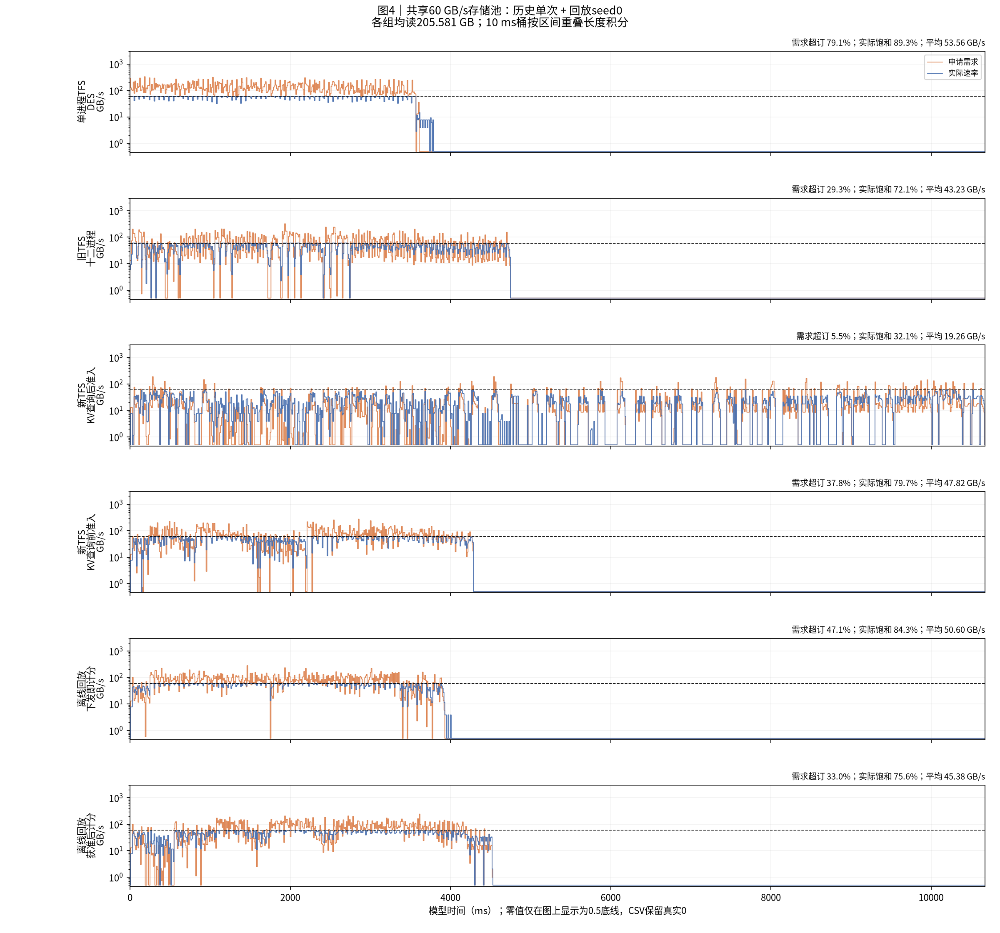
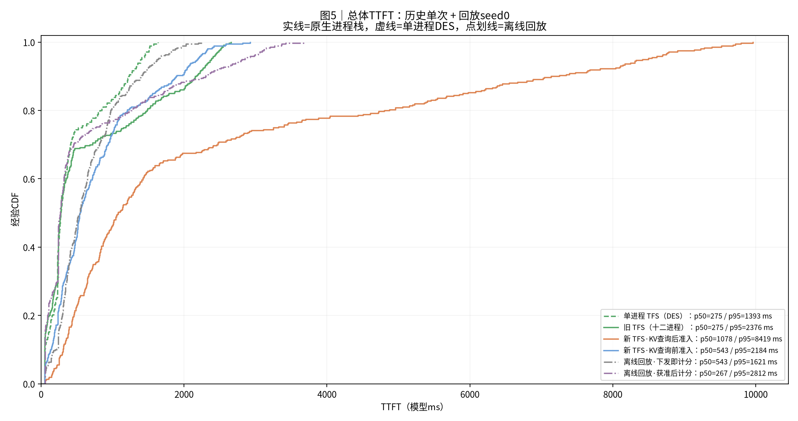
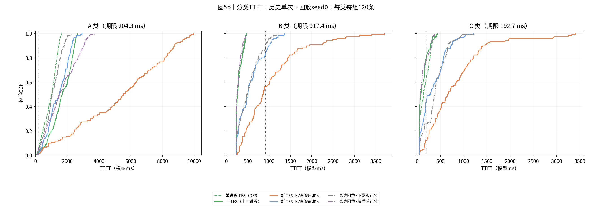

# TFS 历次实验与路由回放综合对照

| 项目 | 约定 |
|---|---|
| 日期 | 实验数据日期2026-10-26；本综合报告整理日期2026-10-27 |
| 本次操作 | 只重组已有数据、重绘图表；新增实验运行0次 |
| 五个阶段 | 单进程TFS、旧多进程TFS、新TFS查询后准入、新TFS查询前准入、本次延后计分回放；回放保留两臂，因此共六行 |
| 输入 | seed416；每次360条，A/B/C各120；同一冻结请求内容，计划到达窗口约3.612秒 |
| 请求形状 | A：h=42883/u=256；B：h=9399/u=4096；C：h=0/u=2657；只输出1 token |
| 资源 | 12个逻辑实例、共享60 GB/s、8192新token/步、最多4序列、SA八层读算及一层预取 |
| KV总量 | 每次205,581,189,120 B，约205.581 GB；同一输入内容SHA256为35e488b618a8744b420eb7a1876d4a8efeb4c7bb0d3f8def55754f9a4b918750 |
| 时间与期限 | 全文采用模型ms；原生进程栈壁钟除以K=10；TTFT包含等待；期限沿用每请求4T0 |
| 汇总口径 | 历史四组各1次；回放两臂各5次的指标中位数。只有回放SLO柱显示路由重复范围 |
| 轨迹口径 | 时间线、利用率、带宽、CDF：历史原单次 + 回放固定seed0；不把5次运行拼接成一条轨迹 |
| 执行边界 | 多进程组运行真实Dynamo/vLLM控制面，计算/KV为CPU仿真；DES和离线回放使用虚拟时间；均非GPU实测 |
| 版本与来源 | 复用两份已完成报告的冻结导出；原实验使用固定vLLM bc150f5、Dynamo b83b1d9；本公开版仅发布报告、图表与汇总；完整配置和冻结导出保留在本地 |

## 0. 总判决

**前移额度准入解决了新V1的大量重复KV查询开销；延后路由计分进一步改善BC，但会拖慢A和整批结束。单进程TFS是另一种执行形态，不能作为多进程改动的直接因果基线。**

查询后→查询前准入：原生十二进程平均TTFT从2376.8降到772.6 ms，完成时间从10673.5降到4298.9 ms。查询前版本相对旧网关TFS仍存在平均TTFT和SLO退步。

回放两臂的5次中位数：B从527.7降到280.1 ms，C从410.4降到115.1 ms；A从1434.5升到1694.6 ms，完成时间从4388.9升到4748.4 ms。这部分属于离线反事实估计。

名称核对：用户此前所说“KV加载后／前”，在两版V1代码中准确含义为**额度准入位于外部KV命中查询之后／之前**。不是等KV数据加载完成后再准入。图表统一采用“KV查询后／前准入”。

## 1. 总体与分类汇总

| 方案 | 统计口径 | 平均TTFT(ms) | p95(ms) | 完成(ms) | SLO | 纯计算占比 |
|---|---:|---:|---:|---:|---:|---:|
| 单进程 TFS（DES） | 历史单次 | 458.4 | 1392.5 | 3838.6 | 56.4% | 84.7% |
| 旧 TFS（十二进程） | 历史单次 | 685.5 | 2376.5 | 4755.3 | 61.1% | 68.3% |
| 新 TFS·KV查询后准入 | 历史单次 | 2376.8 | 8419.2 | 10673.5 | 23.3% | 30.4% |
| 新 TFS·KV查询前准入 | 历史单次 | 772.6 | 2183.8 | 4298.9 | 44.2% | 75.5% |
| 离线回放·下发即计分 | 5次路由重复中位数 | 789.1 | 2247.3 | 4388.9 | 40.0% | 74.0% |
| 离线回放·获准后计分 | 5次路由重复中位数 | 693.7 | 2875.7 | 4748.4 | 61.9% | 68.3% |

回放每项中位数可能来自不同seed；表内各列不能拼成一次运行。原生查询前运行与回放下发基线也不是同一条执行轨迹。

**读法**：前四柱为各自历史单次；后两柱为5次路由重复的中位数及最小—最大范围。范围不是置信区间，只有一个输入种子。

| 方案 | A平均(ms) | B平均(ms) | C平均(ms) | A SLO | B SLO | C SLO |
|---|---:|---:|---:|---:|---:|---:|
| 单进程 TFS（DES） | 927.7 | 289.2 | 158.3 | 5.0% | 100.0% | 64.2% |
| 旧 TFS（十二进程） | 1638.7 | 292.3 | 125.4 | 3.3% | 100.0% | 80.0% |
| 新 TFS·KV查询后准入 | 5283.1 | 1035.0 | 812.4 | 0.8% | 56.7% | 12.5% |
| 新 TFS·KV查询前准入 | 1421.2 | 555.9 | 340.7 | 1.7% | 85.0% | 45.8% |
| 离线回放·下发即计分 | 1434.5 | 527.7 | 410.4 | 3.3% | 90.0% | 25.8% |
| 离线回放·获准后计分 | 1694.6 | 280.1 | 115.1 | 5.0% | 100.0% | 83.3% |

## 2. 完整时间线与组批

**读法**：六方案使用同一横轴，覆盖最长10673.5 ms。虚线表示本组完成。短组完成后的灰色只是统一坐标的补齐，不计入该组利用率分母。

**读法**：详细展示五组在约5秒内完成的完整轨迹；仅将耗时10.67秒的查询后组留在上面的完整图中。回放两行固定seed0。灰色可能仍有等待额度或排队请求。

以下表格对应图2–图5的具体轨迹，**回放采用seed0，数值与主表中位数不同**。

| 方案 | 轨迹平均TTFT(ms) | 轨迹完成(ms) | 轨迹计算占比 | step数 | batch=1/2/3/4的step数 |
|---|---:|---:|---:|---:|---:|
| 单进程 TFS（DES） | 458.4 | 3838.6 | 84.7% | 332 | 307 / 18 / 5 / 2 |
| 旧 TFS（十二进程） | 685.5 | 4755.3 | 68.3% | 338 | 322 / 6 / 7 / 3 |
| 新 TFS·KV查询后准入 | 2376.8 | 10673.5 | 30.4% | 228 | 132 / 34 / 36 / 26 |
| 新 TFS·KV查询前准入 | 772.6 | 4298.9 | 75.5% | 271 | 200 / 34 / 26 / 11 |
| 离线回放·下发即计分 | 662.5 | 4062.9 | 79.9% | 269 | 195 / 35 / 27 / 12 |
| 离线回放·获准后计分 | 675.9 | 4529.9 | 71.7% | 336 | 314 / 16 / 6 / 0 |

金色表示原生成功调度及批内实测控制时间，或离线回放的估计控制延迟。回放将分散控制开销近似放在首层之前，因此金色色块的位置不能用于逐阶段实测比较。单进程DES不推进控制代码的虚拟耗时。批次多不等于耗时一定更少，混批也会延长轻请求的返回时间。

## 3. 模拟计算利用率

**读法**：各实例纯计算时间除以各自运行的完成时间。IO、调度和空闲不计为计算。原实例编号固定；回放取seed0，主表回放利用率则取5次中位数。

单进程DES计算占比84.7%，原生查询后版本30.4%，查询前版本75.5%。回放中BC更快不意味着全窗口计算占比上升：A尾部延长会拉低该指标。这些数值不等于宿主CPU或真实GPU利用率。

## 4. 共享存储带宽

**读法**：同一横轴、同一60 GB/s容量。各组读取量完全相同。非等长区间按重叠长度积分到10 ms桶；零值只在对数图显示为0.5底线。

| 方案（图中单次） | 平均GB/s | 需求超订时间比例 | 实际≥90%容量时间比例 |
|---|---:|---:|---:|
| 单进程 TFS（DES） | 53.56 | 79.1% | 89.3% |
| 旧 TFS（十二进程） | 43.23 | 29.3% | 72.1% |
| 新 TFS·KV查询后准入 | 19.26 | 5.5% | 32.1% |
| 新 TFS·KV查询前准入 | 47.82 | 37.8% | 79.7% |
| 离线回放·下发即计分 | 50.60 | 47.1% | 84.3% |
| 离线回放·获准后计分 | 45.38 | 33.0% | 75.6% |

需求超订按申请速率合计大于60 GB/s计，实际饱和按实际速率至少54 GB/s计，分母为各自完成窗口。当前冻结分配实现会在总申请低于容量时均分剩余带宽，所以申请值q不是硬上限；蓝色实际曲线可能高于橙色申请曲线。所有图中实际速率均受物理共享容量约束。

## 5. 总体与分类 TTFT 分布

**读法**：实线为原生进程栈，虚线为单进程DES，点划线为离线回放。每条曲线对应360个实际保存的请求结果；回放为seed0，不是5次混合CDF。

**读法**：每类每组120条，竖直点线为对应画像期限。A尾部与BC改善需要分开看。CDF采用rank/n，p50/p95使用线性插值。

## 6. 阶段差异与机制解释

| 方案 | 准入位置 | 重读分类 | 计入路由负载 | 执行/反馈 |
|---|---|---|---|---|
| 单进程TFS | 中央准入后才路由 | 动态阈值 | 实际下发时 | 虚拟时间，控制调用不耗模型时间 |
| 旧多进程TFS | 网关准入后才路由 | 动态阈值 | 实际下发时 | 真实HTTP/进程通信与异步反馈 |
| 新TFS查询后 | 先路由，Scheduler先查KV再申请额度 | 到达时冻结 | 下发时 | full后后续轮可再次查KV |
| 新TFS查询前 | 先路由，Scheduler先申请额度再查KV | 到达时冻结 | 下发时 | full时跳过KV查询 |
| 回放下发计分 | 仿照查询前准入 | 同一份冻结hint | 下发时 | 模拟队列/批次/存储/反馈 |
| 回放获准计分 | 仿照查询前准入 | 同一份冻结hint | heavy获准时；轻请求下发时 | 与配对基线使用相同模型 |

**查询前／后V1的直接对照最明确。** 两版配置与hint保持一致。查询后V1在额度满时仍可能重复查询KV；前移后每请求只查询一次。旧报告的查询数为4663→360，平均查询壁钟约148.92→13.58 ms。额度RPC均值0.224 ms是壁钟；不能把这个单次调用时延直接解释为BC全部排队时间。

**旧网关→新V1还改变了请求在哪等待和路由记账。** 新V1先把A送入实例并登记负载，等待额度的A也会抬高分数。另一个差异是动态分类改为到达时冻结：初始B r00000在新V1被标为heavy并持额，旧网关后来可不再将其计为重请求。因此它不是“只多一次查询”的实验。

**延后计分回放检验了路由负载的这部分影响。** seed0中，BC选到忙实例且别处有空闲实例的次数从132降到7。但未获准的A也从分数里消失，单实例累计接收A最多从13升到36条。A固定在本地队列，不能自动迁移，尾部因而可能延长。全5对中BC平均时延都改善，A和完成时间都恶化。

## 7. 可比范围、模型与限制

本报告统一展示同一请求内容、12实例、60 GB/s和相同SA计算公式，但没有把执行形态混同为一种测量。DES用计划到达，原生用实际网关登记，回放沿用查询前运行的实测入口时间。

| 方案 | 首末到达跨度(ms) | 到达来源 |
|---|---:|---:|
| 单进程 TFS（DES） | 3609.0 | 计划到达 |
| 旧 TFS（十二进程） | 3606.8 | 实际网关登记到达 |
| 新 TFS·KV查询后准入 | 3605.5 | 实际网关登记到达 |
| 新 TFS·KV查询前准入 | 3603.3 | 实际网关登记到达 |
| 离线回放·下发即计分 | 3603.3 | 冻结自查询前运行的实测到达 |
| 离线回放·获准后计分 | 3603.3 | 冻结自查询前运行的实测到达 |

主表历史数据各1次，不能给历史结果补造误差线。回放5个seed仅改变同分选择优先序，不是5条独立输入trace。原生Dynamo同分选择与回放共同哈希优先序不同，实际路由和组批也会不同。

回放固定原路由的校准如下。均值和完成时间接近原结果，只能支持此负载上的近似，不保证真实部署收益。

| 校准指标 | 原查询前运行 | 固定原路由回放 | 相对误差 |
|---|---:|---:|---:|
| all平均TTFT(ms) | 772.6 | 761.6 | -1.4% |
| A平均TTFT(ms) | 1421.2 | 1414.5 | -0.5% |
| B平均TTFT(ms) | 555.9 | 540.8 | -2.7% |
| C平均TTFT(ms) | 340.7 | 329.3 | -3.3% |
| 完成时间(ms) | 4298.9 | 4450.0 | +3.5% |

计算和KV操作均为仿真。原生组包含真实控制面的HTTP、进程通信与唤醒；回放使用从旧日志取得的控制/反馈延迟近似，省略CPU争用等反馈。回放既有校准与检查记录随包保存，本次没有重新跑实验或修改运行代码。

## 8. 回放配对结果附表

以下只比较本次回放内部两臂，不与任一历史单次直接相减当作因果收益。

| 路由seed | 总体平均TTFT下降 | 完成时间增加 | 总体SLO变化 |
|---|---:|---:|---:|
| 0 | -2.0% | +11.5% | +21.67个百分点 |
| 1 | +8.2% | +5.7% | +24.17个百分点 |
| 2 | +12.1% | +11.2% | +23.33个百分点 |
| 3 | +8.3% | +4.9% | +19.72个百分点 |
| 4 | +11.3% | +1.7% | +20.56个百分点 |

平均TTFT逐次配对降幅中位数8.3%，与主表两臂中位数之比下降12.1%是两种统计口径。seed0总体均值反而增加2.0%。控制延迟0倍/2倍的已有敏感性汇总见[敏感性CSV](source_exports/replay/sensitivity.csv)，本次未重跑。

## 9. 公开范围与验证

本公开版复用两份既有报告，没有重跑实验。公开正文、七张PNG及汇总指标。逐请求记录、事件、存储区间、原始trace、日志、完整分享ZIP与运行环境均未公开。

本地完整报告已核对六组各360条请求的TTFT、SLO与分类计数，核对计算时间账本、24组CDF、带宽积分和五次回放中位数。存储积分误差小于1 B；七张PNG均已逐张查看。

- [汇总CSV](report_data/summary.csv)、[完整分类汇总](report_data/summary.json)、[回放逐次汇总](report_data/replay_repeats.csv)
- [逐实例计算占比](report_data/utilization.csv)、[带宽积分检查](report_data/bandwidth_validation.json)
- [配对结果](source_exports/replay/paired_changes.csv)、[原路由校准](source_exports/replay/calibration.csv)、[机制汇总](source_exports/replay/mechanism.json)
- [公开来源说明](report_data/sources.json)、[公开文件校验清单](report_data/validation.json)

公开数据足以核对报告汇总，但不足以独立重跑实验或重绘全部时间线和CDF。完整绘图数据和脚本保留在本地。公开推送只包含本报告的独立导出，不包含私有工作区历史或运行代码。

## 10. 简要解读

先看总览表，再看图2b的五组短运行。查询后版本为何慢，用完整图2和查询次数解释；BC为何受计分影响，用分类CDF及回放配对表解释。单进程TFS提供较少控制开销的参考，回放提供策略取舍的估计，两者都不能替代真实十二进程改动后的复测。
