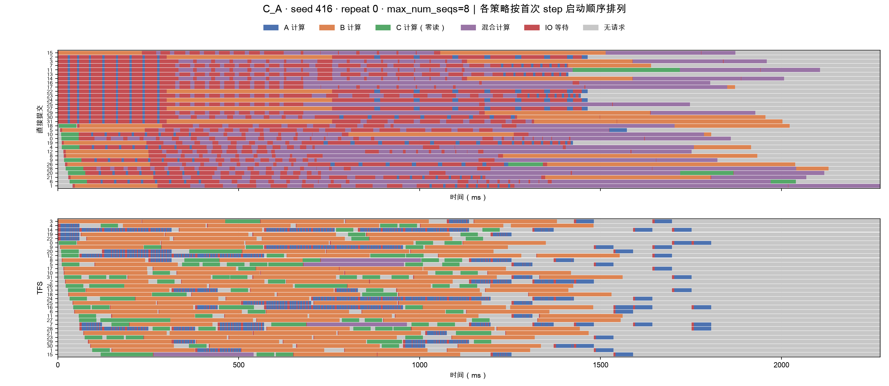
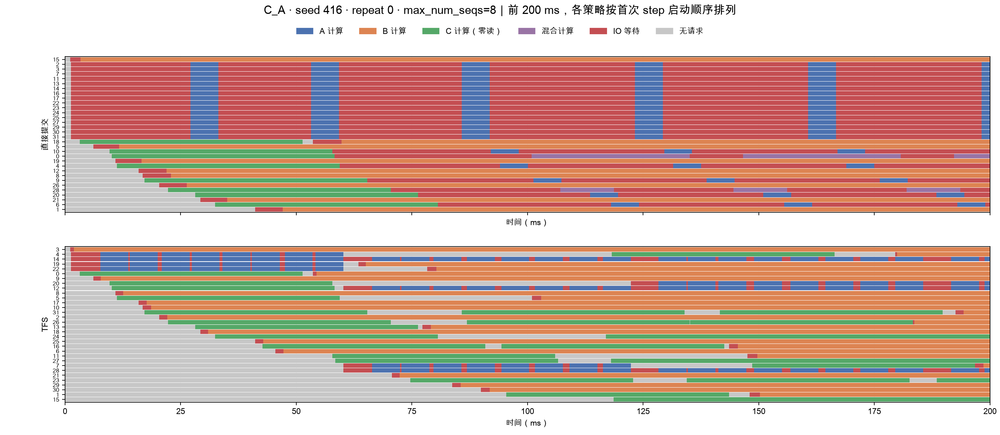
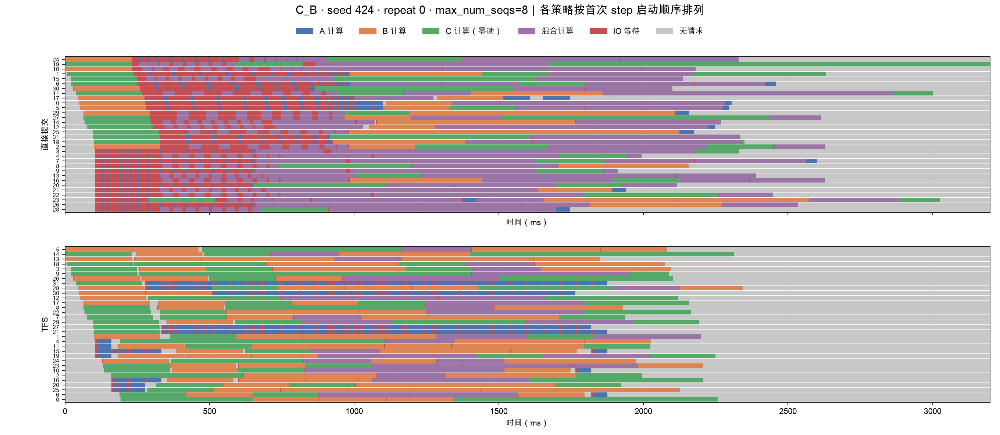
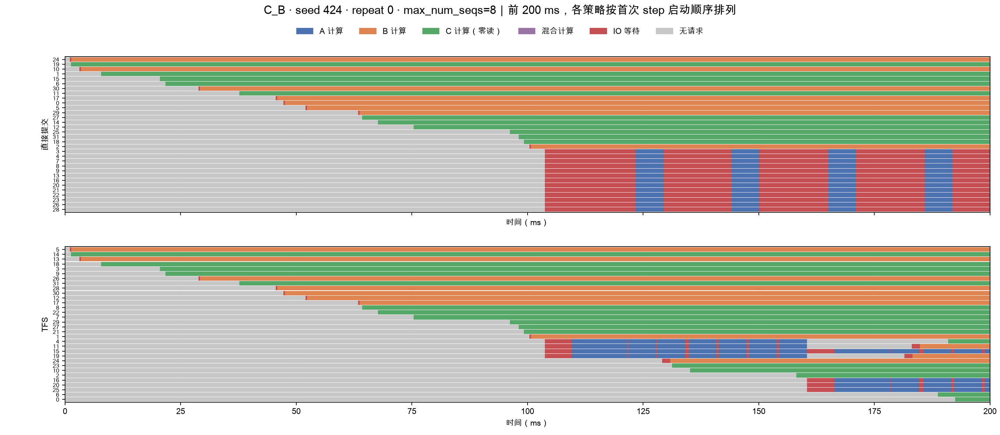

# SA-E26f 执行时间线：混合计算紫色版

使用 2026-10-19 已归档的原始事件重新绘图。没有重跑仿真，没有修改输入或调度算法。

- 蓝：A 计算；橙：B 计算；绿：C 计算（零读）；紫：混合类别计算；红：IO 等待；灰：该 worker 无请求。
- 同一 step 包含两个或更多类别时，整个计算区间显示紫色。相同类别的多请求批次仍显示类别颜色。
- 红色只表示当前执行 step 等待本层读取。后台预取与计算重叠时仍显示计算色。
- 灰色按 worker 口径统计。中央准入队列可能仍有请求，因此灰色不代表系统没有请求。
- 每个 step 包含 8 层。色块数量不等于请求数或批次数。单类多请求批次仍显示该类颜色。
- 全部横轴使用 ms。完整图与放大图均按首次 step 开始时间从上到下排列；同刻按 worker 编号排列。左侧保留原 worker 编号。每个策略独立排序，不能按行比较相同 worker。
- 每对策略共用时间轴，较早结束策略的末尾补灰。排序只改变展示位置，不改变真实路由和执行时间。

## C_A：完整时间线

三类各 120 条，共 360 条；seed=416，repeat=0，每个 step 最多 8 请求。

## C_A：启动阶段放大

仅显示前 200 ms。每个策略独立按首次 step 开始时间从上到下排序，左侧数字为原 worker 编号。此图只用于观察启动先后，不用于按行比较同一 worker。

## C_B：完整时间线

三类各 120 条，共 360 条；seed=424，repeat=0，每个 step 最多 8 请求。

## C_B：启动阶段放大

## 原始计数与时间占比

占比来自各策略自身运行期间的 32 个 worker 时间总和；不包含完整图中为统一横轴而补出的末尾灰色。

| 工况 | 策略 | step 数 | 多请求 step | 计算时间占比 | IO 等待占比 | 无请求占比 |
|---|---|---:|---:|---:|---:|---:|
| C_A | 直接提交 | 176 | 123（69.9%） | 53.1% | 26.7% | 20.1% |
| C_A | TFS | 355 | 5（1.4%） | 67.5% | 2.9% | 29.6% |
| C_B | 直接提交 | 255 | 186（72.9%） | 59.0% | 12.0% | 29.1% |
| C_B | TFS | 339 | 83（24.5%） | 80.9% | 2.0% | 17.1% |

绘图前，逐 worker 核对计算、IO 等待、无请求三项时长与原 report.json 一致，误差小于 1e-9 秒，并检查 step 不重叠。所有 4 次运行、128 个 worker 均通过。

数据：`dynamo_vllm_cpu_sim/results/sa_alignment_summary_20261019/selected_runs/` 下的四份 `events.jsonl.gz` 和 `report.json`。

复现：在项目根目录执行 `data/dynamo_vllm_simulation/dynamo_vllm_cpu_sim/.venv/bin/python note/tfs_dv/figure/generate_figures.py`。
