# 多级速率 TFS 对照（2026-10-20）

| 项目 | 约定 |
|---|---|
| 原始数据 | 本次新运行24次，不复用旧报告数值 |
| 负载 | 每份A/B/C各120条，共360条；C_A种子416/417/418，C_B种子424 |
| 到达率 | 每类98、147、196条/秒；A仍每簇16条，B/C逐条泊松到达；总名义到达率294、441、588条/秒 |
| 受控变量 | 同种子只改lam_each；到达时间按倍率压缩，形状/T0/期限宽度不变；deadline=新arrival+4T0 |
| 资源 | 32独立vLLM调度实例/模拟计算槽位；8层；120GB/s；8192 token/step；max_num_seqs=8 |
| 策略 | immediate直接提交、tfs请求级准入；真实Dynamo原生选路，逐层读算仿真 |
| 重复与汇总 | 各输入×各到达率×各策略只跑一次；C_A取三个输入种子中位数，C_B为单次；指标独立取中位数 |
| 固定轨迹 | C_A固定seed416，C_B固定seed424，展示全部三档与两种策略，不按成绩选图 |
| TTFT与SLO | TTFT从arrival到首token，包含中央等待；逐请求以TTFT≤4T0判断达标 |
| 配额 | 原P75与120GB/s参考带宽；到首token释放；aging关闭、反馈无延迟 |
| 来源 | SA提交3cd826961bb53b05d09eb7f6e6949e4222230605；运行实现SHA见manifest.json |

## 0. 总判决

以下是本轮实际结果。提高到达率同时改变队列、路由和组批，不能把所有变化归因于batch。

- **C_A，TFS 1→2倍**：平均batch 1.094→1.480；空闲 31.5%→32.2%；平均TTFT 307.7→565.6ms；总SLO 66.4%→43.9%。
- **C_B，TFS 1→2倍**：平均batch 1.246→1.535；空闲 16.4%→13.1%；平均TTFT 473.6→863.8ms；总SLO 70.3%→41.9%。
- **分类取舍**：C_B、2倍到达率，A平均TTFT直接提交 940.9ms、TFS 1023.0ms；不能将总体时延改善表述为每类都改善。
- **保留反例**：C_A seed417、1倍到达率，直接提交SLO 66.9%，TFS 66.4%；总体中位数优势不代表每个seed都提高达标率。

## 1. 汇总表与SLO柱状图

### C_A

| 倍率 | 策略 | 总SLO | A/B/C SLO | 平均TTFT(ms) | 中央等待(ms) | makespan(ms) |
|---|---|---:|---:|---:|---:|---:|
| 1 | 直接提交 | 37.2% | 4.2%/88.3%/19.2% | 566.9 | 0.0 | 2596.0 |
| 1 | TFS | 66.4% | 13.3%/100.0%/81.7% | 307.7 | 133.1 | 1924.7 |
| 1.5 | 直接提交 | 24.7% | 0.0%/61.7%/12.5% | 772.3 | 0.0 | 2201.9 |
| 1.5 | TFS | 48.3% | 10.0%/100.0%/39.2% | 486.4 | 184.7 | 1854.0 |
| 2 | 直接提交 | 19.4% | 0.0%/45.0%/13.3% | 881.8 | 0.0 | 2207.2 |
| 2 | TFS | 43.9% | 9.2%/99.2%/28.3% | 565.6 | 224.6 | 1859.1 |

### C_B

| 倍率 | 策略 | 总SLO | A/B/C SLO | 平均TTFT(ms) | 中央等待(ms) | makespan(ms) |
|---|---|---:|---:|---:|---:|---:|
| 1 | 直接提交 | 42.2% | 15.8%/54.2%/56.7% | 815.7 | 0.0 | 3213.9 |
| 1 | TFS | 70.3% | 13.3%/97.5%/100.0% | 473.6 | 135.7 | 2322.6 |
| 1.5 | 直接提交 | 26.4% | 10.8%/32.5%/35.8% | 1055.7 | 0.0 | 3709.8 |
| 1.5 | TFS | 49.2% | 10.0%/68.3%/69.2% | 717.8 | 238.2 | 2188.1 |
| 2 | 直接提交 | 23.1% | 10.8%/29.2%/29.2% | 1126.3 | 0.0 | 3672.3 |
| 2 | TFS | 41.9% | 10.0%/56.7%/59.2% | 863.8 | 317.2 | 2213.2 |

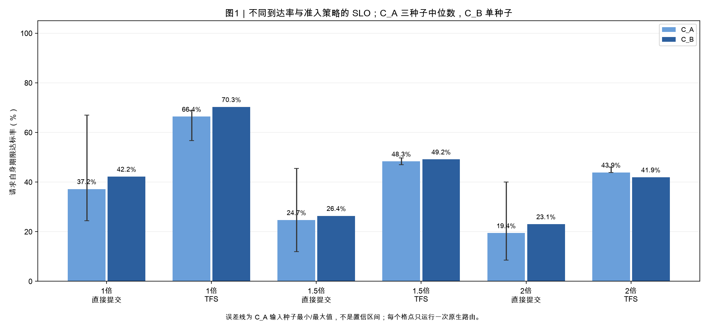

**读法**：C_A为三个输入种子中位数，误差线为种子范围；C_B只有一个输入种子。分类中位数不能加权还原总中位数。原生路由平局未固定，同一倍率两臂的差异包含路由变化。

## 2. 完整执行时间线与真实组批

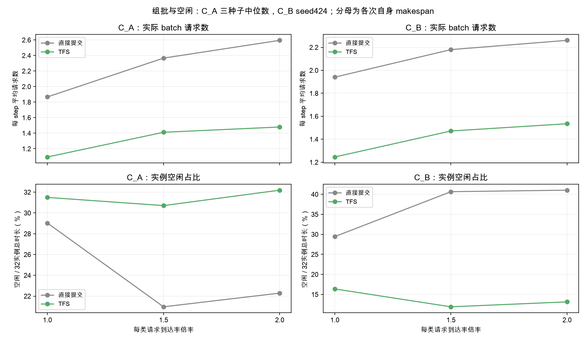

**读法**：请求数增加与token数增加不等价。每档仍为360请求，倍率改变的是输入速度。空闲分母为自身makespan，不含为统一横轴补出的末尾灰色。

| 工况 | 倍率 | 策略 | 平均batch | 多请求step | 平均token/step |
|---|---:|---|---:|---:|---:|
| C_A | 1 | 直接提交 | 1.867 | 48.1% | 4005.1 |
| C_A | 1 | TFS | 1.094 | 6.9% | 2541.0 |
| C_A | 1.5 | 直接提交 | 2.366 | 65.7% | 4890.0 |
| C_A | 1.5 | TFS | 1.412 | 24.2% | 3036.4 |
| C_A | 2 | 直接提交 | 2.595 | 68.1% | 5160.0 |
| C_A | 2 | TFS | 1.480 | 26.8% | 3126.7 |
| C_B | 1 | 直接提交 | 1.940 | 73.4% | 5934.3 |
| C_B | 1 | TFS | 1.246 | 24.6% | 4424.4 |
| C_B | 1.5 | 直接提交 | 2.180 | 82.8% | 6418.2 |
| C_B | 1.5 | TFS | 1.472 | 39.4% | 4673.2 |
| C_B | 2 | 直接提交 | 2.261 | 81.0% | 6617.0 |
| C_B | 2 | TFS | 1.535 | 44.9% | 4762.5 |

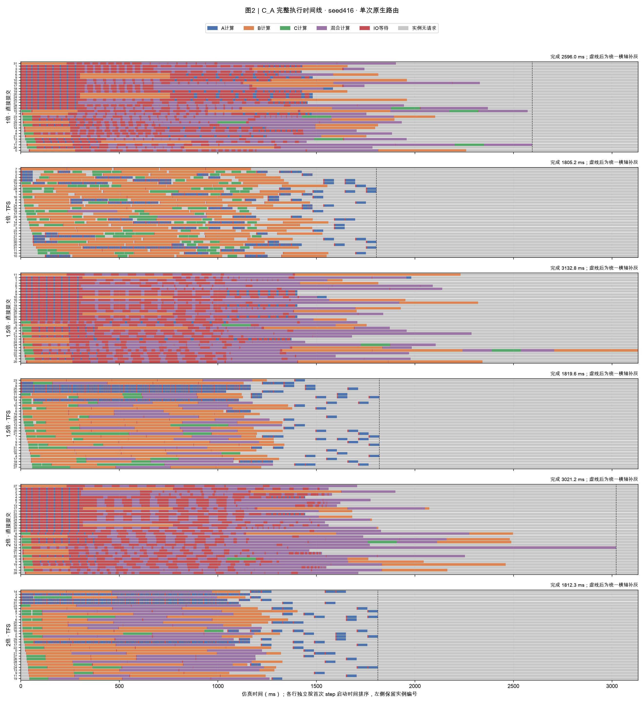

**读法**：固定seed416；每个面板独立按实例首次启动排序。蓝/橙/绿是A/B/C计算，紫色是混批，红色是当前step等待本层读取，灰色为实例无请求。竖虚线后全部请求已完成，为共享横轴补灰。预取与计算重叠时显示计算色。

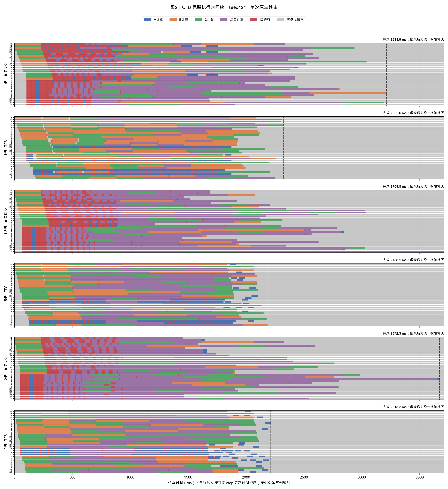

**读法**：固定seed424；每个面板独立按实例首次启动排序。蓝/橙/绿是A/B/C计算，紫色是混批，红色是当前step等待本层读取，灰色为实例无请求。竖虚线后全部请求已完成，为共享横轴补灰。预取与计算重叠时显示计算色。

## 3. 模拟计算利用率与空闲

| 工况 | 倍率 | 策略 | 计算 | IO等待 | 空闲 |
|---|---:|---|---:|---:|---:|
| C_A | 1 | 直接提交 | 46.5% | 24.5% | 29.0% |
| C_A | 1 | TFS | 63.3% | 3.5% | 31.5% |
| C_A | 1.5 | 直接提交 | 54.8% | 24.2% | 21.0% |
| C_A | 1.5 | TFS | 65.7% | 3.6% | 30.7% |
| C_A | 2 | 直接提交 | 54.6% | 23.1% | 22.3% |
| C_A | 2 | TFS | 65.5% | 2.3% | 32.2% |
| C_B | 1 | 直接提交 | 58.7% | 11.9% | 29.4% |
| C_B | 1 | TFS | 81.6% | 2.0% | 16.4% |
| C_B | 1.5 | 直接提交 | 50.8% | 8.6% | 40.7% |
| C_B | 1.5 | TFS | 86.6% | 1.5% | 11.9% |
| C_B | 2 | 直接提交 | 51.3% | 7.7% | 41.0% |
| C_B | 2 | TFS | 85.6% | 1.3% | 13.1% |

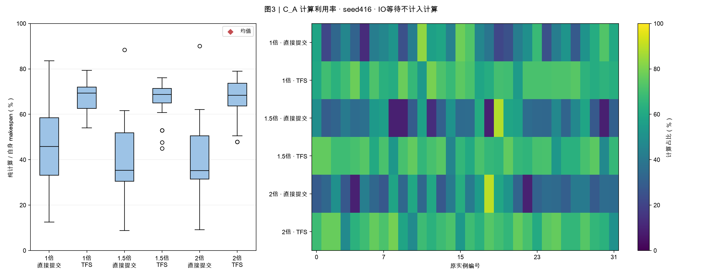

**读法**：固定seed416，纯计算时间除以该次makespan；箱线与热图来自同一组32实例数据。并非硬件实测利用率。

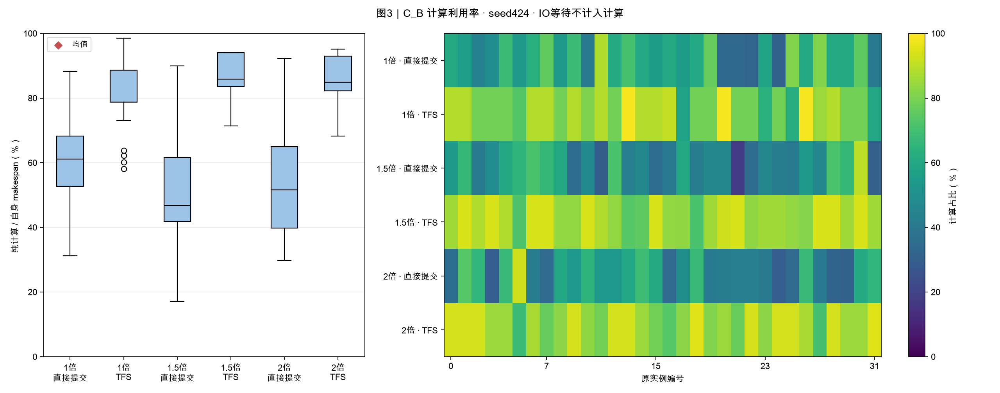

**读法**：固定seed424，纯计算时间除以该次makespan；箱线与热图来自同一组32实例数据。并非硬件实测利用率。

## 4. 存储带宽时序

| 工况 | 倍率 | 策略 | 平均实际GB/s | 实际≥108GB/s占比 | 需求超订占比 |
|---|---:|---|---:|---:|---:|
| C_A | 1 | 直接提交 | 79.2 | 66.0% | 57.3% |
| C_A | 1 | TFS | 106.8 | 89.0% | 63.5% |
| C_A | 1.5 | 直接提交 | 93.4 | 77.8% | 74.1% |
| C_A | 1.5 | TFS | 110.9 | 92.4% | 59.2% |
| C_A | 2 | 直接提交 | 93.1 | 77.6% | 69.3% |
| C_A | 2 | TFS | 110.6 | 92.2% | 54.8% |
| C_B | 1 | 直接提交 | 64.0 | 53.3% | 33.3% |
| C_B | 1 | TFS | 88.5 | 73.8% | 64.8% |
| C_B | 1.5 | 直接提交 | 55.4 | 46.2% | 25.6% |
| C_B | 1.5 | TFS | 94.0 | 78.3% | 45.5% |
| C_B | 2 | 直接提交 | 56.0 | 46.7% | 26.6% |
| C_B | 2 | TFS | 92.9 | 77.4% | 38.1% |

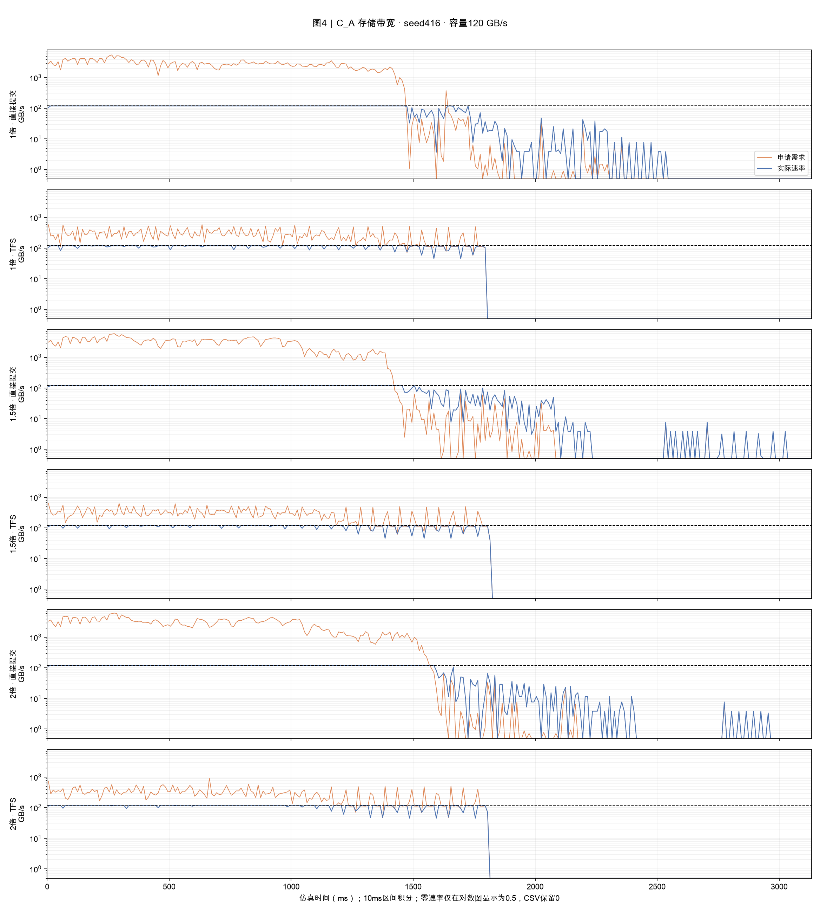

**读法**：固定seed416；10ms桶按真实区间求交积分，橙色申请、蓝色实际、虚线120GB/s；对数图把0显示在0.5底线，CSV保留0。所有格读取总量相同；各策略全程平均带宽分母不同。申请率不是物理限速，也不是TFS配额计数。

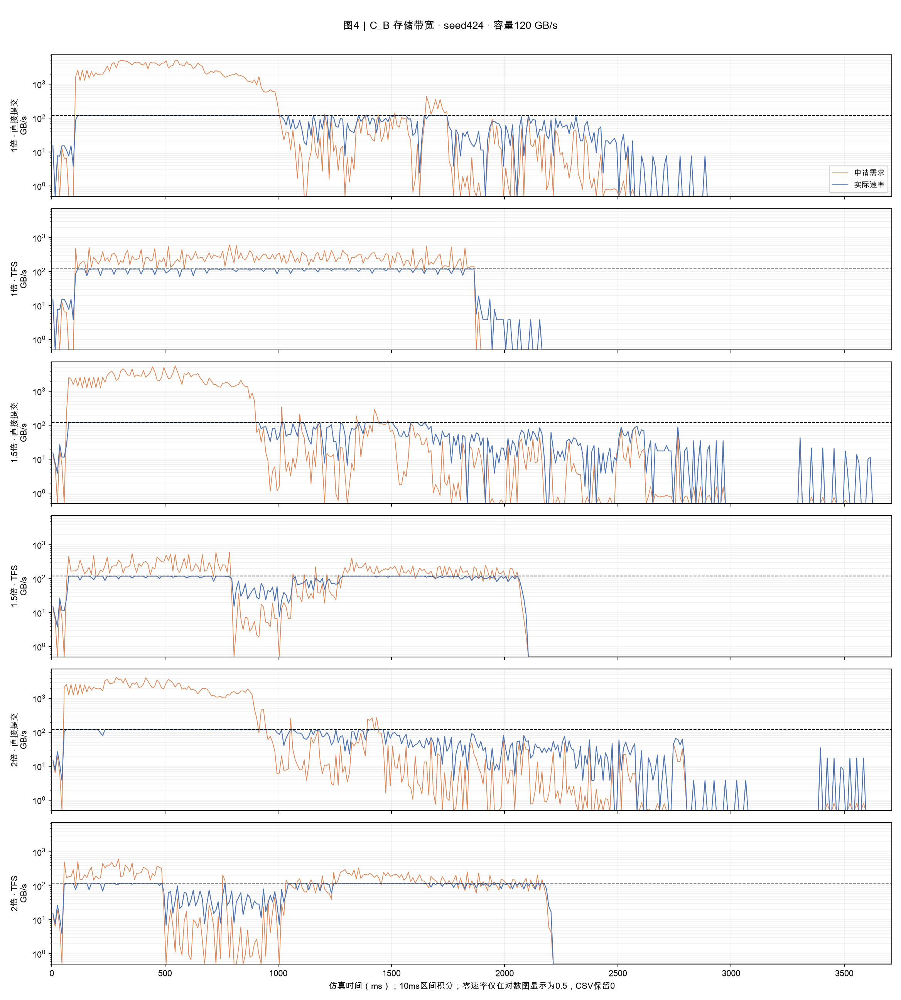

**读法**：固定seed424；10ms桶按真实区间求交积分，橙色申请、蓝色实际、虚线120GB/s；对数图把0显示在0.5底线，CSV保留0。所有格读取总量相同；各策略全程平均带宽分母不同。申请率不是物理限速，也不是TFS配额计数。

## 5. TTFT累积分布

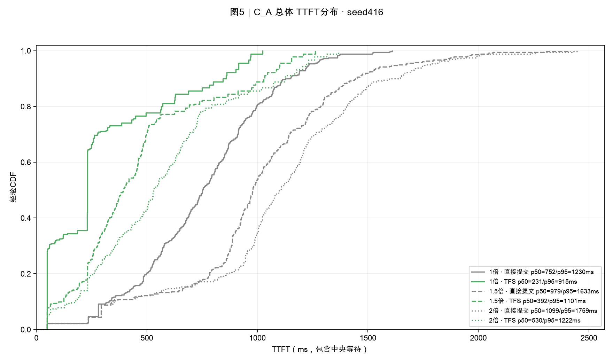

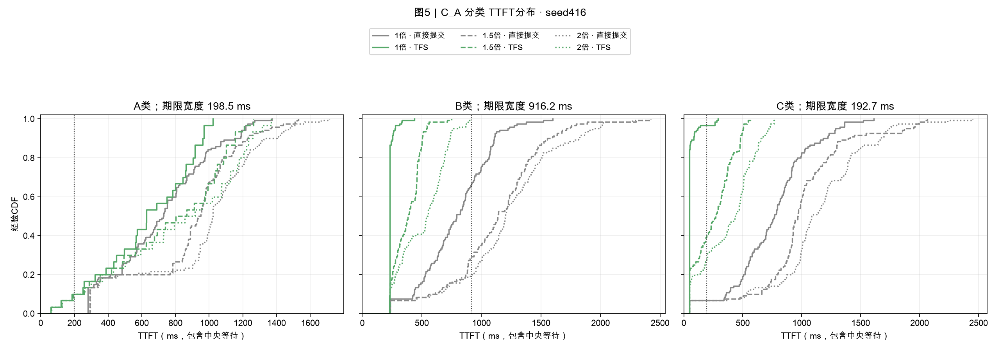

**读法**：固定seed416，每个总体360请求、每类120请求。实线/虚线/点线分别是1/1.5/2倍。经验CDF为rank/n，分位数采用nearest-rank；TTFT包含中央等待。分类竖线为各请求类自身期限宽度，总SLO按请求一一比较，不从总体边际CDF推导。

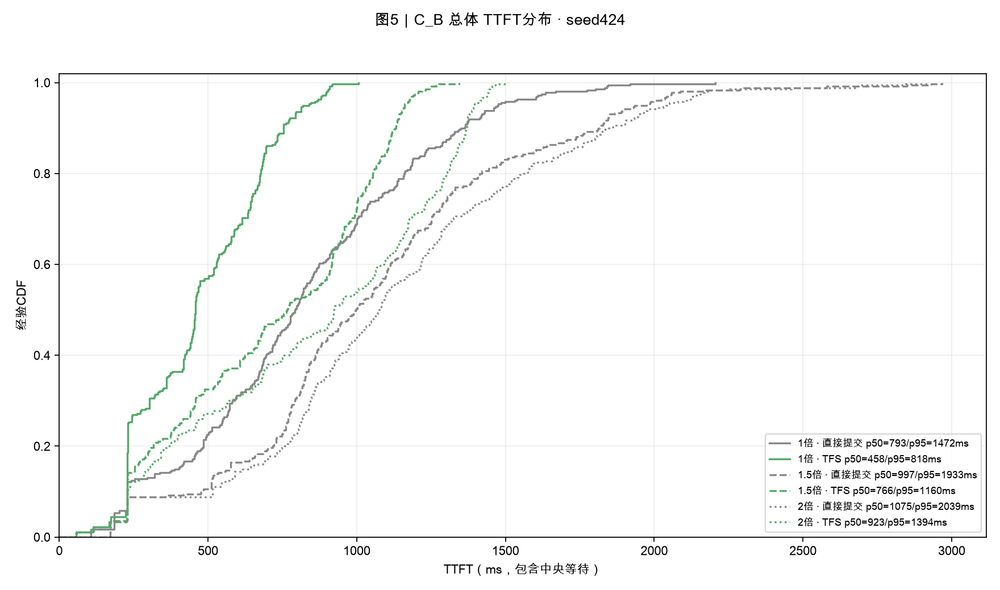

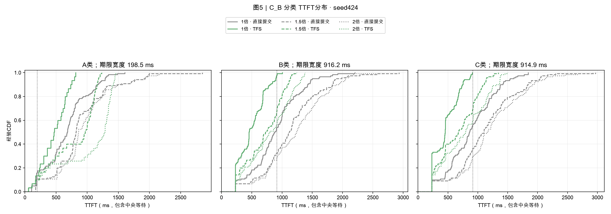

**读法**：固定seed424，每个总体360请求、每类120请求。实线/虚线/点线分别是1/1.5/2倍。经验CDF为rank/n，分位数采用nearest-rank；TTFT包含中央等待。分类竖线为各请求类自身期限宽度，总SLO按请求一一比较，不从总体边际CDF推导。

### TFS 的 A 类等待与输入结束后的收尾

| 工况 | 倍率 | A中央等待(ms) | A下发后耗时(ms) | A总TTFT(ms) | 最后到达(ms) | 全部完成(ms) |
|---|---:|---:|---:|---:|---:|---:|
| C_A | 1 | 399.3 | 64.3 | 463.6 | 1582.4 | 1924.7 |
| C_A | 1.5 | 554.1 | 66.6 | 755.3 | 1054.9 | 1854.0 |
| C_A | 2 | 666.7 | 66.8 | 812.1 | 791.2 | 1859.1 |
| C_B | 1 | 407.1 | 59.0 | 466.1 | 1652.8 | 2322.6 |
| C_B | 1.5 | 714.6 | 67.1 | 781.7 | 1101.9 | 2188.1 |
| C_B | 2 | 951.5 | 71.5 | 1023.0 | 826.4 | 2213.2 |

各指标分别取种子中位数，A中央等待中位数与下发后耗时中位数之和未必等于A总TTFT中位数。输入结束更早不代表全部计算和读取更早完成。

## 6. 机制解释与前序实验衔接

- 本轮提高每类到达率，保持每类请求数120不变。输入更密集，输入持续时间更短，并非增加总请求数。
- 更密集的输入可以增加实例内组批候选，同时也增加中央等待、实例内排队和混批共同等待；批次变大不保证TTFT下降。
- 原生Dynamo每格只运行一次，同代价路由存在随机性。不要将本轮1倍数字与旧三次路由中位数直接相减作为算法收益。
- 本轮比较的是当前TFS与直接提交，没有加入前一轮“空泡额外放行A”的例外，也没有修改路由或组批规则。

## 7. 计算模型与限制

沿用SA synthetic-v1，8层读取与计算重叠。512-token效率参数未经过硬件校准；每请求只生成一个合成token。真实代码边界为Dynamo SelectionService、vLLM Scheduler/KV管理，未执行真实ModelRunner与设备kernel。C_A只有三输入种子，C_B只有一输入种子，每格一次路由；用于观察方向与反例，不作显著性或真实部署结论。

## 8. 逐seed完整附表

| 工况/seed | 倍率 | 策略 | 总SLO | 平均TTFT(ms) | 平均batch | 空闲 | IO等待 |
|---|---:|---|---:|---:|---:|---:|---:|
| C_A/416 | 1 | 直接提交 | 24.4% | 750.2 | 2.291 | 29.0% | 24.5% |
| C_A/416 | 1 | TFS | 68.9% | 307.7 | 1.017 | 29.6% | 2.8% |
| C_A/416 | 1.5 | 直接提交 | 11.9% | 995.7 | 2.630 | 40.7% | 20.8% |
| C_A/416 | 1.5 | TFS | 49.7% | 463.6 | 1.254 | 30.1% | 3.0% |
| C_A/416 | 2 | 直接提交 | 8.6% | 1089.9 | 2.817 | 38.6% | 21.5% |
| C_A/416 | 2 | TFS | 46.1% | 567.4 | 1.461 | 29.9% | 2.9% |
| C_A/417 | 1 | 直接提交 | 66.9% | 308.5 | 1.175 | 12.9% | 33.2% |
| C_A/417 | 1 | TFS | 66.4% | 267.4 | 1.094 | 31.5% | 15.2% |
| C_A/417 | 1.5 | 直接提交 | 45.6% | 511.9 | 1.699 | 8.5% | 31.7% |
| C_A/417 | 1.5 | TFS | 48.3% | 512.1 | 1.479 | 43.0% | 6.3% |
| C_A/417 | 2 | 直接提交 | 40.0% | 681.6 | 2.242 | 8.9% | 30.8% |
| C_A/417 | 2 | TFS | 43.9% | 565.6 | 1.576 | 43.5% | 1.3% |
| C_A/418 | 1 | 直接提交 | 37.2% | 566.9 | 1.867 | 37.1% | 18.8% |
| C_A/418 | 1 | TFS | 56.7% | 309.9 | 1.141 | 33.2% | 3.5% |
| C_A/418 | 1.5 | 直接提交 | 24.7% | 772.3 | 2.366 | 21.0% | 24.2% |
| C_A/418 | 1.5 | TFS | 46.9% | 486.4 | 1.412 | 30.7% | 3.6% |
| C_A/418 | 2 | 直接提交 | 19.4% | 881.8 | 2.595 | 22.3% | 23.1% |
| C_A/418 | 2 | TFS | 43.9% | 564.6 | 1.480 | 32.2% | 2.3% |
| C_B/424 | 1 | 直接提交 | 42.2% | 815.7 | 1.940 | 29.4% | 11.9% |
| C_B/424 | 1 | TFS | 70.3% | 473.6 | 1.246 | 16.4% | 2.0% |
| C_B/424 | 1.5 | 直接提交 | 26.4% | 1055.7 | 2.180 | 40.7% | 8.6% |
| C_B/424 | 1.5 | TFS | 49.2% | 717.8 | 1.472 | 11.9% | 1.5% |
| C_B/424 | 2 | 直接提交 | 23.1% | 1126.3 | 2.261 | 41.0% | 7.7% |
| C_B/424 | 2 | TFS | 41.9% | 863.8 | 1.535 | 13.1% | 1.3% |

## 9. 验证、数据与复现

本次实际运行24次，全部通过原始`check_sa_results.py`验收。另复算8640请求、768实例时间账本、24条实际带宽字节积分、真实step与计算/IO区间、CDF单调性和终点概率。具体检查及交付文件SHA见[validation.json](report_data/validation.json)。

- [24次运行指标](report_data/runs_24.csv)、[汇总中位数](report_data/summary.csv)、[8640条请求](report_data/requests_8640.csv)、[768实例时间数据](report_data/workers_768.csv)。
- [输入与运行清单](report_data/manifest.json)、[实验设计](plan.json)、[实验执行脚本](run_sweep.py)、[报告生成脚本](build_report.py)。
- 完整原始资产在工作区`temp/rate_sweep_20261020/`，包括12份输入、24份report.json/events.jsonl及运行与验收日志；分享包不包含大型原始事件文件。manifest保留原始路径和SHA。
- 重新生成报告：使用DV的`.venv/bin/python`执行本目录`build_report.py`。需要保留上述原始资产。
- 重新运行：将`run_sweep.py`和`plan.json`放入工作区`temp/rate_sweep_20261020/`，使用DV的`.venv/bin/python`执行。已有运行目录会报错，防止覆盖记录。需要本地固定SA/DV源码与环境。

## 10. 简要解读

提高到达率后，先看batch与灰色是否变化，再检查TTFT、分类达标率与红色IO等待。灰色减少可能意味着计算更连续，也可能意味着等待或积压更多。应使用本轮同倍率直接提交对照评估TFS，并保留各seed结果。
