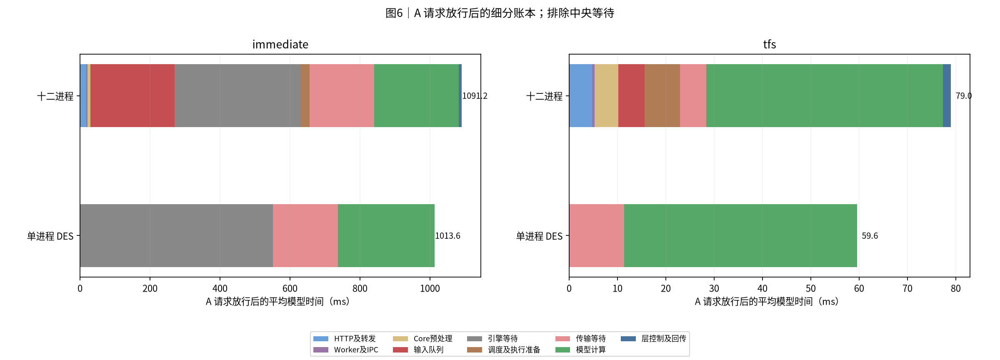
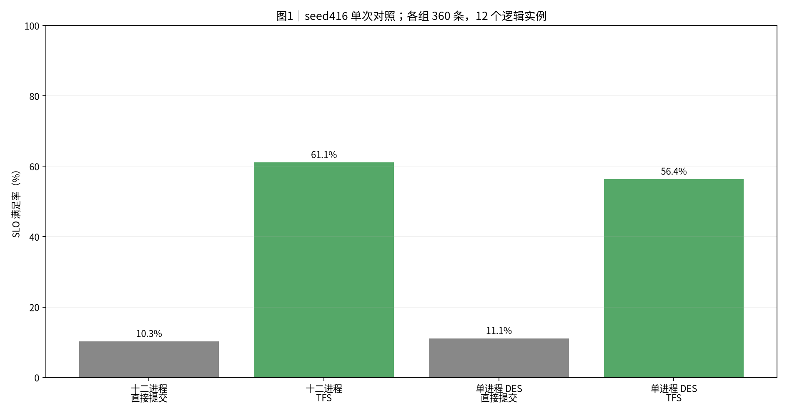
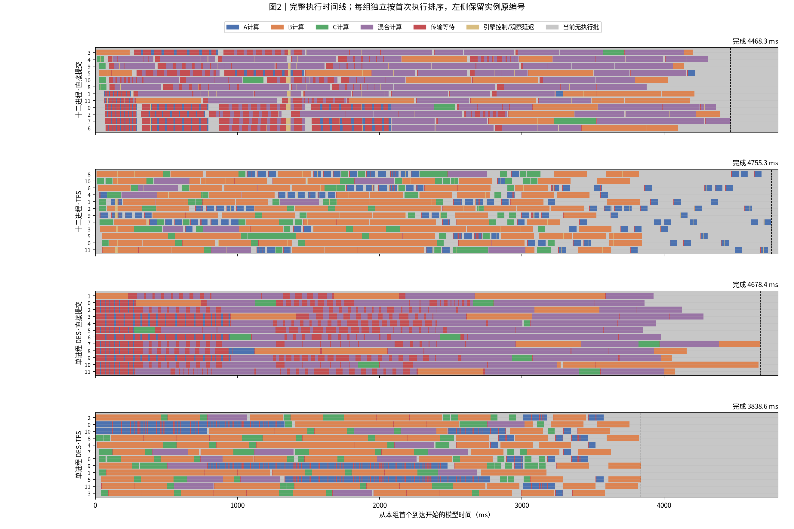
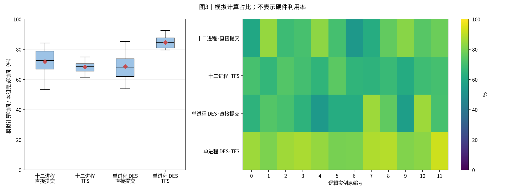
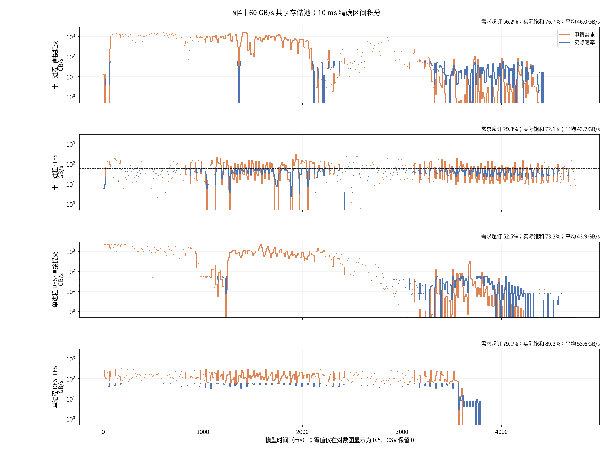
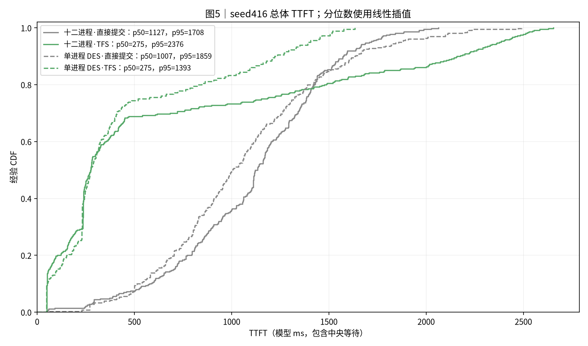
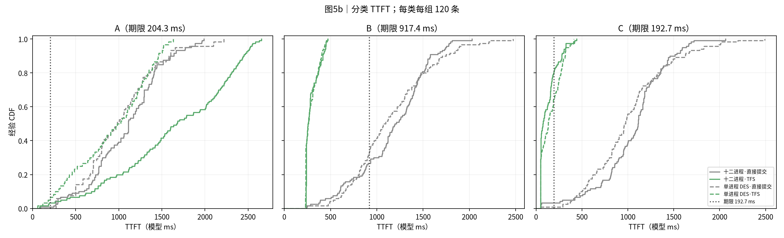

# 实验结果：seed416 十二进程与单进程 DES 细粒度耗时对照

| 项目 | 约定 |
|---|---|
| 实验日 / 整理日 | 2026-10-26；本次实际重跑，没有沿用旧运行数值 |
| 矩阵 | seed416；十二进程和单进程 DES，各运行 immediate/TFS 一次；4组、1440条正式请求 |
| 逻辑规模 | 两种形态都是12个实例；单进程是12实例的离散事件仿真（DES） |
| 输入 | ABC各120；A=(h=42883,u=256)，B=(9399,4096)，C=(0,2657)；计划末次到达3.612秒 |
| 输入指纹 | `35e488b618a8744b420eb7a1876d4a8efeb4c7bb0d3f8def55754f9a4b918750`，与原冻结输入逐字节一致 |
| 资源 | 共享60 GB/s；SA八层；32768 B/token；每步8192新token、最多4序列；缓存事件和本地前缀缓存关闭 |
| 执行与准入 | layer_pipeline；Dynamo原生kv负载选择；动态P75 TFS，首token释放；输出1token |
| 时间口径 | 正文均为模型ms。进程栈壁钟除以K=10；原始探针保留monotonic_ns。DES虚拟时钟不计真实控制面CPU耗时 |
| SLO与TTFT | 首token≤arrival+4T0；TTFT=首token−网关登记到达，含中央等待；DES使用计划到达 |
| 环境与版本 | Windows WSL Linux x86_64；WSL上限24GiB；vLLM0.20.2、Dynamo1.5.0、CPU torch2.11.0。固定源码指纹全部通过 |
| 证据边界 | mock模型执行与存储；不是GPU测速。只有一个种子和每臂一次，不做统计显著性判断 |

## 0. 总判决

**24GiB解决了本轮16GiB内存不足。四组正式运行全部成功。新增探针把原先的“执行前额外时间”拆成了输入队列、预处理、调度和通信。**

十二进程平均TTFT从 **1103.5降至685.5ms**（-37.9%）；总SLO从10.3%提高到61.1%。单进程DES平均TTFT从1060.3降至458.4ms（-56.8%）。

有明确反例：十二进程TFS完成整批需要 **4755.3ms**，比直接提交的4468.3ms更长。TFS降低平均时延和提高总体SLO，并不保证本轮完成时间更短。A类平均TTFT也从1091.4升至1638.7ms；A的中央等待增加。不能只给出总体收益。

### 最先看：A请求放行后的额外时间

TFS下，十二进程A放行后平均 **79.001ms**；DES为 **59.571ms**。差值同时包含控制面成本、IO竞争及组批差异，不能全部叫通信开销。

**读法**：A请求排除中央等待后的互斥阶段。直接提交下，输入队列和Scheduler等待占很大部分；TFS下这些等待缩短，但预处理与调度仍消耗壁钟时间。

下面每列均为同一组120个A请求的算术平均，单位为模型ms。全部互斥阶段相加严格等于TTFT。

|A请求互斥阶段|十二进程·直接提交|十二进程·TFS|单进程 DES·直接提交|单进程 DES·TFS|
|---|---:|---:|---:|---:|
|中央准入等待|0.139|1559.723|0.000|868.126|
|已放行→网关开始转发|2.106|0.420|0.000|0.000|
|HTTP+Dynamo→Worker入口|16.061|4.358|0.000|0.000|
|Worker入口→AsyncLLM入口|0.048|0.018|0.000|0.000|
|AsyncLLM处理与输出登记|0.166|0.062|0.000|0.000|
|IPC请求序列化|0.030|0.016|0.000|0.000|
|IPC发送就绪→Core收到完整消息|2.702|0.314|0.000|0.000|
|Core消息反序列化|0.154|0.051|0.000|0.000|
|反序列化→预处理调用|0.001|0.001|0.000|0.000|
|Core请求构造/块哈希预处理|8.628|4.910|0.000|0.000|
|预处理结束→输入队列投递|0.001|0.049|0.000|0.000|
|EngineCore输入队列等待|240.777|5.387|0.000|0.000|
|输入队列取件→Scheduler入队完成|0.001|0.002|0.000|0.000|
|Scheduler入队→首次组批|359.040|0.001|551.862|0.000|
|schedule调用（包含KV/RPC）|26.321|7.103|0.000|0.000|
|调度结束→Executor入口|0.001|0.001|0.000|0.000|
|Executor准备→首次层提交|0.100|0.156|0.000|0.000|
|首次层提交调用（包含RPC/反馈）|0.242|0.075|0.000|0.000|
|显式等待中仍未完成的层传输|184.929|5.491|185.192|11.411|
|层传输已完成后的观察/调用延迟|6.628|1.061|0.000|0.000|
|模型规定的批次计算窗口|241.356|48.904|276.549|48.160|
|计算窗口超时|0.176|0.094|0.000|0.000|
|其余Executor层间控制/日志|0.127|0.051|0.000|0.000|
|两次执行之间的等待|0.004|0.000|0.000|0.000|
|执行结束→结果回写结束|0.997|0.289|0.000|0.000|
|结果回写结束→Worker首条输出|0.481|0.096|0.000|0.000|
|Worker首条输出→网关首token|0.164|0.093|0.000|0.000|

EngineCore输入队列在Scheduler之前。请求到达Core的收件线程后，收件线程可以完成预处理；主执行循环可能仍在执行上一批，所以请求继续停在输入队列。Scheduler入队后，才开始另一段引擎等待。两者不能合并成HTTP耗时。

### 调度与RPC再拆一层

|A类嵌套项目|十二进程直接提交(ms)|十二进程TFS(ms)|
|---|---:|---:|
|输入处理（属于AsyncLLM准备）|0.145|0.052|
|输出登记（属于AsyncLLM准备）|0.003|0.002|
|KV allocate_slots（属于schedule）|0.308|0.347|
|调度内存储RPC总时长（属于schedule）|10.286|6.043|
|其中：JSON编码|1.065|1.051|
|其中：发送调用|5.355|1.438|
|其中：等响应与接收|3.824|3.512|
|其中：JSON解码|0.042|0.042|
|反馈RPC（跨多个层阶段的嵌套诊断）|0.723|0.608|

这是**嵌套诊断表**，不能加到上一张互斥账本。`allocate_slots`包含在schedule中；调度内RPC包括命中查询、逐层缓存注册等CPU mock存储协议。大段块哈希JSON的传送与处理属于仿真控制面成本，不表示真实KV张量读取带宽。块哈希构造归入Core预处理。

## 1. 汇总表与SLO

|方案|总SLO|A-SLO|B-SLO|C-SLO|平均TTFT(ms)|中央等待(ms)|首到达至末token(ms)|
|---|---:|---:|---:|---:|---:|---:|---:|
|十二进程·直接提交|10.3%|0.8%|26.7%|3.3%|1103.5|0.1|4468.3|
|十二进程·TFS|61.1%|3.3%|100.0%|80.0%|685.5|519.9|4755.3|
|单进程 DES·直接提交|11.1%|0.0%|32.5%|0.8%|1060.3|0.0|4678.4|
|单进程 DES·TFS|56.4%|5.0%|100.0%|64.2%|458.4|289.4|3838.6|

**读法**：四个柱均来自seed416的单次正式运行，没有误差线。总SLO使用逐请求期限判断。

两种形态使用同一计划输入、资源与规则，但真实HTTP接收时刻、Dynamo平局选择和组批结果不同。进程栈使用网关实际登记时刻，DES使用计划时刻。这不是逐请求路径相同的通信消融。

## 2. 完整执行时间线与batch

**读法**：灰色表示当前没有执行批，不能据此认定中央队列为空。金色表示原生执行批内控制或观察延迟。红色只画显式等待期间仍在进行的层传输。彩色表示模型规定的计算窗口。

|方案|执行步数|批大小1/2/3/4的步数|A参与批大小1/2/3/4的请求数|
|---|---:|---:|---:|
|十二进程·直接提交|142|22 / 21 / 43 / 56|7 / 12 / 20 / 81|
|十二进程·TFS|338|322 / 6 / 7 / 3|119 / 0 / 1 / 0|
|单进程 DES·直接提交|136|15 / 19 / 40 / 62|7 / 17 / 12 / 84|
|单进程 DES·TFS|332|307 / 18 / 5 / 2|120 / 0 / 0 / 0|

本轮TFS下，十二进程A中119条只参与单请求批，1条参与3请求混批；DES的120条A全部单请求批。因此十二进程A的平均批次计算窗口略高于48.16ms。该差异已进入计算项，不能当作额外通信。

## 3. 模拟计算占比

**读法**：每个实例使用模型规定的计算时间除以本组首到达至末token时间。IO、队列和宿主控制耗时不计入计算；此图不是CPU或GPU实测利用率。

## 4. 存储带宽与RPC

**读法**：每组都读取205581189120B。实际速率按事件区间积分后重采样到10ms；四组积分误差均小于1B。需求与实际速率不是同一指标。

|方案|积分读取量(GB)|需求超订时间占比|实际≥90%容量占比|全程平均(GB/s)|
|---|---:|---:|---:|---:|
|十二进程·直接提交|205.581|56.2%|76.7%|46.01|
|十二进程·TFS|205.581|29.3%|72.1%|43.23|
|单进程 DES·直接提交|205.581|52.5%|73.2%|43.94|
|单进程 DES·TFS|205.581|79.1%|89.3%|53.56|

TFS原生存储服务的单次处理细分如下。单位为模型ms；客户端等待响应包含服务端处理、锁竞争、线程调度、socket传送与接收，不能直接称为网络延迟。

|TFS服务操作|调用次数|锁前JSON解码+等锁(ms/次)|锁内处理(ms/次)|序列化+回复(ms/次)|
|---|---:|---:|---:|---:|
|bind|360|0.0070|0.0136|0.0074|
|layer_register|240|0.3232|0.6199|0.0108|
|layer_status|13249|0.0056|0.0055|0.0040|
|layer_submit|1920|0.0060|0.0081|0.0066|
|present_for_request|360|0.1642|0.4741|0.0356|
|stats|1|0.0014|0.0208|147.5023|

当前探针把“JSON解码+等待服务锁”记为同一段，尚不能把两者独立分开。服务端处理与回复可分别读取。逐操作原始表见[RPC汇总](report_data/rpc_summary.csv)。客户端和服务端是同一RPC的两个视角，不能相加。

## 5. TTFT累积分布

**读法**：经验CDF按rank/n绘制。实线为十二进程，虚线为单进程DES；灰色为直接提交，绿色为TFS。分位数使用线性插值。

**读法**：分类期限分别画点线。A类中央等待较长，不能用总体曲线掩盖该取舍。

## 6. 机制与单多进程差异

单进程DES同样调用真实路由与Scheduler，但这些函数执行时虚拟时钟不前进。DES表中的IPC、HTTP和预处理时间为零，表示没有把这些阶段作为虚拟延迟计入；不表示代码不执行或宿主CPU没有花时间。

原生路径为：网关放行→HTTP/Dynamo→Worker→AsyncLLM输入处理→IPC编码→Core收件线程解码和构造Request/块哈希→输入队列→主循环取件→Scheduler队列→schedule/KV分配/存储查询→Executor逐层读算→结果回写→输出回传。

原生主循环执行上一批时，收件线程仍可接收请求。直接提交下，这会形成大量输入队列等待。DES在同一虚拟时刻完成入队，因此等待主要出现在Scheduler/实例端。只有把这两段一起比较，才不会误认一种形态“少排队”。

TFS从下发占用配额，到首token释放。单条A的额外处理时间会延长配额占用，并影响后续A的放行时间。A的中央等待差异不是一次socket往返的耗时。当前数据同时受路由、组批和IO竞争影响，不能把累计中央等待差异完全归因给某一探针阶段。

### 本轮A类拖尾的直接证据

各类最后完成时刻从本组首个到达计起，单位为模型ms：

| 类别 | 单进程DES的TFS | 十二进程TFS |
|---|---:|---:|
| A | 3574.8 | 4755.3 |
| B | 3838.6 | 3846.1 |
| C | 3230.5 | 3230.4 |

B、C的完成时间接近，主要拖尾差异来自A。十二进程中B、C完成时还剩26条A，24条尚未放行。此时重读准入配额为2；尾段新放行A平均约70ms返回首token。粗算26/2×70≈910ms，与图中约909ms尾段接近。这是机制解释用的近似，不能替代逐请求账本。

同一TFS配额从下发占用到首token释放。十二进程的HTTP、预处理、输入队列、调度和回传增加了配额持有时间；DES虚拟时间不计入这些宿主控制成本。图中灰色表示实例当前没有执行批，中央仍可有待放行请求。路由、组批和真实到达仍有差异，本次不是只改变通信成本的消融。

## 7. 时间模型、探针与限制

1. 真实进程栈以K=10兑现模拟计算。模型ms乘10才是对应原始壁钟ms。数据文件保留原始monotonic_ns。不能把本报告的模型ms作为真实生产IPC延迟。
2. 计算窗口包括下一层预取RPC。预取先花掉的时间从随后sleep中扣除；所以不能再加一次完整RPC时长。计算窗口超时包括sleep唤醒延迟和可能的预取超时，尚未独立量化内核调度与Python运行时的份额。
3. 层等待分为仍在传输的部分和传输完成后的观察/调用部分。后者含轮询、RPC与CPU调度，不等于全部sleep超时。
4. 每批公共调度和计算时间可以计入所有参与请求的延迟，但不能按参与请求数重复当作资源用量。利用率按批次统计。
5. 只有seed416、每臂一次；Dynamo平局仍可随机。不能给出稳定收益区间或显著性结论。新运行在WSL，旧Mac数据未混入。
6. 小样本6条请求：探针开/关客户端平均TTFT分别126.301/124.994ms。两次路由与宿主负载不完全相同，约1.05%的差值不能视为探针开销的精确估计。单独emit微基准的中位数约440ns/事件，只覆盖时间戳、字典与缓冲追加，不覆盖所有包装及线程扰动。

## 8. 内存与失败预试

|方案|最低可用内存(GiB)|最大WSL交换(GiB)|子进程RSS和峰值(GiB)|启动+回放+校验壁钟(s)|
|---|---:|---:|---:|---:|
|十二进程·直接提交|4.09|0.00|19.75|124.6|
|十二进程·TFS|4.83|0.00|19.15|133.5|

子进程RSS相加会重复统计共享页，不代表物理内存占用。两组均无内存保护事件，且回收后无记录中的活进程。16GiB预试在回放阶段触发保护，已清理并保留失败记录；本报告只使用之后24GiB的四个正式运行。

WSL配置已保存为`memory=24GB`，其余原配置保留。原配置已在本机备份。

## 9. 验证、发布范围与数据

本公开版仅发布报告、7张图、分类/阶段汇总、RPC操作汇总和验证摘要。**不发布原始trace、逐请求CSV、逐步事件、逐条RPC、存储区间、完整运行日志或原始归档。**

原始实验已完成以下核验：四组1440条全部完成；每组ABC各120；每组读取205581189120B；原生两组12实例均就绪并实际执行。原生720个请求的16个主要节点及每步8层起止完整。逐请求互斥账本误差<1e-6ms；计算公式误差≤1.2e-16秒；带宽积分误差<1B；固定上游源码指纹全部匹配。

本次只向公开notes仓库提交报告导出，不发布私有工作区历史或运行代码，不升级上游版本。

公开附件：[四组汇总](report_data/summary.json)、[A阶段表](report_data/A_stage_comparison.csv)、[RPC操作汇总](report_data/rpc_summary.csv)、[带宽核验](report_data/bandwidth_validation.json)、[运行环境摘要](report_data/control/environment.json)、[公开文件清单与核验](report_data/validation.json)。数据边界见[复现说明](reproduce/README.md)。

## 10. 简要解读

先看第0节的A阶段表。TFS下，A的核心计算约49ms；其余时间确实包括通信，但主要还包括请求预处理、输入队列和存储协议。直接提交下，排队才是最大项。24GiB已经使本机完成本轮12实例对照，后续解读应以本次细分记录为准。
