# 实验结果：TFS 接入 Dynamo/vLLM——E26f 零读第三类对齐实验

| 项目 | 约定 |
|---|---|
| 实验日 / 报告整理日 | 原实验 2026-10-19；本报告 2026-10-20 从冻结记录重新整理，没有重跑仿真 |
| 参照格式 | `status_aware_network/实验结果-E26f-零读第三类实验-20261011.md`，沿用汇总、甘特、利用率、带宽、CDF 的组织与主要配色 |
| 负载 | A 簇到达：簇间隔为均值 16/98 秒的指数分布，每簇 16 条，末簇补余；B/C 各自逐条泊松到达，间隔为均值 1/98 秒的指数分布；A/B/C 各 120 条，共 360 条 |
| 请求形状 | A=(h=42883,u=256)，B=(9399,4096)，C_A=(0,2657)，C_B=(0,8110)；h 为远端命中 token，u 为新计算 token |
| 资源 | 32 worker/NPU 槽位，8 层，120 GB/s 聚合存储，8192 新计算 token/step，逻辑内存每 worker 8 GB；单流初始申请上限 200 GB/s |
| 比较方案 | 直接提交 `immediate` / 仅等待预算排序 `slack_only` / 配额+先到先服务 `quota_fcfs` / TFS `tfs` |
| 输入种子 / 路由重复 | C_A：416/417/418；C_B：424。每个输入种子、策略、请求数上限运行 3 次；Dynamo 平局选择未固定随机种子 |
| 总矩阵 | 4 条输入 × 2 档 max_num_seqs(1/8) × 4 策略 × 3 次路由重复 = 96 次；主报告展示上限 8，附表展示上限 1 |
| 汇总口径 | 同一输入种子的 3 次路由重复先取中位数，再对输入种子取中位数。分类指标分别取中位数，不能用它们反推总指标 |
| 轨迹图口径 | 固定 C_A seed416、C_B seed424，repeat0、max_num_seqs=8；每方案 360 请求。单次图不代表全部种子的中位轨迹 |
| SLO（时延目标）与 TTFT（首 token 时延） | 首 token 时间 ≤ arrival+4T0。T0 为 SA 同源单请求参考服务时间；TTFT 从 arrival 计起，包含中央准入等待；不使用统一 1 秒阈值作为本报告主口径 |
| 执行边界 | 真实 Dynamo SelectionService、vLLM Scheduler/Allocator；逐层 IO、计算时间、模型输出为仿真。利用率指模拟计算时间占比，不是物理 NPU 硬件利用率 |
| 存储与配额 | SA 聚合 max_min；每批每层一条读取流，下一层与本层计算重叠；TFS 从准入占配额，到首 token 释放，本实验只输出一个 token，无后续 decode |
| 版本 | SA 来源提交 `3cd826961bb53b05d09eb7f6e6949e4222230605`；本批运行实现 SHA256 `06f3914df6016cbee868b7eab54450fb7dd4161060d26c773b4696982b121ea7` |

## 0. 总判决

**条件性通过：当前合成执行模型下，TFS 相对直接提交提高 SLO 满足率，并降低平均 TTFT。不能据此确认真实硬件收益幅度。**

- **C_A**：总 SLO 35.3% → **68.9%**，提高 **33.6 个百分点**；平均 TTFT 561.2 → **308.6 ms**。
- **C_B**：总 SLO 40.0% → **70.8%**，提高 **30.8 个百分点**；平均 TTFT 810.0 → **477.2 ms**。

- 配额机制是本矩阵中的主要差异来源：仅排序策略没有表现出相近收益；TFS 与“配额+先到先服务”更接近。这是策略对照支持的现象，不是对配额与排序做独立因果量化。
- TFS 仍有反例与取舍：C_A seed418 的表现低于同源 SA 控制，A 类远未全部达标。详见 §6、§7。

## 1. 汇总表与 SLO 柱状图

主口径：max_num_seqs=8。方括号为输入种子 416/417/418 各自的路由重复中位数；C_B 只有 seed424。

### C_A：零读轻算 C，单请求纯计算约 48.17 ms

| 方案 | 总 SLO [逐输入种子] | A-SLO | B-SLO | C-SLO | 平均 TTFT(ms) | 中央等待(ms) | makespan(ms) |
|---|---:|---:|---:|---:|---:|---:|---:|
| 直接提交 | **35.3%** [24.2/64.2/35.3] | 0.0% | 84.2% | 20.0% | 561.2 | 0.0 | 2337.1 |
| 仅等待预算排序 | **34.2%** [23.9/64.7/34.2] | 0.0% | 85.0% | 18.3% | 557.4 | 0.0 | 2258.8 |
| 配额+先到先服务 | **65.8%** [69.2/65.8/58.6] | 13.3% | 100.0% | 80.0% | 307.3 | 132.7 | 1923.5 |
| TFS | **68.9%** [68.9/69.4/57.5] | 13.3% | 100.0% | 85.8% | 308.6 | 133.3 | 1926.2 |

### C_B：零读重算 C，单请求纯计算约 228.73 ms

| 方案 | 总 SLO [逐输入种子] | A-SLO | B-SLO | C-SLO | 平均 TTFT(ms) | 中央等待(ms) | makespan(ms) |
|---|---:|---:|---:|---:|---:|---:|---:|
| 直接提交 | **40.0%** [40.0] | 15.0% | 51.7% | 54.2% | 810.0 | 0.0 | 3201.7 |
| 仅等待预算排序 | **38.9%** [38.9] | 14.2% | 52.5% | 51.7% | 822.8 | 0.0 | 3254.7 |
| 配额+先到先服务 | **70.3%** [70.3] | 13.3% | 97.5% | 100.0% | 477.8 | 135.2 | 2315.5 |
| TFS | **70.8%** [70.8] | 13.3% | 99.2% | 100.0% | 477.2 | 135.6 | 2343.2 |

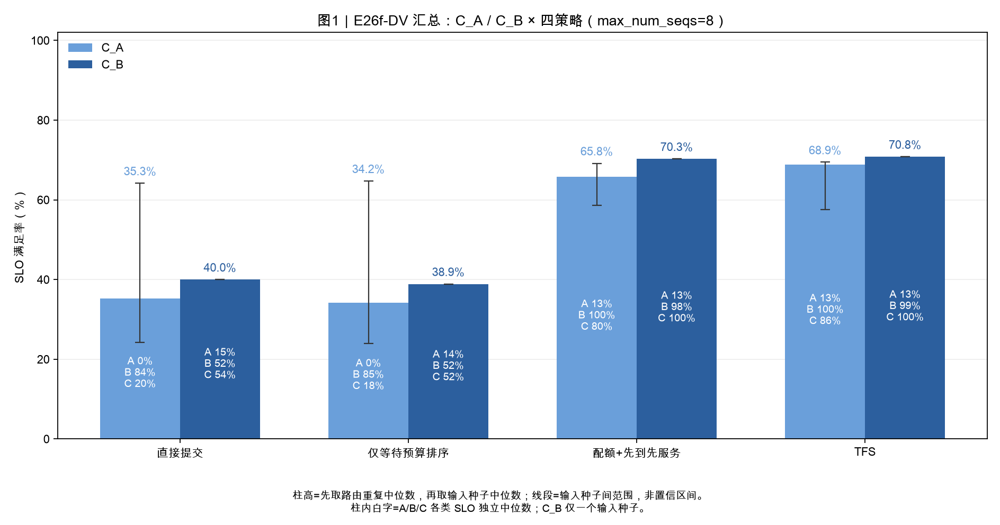

**读法**：浅蓝 C_A，深蓝 C_B，与原报告汇总图一致。柱内 A/B/C 白字为分类 SLO 独立中位数。误差线只表示输入种子间最小/最大值，不是置信区间；C_B 不画输入种子变异。

### 四种策略的区别

| 方案 | 中央排序 | 重请求配额 | 实例内组批 |
|---|---|---|---|
| 直接提交 | 到达顺序 | 无 | 真实 vLLM |
| 仅等待预算排序 | deadline−now−T0 | 无 | 真实 vLLM |
| 配额+先到先服务 | 到达顺序，受限重请求可跳过 | 有 | 真实 vLLM |
| TFS | deadline−now−T0，受限重请求可跳过 | 有 | 真实 vLLM |

这里的“仅等待预算排序”不是原 SA 报告中的 EDF；“配额+先到先服务”也不是原 SA FCFS。本轮没有重新运行 local/MPC，不把原报告旧数值混进本轮策略柱状图。

没有配额时，请求到达即被下发，排序通常只影响同刻到达的候选，不会主动等待未来请求形成跨时刻中央队列。直接提交与仅排序之间的小幅数值差异也包含随机路由变化，不应全部归因于排序。

## 2. 各方案 full-sort-ms 执行时间线

蓝=A 计算，橙=B 计算，绿=C 计算，紫=混合类别计算，红=当前 step 等待本层读取，灰=worker 无请求。单类多请求批次仍显示该类别颜色。每个 step 包含 8 层，不能把色块数量当作批次数。

每个策略独立按首次 step 开始时间从上到下排序，同刻按原 worker 编号排列；左侧保留原编号。排序只改变展示，不改变路由。四策略在同一工况内共用横轴，较早结束的策略末尾补灰。中央队列仍可能有请求，灰色不表示系统无请求。

### C_A：完整轨迹

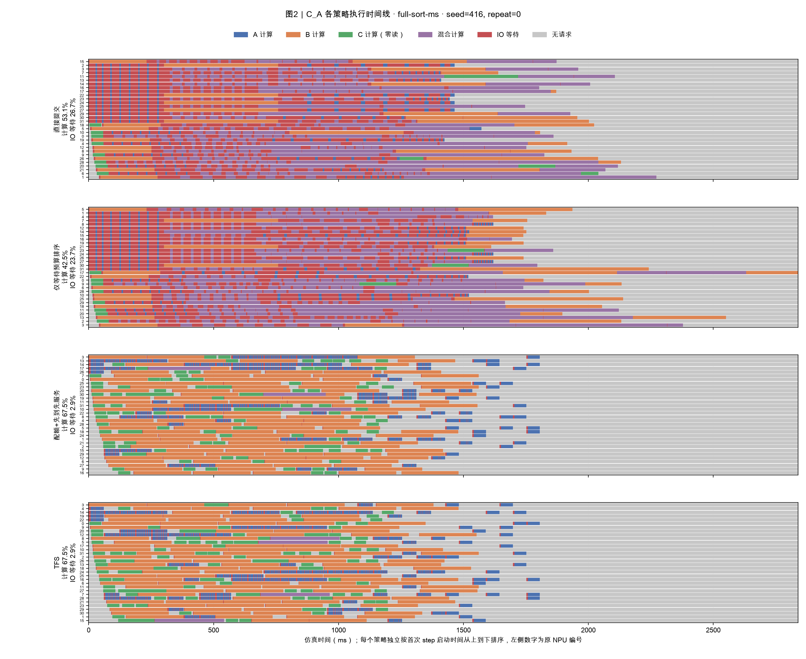

[查看 C_A 前 200 ms 放大图](figure/e26f_dv_CA_startup-sort-ms.png)

| 方案 | 总 SLO（本次） | step 数 | 多请求 step | 混合类别 step | 平均批次请求数 |
|---|---:|---:|---:|---:|---:|
| 直接提交 | 25.0% | 176 | 123 (69.9%) | 94 | 2.330 |
| 仅等待预算排序 | 22.2% | 182 | 119 (65.4%) | 99 | 2.264 |
| 配额+先到先服务 | 68.6% | 355 | 5 (1.4%) | 3 | 1.020 |
| TFS | 68.9% | 355 | 5 (1.4%) | 4 | 1.014 |

### C_B：完整轨迹

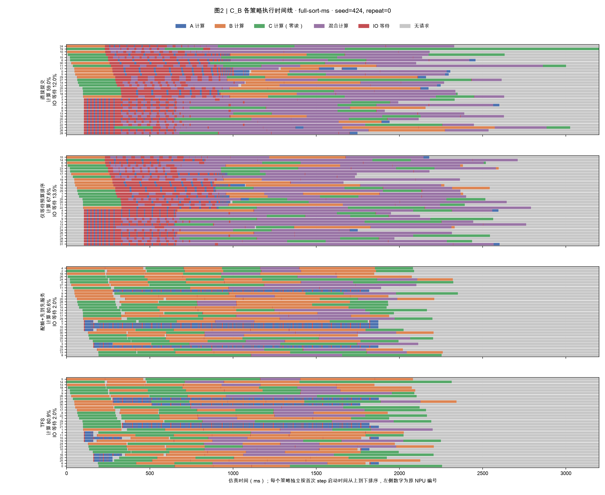

[查看 C_B 前 200 ms 放大图](figure/e26f_dv_CB_startup-sort-ms.png)

| 方案 | 总 SLO（本次） | step 数 | 多请求 step | 混合类别 step | 平均批次请求数 |
|---|---:|---:|---:|---:|---:|
| 直接提交 | 40.0% | 255 | 186 (72.9%) | 117 | 1.933 |
| 仅等待预算排序 | 38.9% | 251 | 182 (72.5%) | 130 | 1.980 |
| 配额+先到先服务 | 70.6% | 339 | 77 (22.7%) | 41 | 1.233 |
| TFS | 70.8% | 339 | 83 (24.5%) | 40 | 1.251 |

**读法**：直接提交下，多请求已进入 worker 队列，当前 step 因读等待而变慢，后续 step 获得更多组批候选。TFS 将重请求积压留在中央，worker 内积压减少；这解释了 C_A 中 TFS 批次较小，但不能把‘批次小’本身当作性能优势。

## 3. NPU 利用率分布与热力图

主口径为 `worker.compute_s / 本次 makespan`，IO 等待不算计算。混合批次的计算区间在每个 worker 只累计一次，不按批内请求重复相加。箱线图与热图均对应上述固定单次轨迹；热图按原 NPU 编号排列，便于观察负载分布。

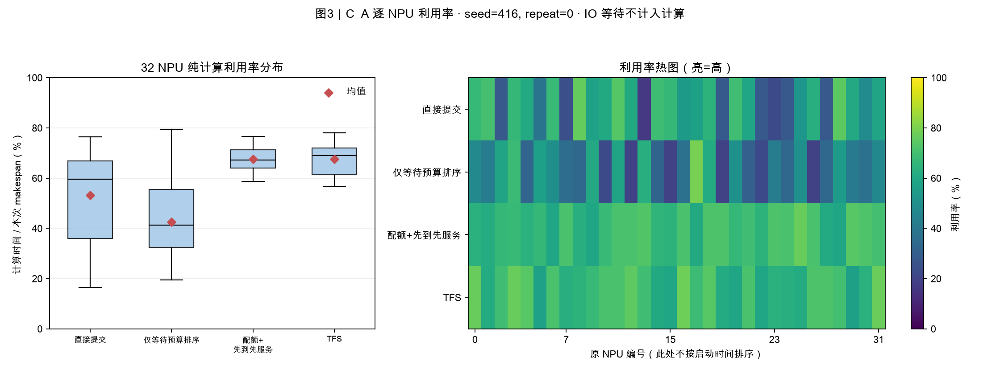

**C_A 利用率汇总**（双层中位数，与 §1 相同；图中为固定单次，数值不必相同）：

| 方案 | min | p50 | p90 | max | 均值 | CV | 含 IO 等待的均值 | makespan(ms) |
|---|---:|---:|---:|---:|---:|---:|---:|---:|
| 直接提交 | 21.8% | 54.2% | 70.5% | 79.3% | 51.8% | 0.312 | 79.2% | 2337.1 |
| 仅等待预算排序 | 24.6% | 53.6% | 65.5% | 78.5% | 53.5% | 0.302 | 76.9% | 2258.8 |
| 配额+先到先服务 | 42.6% | 64.8% | 72.0% | 76.7% | 63.3% | 0.121 | 68.4% | 1923.5 |
| TFS | 45.0% | 65.0% | 70.0% | 76.9% | 63.3% | 0.115 | 68.2% | 1926.2 |

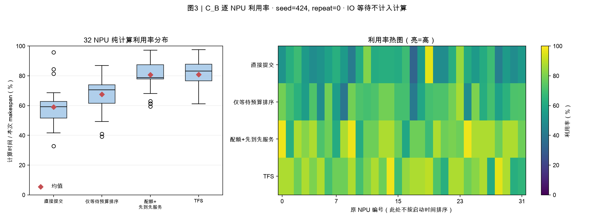

**C_B 利用率汇总**（双层中位数，与 §1 相同；图中为固定单次，数值不必相同）：

| 方案 | min | p50 | p90 | max | 均值 | CV | 含 IO 等待的均值 | makespan(ms) |
|---|---:|---:|---:|---:|---:|---:|---:|---:|
| 直接提交 | 32.7% | 59.3% | 68.6% | 91.4% | 58.9% | 0.209 | 70.7% | 3201.7 |
| 仅等待预算排序 | 39.2% | 60.3% | 67.6% | 86.9% | 58.0% | 0.194 | 70.1% | 3254.7 |
| 配额+先到先服务 | 61.8% | 80.1% | 88.9% | 97.3% | 81.9% | 0.117 | 83.9% | 2315.5 |
| TFS | 61.4% | 83.2% | 87.9% | 97.2% | 80.9% | 0.114 | 82.9% | 2343.2 |

**读法**：红菱形为 32 NPU 纯计算均值；CV 为标准差/均值，越小表示该次运行中各 worker 的计算占比越接近。‘计算+IO 等待’只是槽位占用对照，不可当作有效计算利用率。不同策略 makespan 不同，利用率差异同时包含分母变化，不能解释为计算量或硬件算力增加。

## 4. 存储带宽时序

沿用原报告：橙色为需求 Σ申请率，蓝色为实际 Σ速率，黑虚线为 120 GB/s，上下采用相同对数纵轴。对每个真实区间与 10 ms 时间桶求交并积分，不把整段按起点塞进一个桶。每条实际速率曲线的字节积分与原报告读取字节数核对。

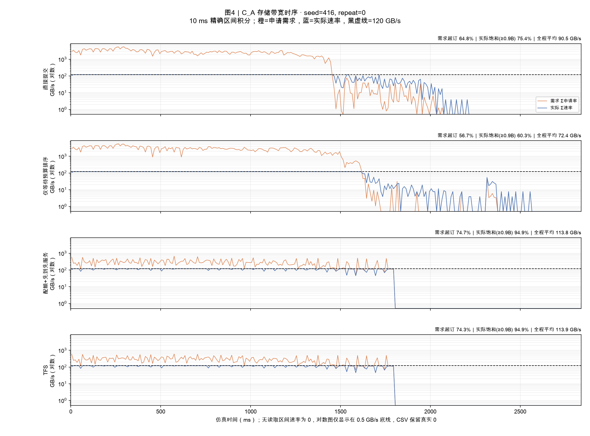

| 方案（固定单次） | 需求超订时间占比 | 实际≥108 GB/s时间占比 | 全程平均实际带宽(GB/s) |
|---|---:|---:|---:|
| 直接提交 | 64.8% | 75.4% | 90.5 |
| 仅等待预算排序 | 56.7% | 60.3% | 72.4 |
| 配额+先到先服务 | 74.7% | 94.9% | 113.8 |
| TFS | 74.3% | 94.9% | 113.9 |

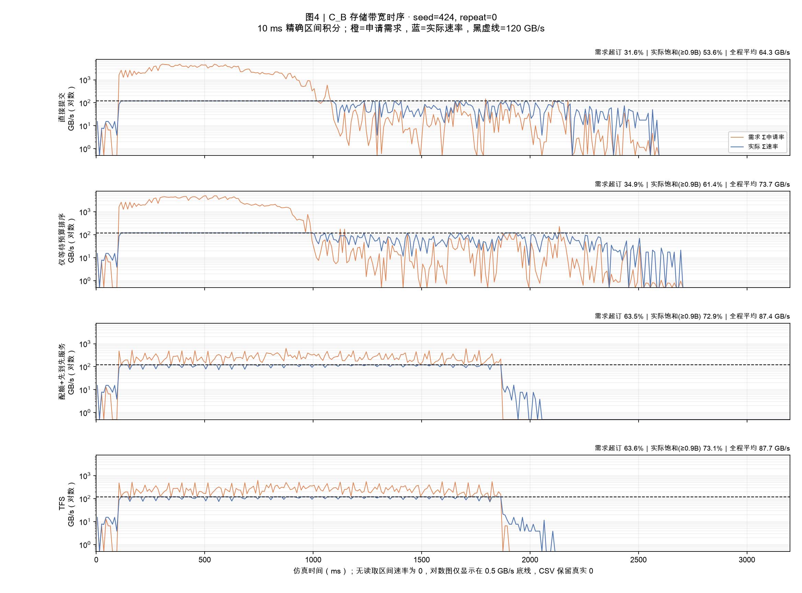

| 方案（固定单次） | 需求超订时间占比 | 实际≥108 GB/s时间占比 | 全程平均实际带宽(GB/s) |
|---|---:|---:|---:|
| 直接提交 | 31.6% | 53.6% | 64.3 |
| 仅等待预算排序 | 34.9% | 61.4% | 73.7 |
| 配额+先到先服务 | 63.5% | 72.9% | 87.4 |
| TFS | 63.6% | 73.1% | 87.7 |

**读法**：C 零读，不直接产生带宽需求；进入混批后，C 会改变本层计算时长，进而改变下一层读取申请率 `V_batch/c_batch`。因此图中带宽差异同时包含准入、批次组成、路由和读算重叠。SA 的低需求规则会把剩余带宽均分给在途流，因此实际速率可以高于申请率；申请率在此不是硬限速。超订/饱和占比均以本策略整个 makespan 为分母，包含无读取时间；对数图将真实 0 速率画在 0.5 GB/s 底线，仅为显示，CSV 保留 0。

## 5. TTFT 累积分布 CDF

四策略颜色固定：直接提交灰、仅排序红、配额先到先服务橙、TFS 绿，与原报告的基线灰、期限类红、TFS 绿保持接近。实线是实际 TTFT，灰点线是共享输入的期限宽度分布。CDF 包含中央排队，不只统计下发之后的耗时。

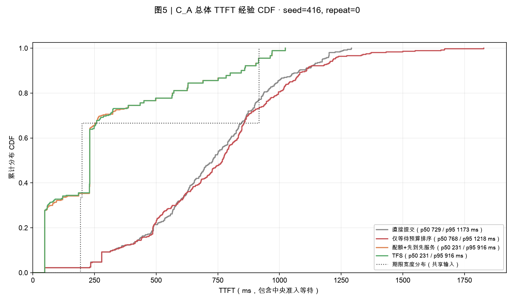

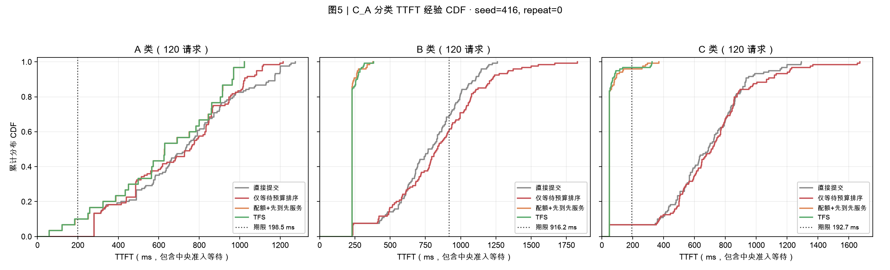

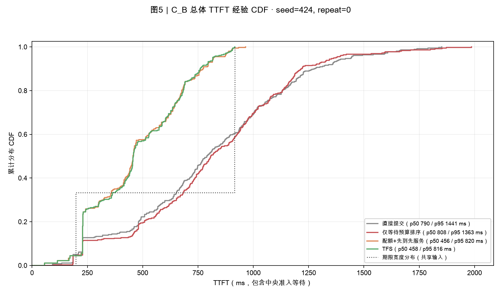

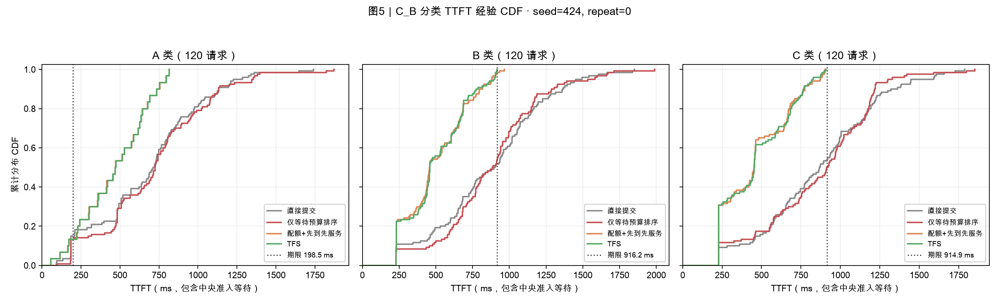

**读法**：总体 TTFT CDF 与期限宽度 CDF 的相对位置只能辅助观察，不能据两条边际分布直接计算 SLO；SLO 必须逐请求比较 TTFT 与该请求自身的期限宽度。分类图的每类期限相同，可直接在垂直期限线处读取该类达标比例。图中 p50/p95 是固定单次全 360 请求分位数，不是多次运行分位数的中位数。

## 6. 与同事 SA 结果的衔接

原 2026-10-11 报告含旧存储分配与 local/MPC 等臂，不能与本轮 max_min 结果直接相减。本轮独立导出同源 SA 输入，并运行相同 max_min 的 SA FCFS/TFS 控制；下表仅比较这些同源控制。SA 为单请求执行模型，DV 使用真实 Dynamo 路由、每 worker 排队与 vLLM 组批，两者不应预期逐请求完全一致。

| 工况 | SA FCFS 总 SLO | SA TFS 总 SLO | DV 直接提交（cap8） | DV TFS（cap8） |
|---|---:|---:|---:|---:|
| C_A | 41.9% | 70.0% | 35.3% | 68.9% |
| C_B | 31.1% | 71.1% | 40.0% | 70.8% |

**保留反例**：C_A seed418，SA TFS 达标率 71.1%，DV TFS cap1 路由重复中位数 64.2%、cap8 为 57.5%。不能将汇总收益表述成所有输入都与 SA 一致，也不能保证所有 A 请求因 TFS 而更快。

## 7. 计算模型与结论限制

1. **512 token 是模型参数，不是实测硬件饱和点。** 本轮继承 SA `synthetic-v1`，每层 `c=launch+aN/η(N)+b·attention_pairs`，`η=min(1,max(1/16,N/512))`。B 与两种 C 的单请求新计算 token 都超过 512，因此额外组批的纯计算加速较小。
2. **组批仍能改变 IO 重叠。** 每批每层读取量按成员求和，下一层预取窗口为本批计算时长。A+B 可用较长计算窗口隐藏读取；B+C 在 B 原本已能隐藏 IO 时额外收益较小。不能仅凭纯计算耗时判断整体组批收益。
3. **混批同步等待。** 仿真一个 step 在本层读取完成后执行本层；C 本身零读，若进入有读取的混批仍会等待该批读取。紫色表示共同执行，不表示将类别串行调用。
4. 输入与资源对齐不等于真实硬件校准。没有目标 GPU/NPU 的批次形状测量，无法证明实际组批收益、策略排名或收益幅度与本报告一致。输出为一个合成 token，没有长期 decode 连续组批。
5. C_A 只有 3 个输入种子，C_B 只有 1 个。路由重复不等于新增输入种子。误差线不是显著性检验，固定单次轨迹不代表中位数运行。
6. 独立 SA 对拍覆盖单请求、串行与双 worker 并发，批次上限为 1；没有多请求混批的独立执行真值。相同画像的自洽和账本守恒不能代替硬件真实性验证。
7. 原始 96 次实验均无抢占或重复加载；本轮报告未覆盖多存储节点/路径、写回、故障、反馈延迟与预测误差。TFS 的配额占用是准入计数，不是物理带宽预留。

## 8. 附表：max_num_seqs=1 对照

此档只限制每个 step 最多一个请求，仍使用 Dynamo 路由与 worker 排队。口径与主表相同，不将 cap1 视为原 SA 引擎的完全替代。

| 工况 | 方案 | 总 SLO | A-SLO | B-SLO | C-SLO | 平均 TTFT(ms) | makespan(ms) |
|---|---|---:|---:|---:|---:|---:|---:|
| C_A | 直接提交 | 40.3% | 1.7% | 85.0% | 35.8% | 505.9 | 2370.0 |
| C_A | 仅等待预算排序 | 41.9% | 1.7% | 87.5% | 36.7% | 499.5 | 2311.0 |
| C_A | 配额+先到先服务 | 70.0% | 13.3% | 100.0% | 89.2% | 292.3 | 1925.7 |
| C_A | TFS | 70.0% | 13.3% | 100.0% | 88.3% | 290.1 | 1922.7 |
| C_B | 直接提交 | 48.6% | 12.5% | 65.0% | 69.2% | 758.1 | 3262.0 |
| C_B | 仅等待预算排序 | 48.6% | 12.5% | 66.7% | 66.7% | 753.4 | 3195.1 |
| C_B | 配额+先到先服务 | 71.1% | 13.3% | 100.0% | 100.0% | 453.2 | 2311.4 |
| C_B | TFS | 71.1% | 13.3% | 100.0% | 100.0% | 455.4 | 2319.8 |

## 9. 验证、数据与复现

本次只读已有记录，不改运行时、配置、调度策略或旧图。重新核对 384 个原始文件 SHA256，读取 96 份报告、34,560 条请求；重新计算总/分类 SLO 与 TTFT，并对照原汇总 CSV。全部 3,072 个 worker 时间账本核对；8 次固定轨迹的 256 个 worker 计算与 IO 区间核对；8 条带宽实际速率积分核对读取字节。误差阈值与检查结果见 [生成验收记录](report_data/validation.json)。本次没有重新运行仿真或原单元测试。

- [96 次运行完整指标 CSV](report_data/run_metrics_96.csv)
- [生成验收与文件哈希](report_data/validation.json)
- 各固定轨迹的带宽 10ms 数值、CDF 排名数值和利用率 CSV 位于 `report_data/`；PNG 位于 `figure/`，可连同本 Markdown 一起发给同事。
- 原始记录：`data/dynamo_vllm_simulation/dynamo_vllm_cpu_sim/results/sa_alignment_20261019/`；归档摘要：同级 `sa_alignment_summary_20261019/`。完整事件文件为本地实验资产，分享本报告不需要附上运行环境。
- 复现：在项目根目录执行 `data/dynamo_vllm_simulation/dynamo_vllm_cpu_sim/.venv/bin/python note/tfs_dv/build_e26f_report.py`。需保留原始事件资产；脚本只生成报告、图和 CSV。

## 10. 简要解读

- 直接提交允许请求进入 worker 队列，积压会增加后续组批候选，也会增加排队和共同等待。
- TFS 将重请求等待留在中央，减少 worker 内积压，并给 B/C 留出更及时执行的机会；A 的中央等待仍计入 TTFT。
- 本报告用于对齐当前仿真实验的输入、机制、观测结果和限制。要验证真实部署结论，下一步需要独立测量单类/混合批次计算画像，而不是直接调高或调低饱和 token 参数来获得预期结论。
